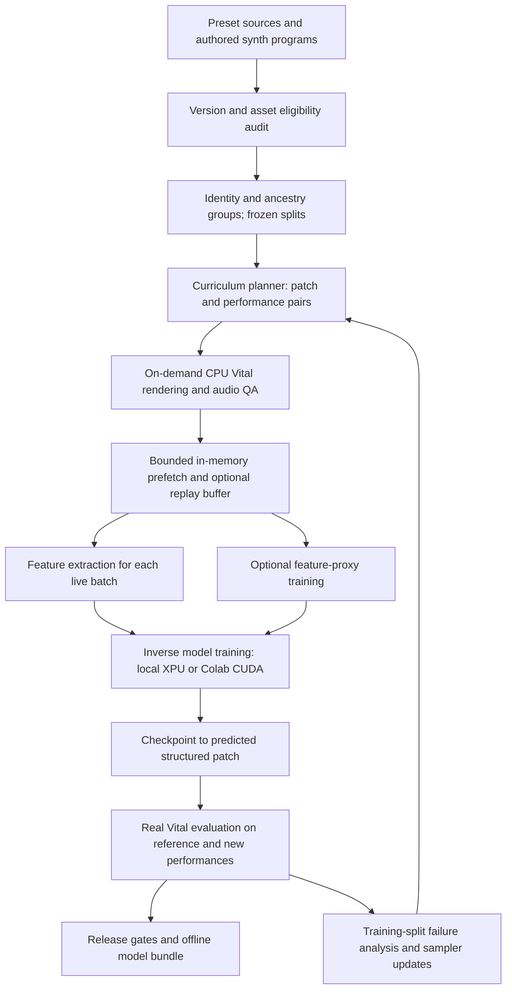

# OBRUXO training and release plan

Implementation update, 2026-10-16: the [sound-prediction helper](../training/AUDIO_PROXY.md) now implements the forward-model part of Stage D. Its fixed native check compares held-out prediction against train-only baselines and verifies candidate rankings and input-gradient advice with real Vital audio. [Results](../training/reports/SOUND_PROXY_RESULTS.md) determine whether it can guide a later inverse-training comparison; inverse training is not enabled merely because forward regression works.

The completed helper check passes reference prediction but fails transfer and native guidance: predicted error decreases on 20/20 updates while real error increases on 20/20. It remains disconnected from inverse training. The next broad capability is bounded render-based candidate improvement, which can also supply Stage D's fallback training targets; larger proxy runs and tuning remain deferred until that direction is screened.

Implementation update, 2026-10-16: [paired synthesis-identity learning](../training/PAIRED_IDENTITY.md) now trains the decoder representation across distinct performances with explicit positives and distinct-state negatives. Its fixed alpha screen compares identical paired features/minibatches with weight zero versus weight one, including reserved-performance identity diagnostics and native reconstruction. Audio-based learning remains the next independent direction; detailed tuning and replication remain deferred.

The [completed identity screen](../training/reports/PAIRED_IDENTITY_RESULTS.md) found no held-out benefit for that setting: native error rose 8.25% (paired interval includes zero), and representation retrieval fell from 25% to 20%. The identity objective remains opt-in with default weight zero; no model is promoted.

Priority update, 2026-10-15: the pipeline proof is complete enough to prioritize broader capabilities. [Alpha synthesis training](../training/ALPHA.md) now connects a larger wavetable/oscillator/LFO/effect vocabulary and mixed-level coverage curriculum to the on-demand trainer and offline export. Screen synthesis identity learning, audio-based objectives and bounded candidate refinement next, before additional seed replication or release-head tuning. The historical pilot results below remain evidence for the narrow model; the alpha smoke run is an integration check, not a finished-model quality claim. Free-first compute and the final-test reserve remain in force.

Prepared 2026-10-04; implementation updated 2026-10-13. The narrow pilot has been trained across its full authored training split with one and two reference performances per state, including cached-feature curves through 16,000 updates; the broader architecture and release plan remain proposals. Grounded in checkout `c2c9430` and the existing local corrections to the quick-research audits. Budgets, hyperparameters, and promotion thresholds below are proposed starting points unless explicitly identified as measurements.

The recommended route is to establish a complete, small audio-to-patch model, improve it against real Vital renders, and expand synthesis coverage in controlled stages. **Generate training audio on demand during training**, with a CPU renderer feeding a bounded prefetch queue to the model. Persist patch/performance recipes, checkpoints, and a small fixed evaluation set; a fully pre-rendered audio corpus is not required. Use the local Intel machine first, and validate colocated CPU rendering plus GPU training on free Colab. Larger runs should follow measured learning curves and end-to-end throughput.

The user has selected **free-first: local hardware and free Colab**. That is the default execution path; no subscription, GPU rental, or paid storage is assumed. Paid resources are a separately costed fallback only if measured limits prevent progress. Cloud training must not create a cloud dependency for inference.

Implementation status, 2026-10-04: the [first contracts increment](../training/README.md) now provides executable identity/eligibility rules, ancestry-aware splits, a reserved performance bank, immutable render recipes and a read-only corpus audit. See the [readiness report](../training/reports/CONTRACT_READINESS.md) for actual counts and capability limits. This completes the initial contracts unit, not all of M0: native audio QA, coupled throughput measurement and Linux/Colab qualification remain open.

Implementation status, 2026-10-05: the [authored online pilot](../training/ONLINE_PILOT.md) supplies 256 statically eligible states, a limited oscillator/filter/envelope codec, deterministic sampling and bounded rendering. The first trainer exposed a native loading defect: Vita's synthetic version marker caused the plugin to retain its default state. Earlier QA/timing and reconstruction results are superseded for patch fidelity. The corrected renderer verifies scalar, LFO and route readback; new authored patches use version `1.0.8`, with new codec, pool and renderer identities.

The [audio-only trainer](../training/TRAINER.md) has 355,806 trainable parameters, frozen Basic Pitch features, bounded online/replay modes, optimizer-boundary recovery, real-render baselines and offline inference. The [first report](../training/reports/FIRST_TRAINER_RESULTS.md) records 32-example overfit, interrupted recovery and four-state validation. The [full-pilot report](../training/reports/FULL_PILOT_RESULTS.md), completed 2026-10-10, covers all 205 training states and compares 1,000/2,000/4,000-update checkpoints on all 21 validation states. That selected 4,000-update model reduces mean reference/transfer spectral error by 18.4% versus 205-example training retrieval, but its descriptive paired interval includes zero advantage. Training took 8.82 CPU minutes; native evaluation and interrupted-case recovery are measured separately.

The [controlled two-view experiment](../training/reports/TWO_VIEW_RESULTS.md), completed 2026-10-11, reuses the first 205 feature records and adds one new reference performance per training state. Both new models reset learning state and receive 4,000 updates. The two-view model is selected at primary distance 0.9870, 8.5% below the matched single-view control and 5.2% below the previous selected model; intervals against both model comparators still include zero. Unison accuracy reaches 81%, while sustain, release and signal-level errors remain. Feature seeding, named comparisons with fixed external retrieval, and recovery are tested. Both new training arms plus 294 native evaluation renders took 22.92 recorded CPU minutes, with no paid compute or WAV archive.

The [cached-feature optimization curve](../training/reports/CACHED_CURVE_RESULTS.md) remains the 205-state one/two-performance control. The completed [205-versus-404-state coverage experiment](../training/reports/STATE_COVERAGE_RESULTS.md) selects the 404-state, one-view 16K checkpoint at primary distance 0.9124 versus 0.9870 for the incumbent and 0.9906 for the matched 205-state 16K control. Both paired intervals include zero, and the selected model wins on 8/21 incumbent comparisons, so this is a promising mean result on a small fixed set rather than broad statewise dominance. All 462 evaluation renders and 147 predicted presets pass; the 404-record replay was fully available before update one. The final test remains reserved, the expanded arm narrowly misses the tiny-overfit MAE gate, and Linux/Colab remains unqualified. The [fixed-case two-seed replication](../training/reports/STATE_COVERAGE_REPLICATION_RESULTS.md) is complete: expanded-minus-205 paired deltas are +0.0026 and -0.0405, with both state-bootstrap intervals including zero. No replication candidate is promoted; the seed-0 selected bundle remains current. The final test remains reserved.

The [pool-expansion contracts](../training/reports/POOL_EXPANSION_READINESS.md), completed 2026-10-13, preserve the original population and all split assignments while increasing training membership from 205 to 404 states. The expanded 512-state pool also has 44 validation and 64 reserved test states. Cross-pool comparisons keep the original 21 validation cases and 205-record retrieval bank fixed, verify each model under its own training pool, and pin candidate tie order and export provenance. Cross-pool feature seeding/resume remain rejected; expanded training starts fresh. One view per training state occupies 14.90 MiB of features within the current replay limits. The [state-coverage discovery](../training/reports/STATE_COVERAGE_RESULTS.md) and [two-seed replication](../training/reports/STATE_COVERAGE_REPLICATION_RESULTS.md) are complete. Replication deltas vary by seed and both paired state-bootstrap intervals include zero; no candidate was promoted and the seed-0 selected bundle remains current.

## 1. What the finished system should deliver

The release target follows the [research tracker](RESEARCH_TRACKER.md): exactly one audio clip enters; a valid, playable `.vital` patch leaves. MIDI, source preset identity, asset labels, and oracle LFO codes are never inference inputs. Imported pretrained models remain frozen, including their running statistics; trainable adapters and an independently trained timbre trunk are allowed.

Proposed first supported input contract: an isolated instrument or synth recording, approximately 2–16 seconds, mono or stereo. Longer recordings can be handled by documented, deterministic windows from that same clip. Report limits for very short clips, long evolving sounds, noise, and percussion. Full mixes and source separation are separate work, not evidence of patch-reconstruction quality.

Three milestones distinguish progress from completion:

| Milestone | Capability | What it establishes |
|---|---|---|
| Pipeline proof | Small, controlled oscillator/filter/envelope vocabulary; one valid output patch | Data, learning, serialization, rendering, and evaluation work together |
| Useful alpha | Multiple oscillators, modulation/LFOs, representative effects, held-out-performance evaluation | The model learns synthesis identity beyond simple parameter recovery |
| Canonical-vocabulary v1 | The supported canonical factory assets and a declared, tested control-coverage matrix across oscillators, sampler, filters, envelopes, LFOs, routing, effects, and voice controls | A reproducible, usable local model with measured quality and explicit approximation limits |

The narrow pipeline proof is not the final project scope. For v1, every in-scope control family must be learned or have an explicit, evaluated approximation; accidental omissions do not count as completion. Imported/edited wavetables and samples stay a separate out-of-domain evaluation, consistent with the current tracker. Direct asset generation remains later work.

The finished release includes trained weights, configuration, preprocessing, patch codec, LFO assets, factory-asset resolver, an offline inference CLI, reproducible training instructions, benchmark results, and a model card. A GUI or DAW plugin is not required to prove the model, though the inference API should permit either later.

Preserve the runtime aspiration already recorded in [ideas.txt](../ideas.txt): roughly 15–20 seconds per clip on a modern CPU/iGPU, with about 8 GB peak application memory. Treat these as measured release targets, not guarantees; report cold and warm execution separately. A slower optional refinement mode must have its own latency result.

## 2. Readiness and consequential gaps

| Area | Evidence already present | Work needed before scaling |
|---|---|---|
| Preset/MIDI/render foundation | Typed authoring, validation, continuous VST3 rendering, provenance, QA, resumable batches | Curriculum sampler, ancestry tracking, split manifests, bounded online producer/consumer stream |
| Renderer | Reviewed Windows Vital 1.6.4 hosted by DawDreamer; one fresh synth per request; audio returned in memory | Coupled rendering/training throughput measurement, recovery, optional validated process scaling, Linux/Colab qualification |
| Schema | Executable 772-control bundle tied to Vital 1.0.8/Vita; corpus includes newer fields | Version-aware schema coverage before treating modern presets as training-ready |
| Corpus identity | 9,618 parsed files, 9,592 stored-state groups after the declared display-field normalization | Group-aware splits, mutation lineage, near-duplicate review, eligibility counts |
| Asset taxonomy | Local analysis labels 3,568/9,618 presets as stock-assets-only, about 37.1% | Verify factory fingerprints from actual reference assets; this heuristic count is not a certified usable training count |
| Performance branch | Native Basic Pitch port, parity and XPU benchmarks, corpus quality study | Cache dense features; test whether conditioning improves reconstruction |
| LFO representation | Era 2 fixed 97-point lattice, compact codebook experiments, runtime accounting | Rebuild train-only assets for the inverse-model split; test predictability from audio and render impact |
| Inverse model | Trained narrow pilot, masked heads, frozen performance branch, recovery, real-render evaluation and inference export | Full authored-split learning, stronger reconstruction objectives, broader control coverage, useful held-out quality |
| Perceptual credit assignment | Proxy proposal and supporting literature | A validated feature proxy or a practical render-based alternative; neither is implemented as a complete training solution |

Sources: [render foundation](../data_generation/README.md), [identity audit](../experiments/quick_research/reports/DATASET_IDENTITY_REPORT.md), [corpus versions](../vital/VITAL_CORPUS_AUDIT.md), [performance comparison](performance_transcription_benchmark/reports/model_comparison.md), [LFO design](../experiments/lfo_representation/era2/reports/LFO_ERA2_DESIGN.md). The stock-assets-only count comes from the local, Git-ignored `datasets/presetshare/analyze/README.md`; publish a sanitized, reproducible eligibility summary with the training dataset.

Several existing documents describe different stages of the research. For this plan:

- The tracker governs the frozen-pretrained-model rule. The older architecture drawing's trainable Basic Pitch trunk is not authorization to fine-tune imported weights.
- Use **64 positional modulation slots**, not the older 32-slot descriptions. A slot includes its connection, optional line map, and indexed controls. Preserve slot order and references. The [source audit](../experiments/quick_research/reports/MODULATION_SLOT_SEMANTICS_AUDIT.md) does not justify unrestricted Hungarian matching or sorting of the full modulation graph.
- The production renderer is the continuous VST3 backend. The older neural-proxy notes recommending independent Vita note renders are not a faithful polyphonic-performance rendering recipe.
- The 903 scalar fields observed in Vital 1.6.x presets do not imply 903 independent neural regression targets. The codec must distinguish continuous, categorical, structural, inactive, and version-specific state.

## 3. End-to-end pipeline



The training entry point owns the whole loop: sample a patch and two performances, render labelled audio, extract features, update the model, and repeat. Start with a synchronous one-producer correctness path, then overlap CPU rendering with model updates using a bounded queue. `VitalRenderer.render()` already returns an audio array; the online path does not need to call the WAV-writing batch API.

The renderer generates training examples under `no_grad`; it does not become differentiable by running inside the training loop. Gradients through the inverse model and any validated proxy are separate. Real Vital still provides evaluation and, where selected, black-box candidate improvement.

Use one active renderer initially, in an isolated producer process, with explicit request IDs, timeouts, bounded retries and backpressure. Keep the existing fresh-plugin-per-request semantics. More isolated processes or safe plugin-instance reuse are later optimizations that need state-reset, polyphony, tail, failure-recovery and throughput tests; do not simply increase the existing thread pool. Windows workers should start independently rather than inherit live plugin/GPU objects. Set native thread limits to avoid oversubscribing CPUs.

Keep batches paired and sequence-tagged; the slower render of a complex sound must not silently make that sound less likely to reach the model. Define how timed-out/QA-failed requests are recorded and replaced without changing the split or hiding the failure rate. A small fixed evaluation corpus stabilizes comparisons while fresh training renders provide variation.

Proposed implementation location, following the repository's research-workspace pattern:

```text
research/training/
  README.md
  run.py
  configs/                    # dataset, curriculum, model, experiment, device profiles
  environments/               # separately pinned CPU, Windows XPU, Linux CUDA installs
  obruxo_training/
    manifest.py, splits.py     # identities, ancestry, eligibility, immutable splits
    curriculum.py, stream.py  # recipes, on-demand render workers, prefetch/backpressure
    dataset.py, features.py   # paired collation, masks, live features, optional bounded replay
    codec.py                  # structured targets, constraints, preset reconstruction
    model.py, losses.py       # small inverse baseline and objective composition
    proxy.py                  # optional differentiable forward feature model
    train.py, checkpoint.py   # optimizer, monitoring, full-state resume
    evaluate.py, export.py    # real-render jobs, reports, inference bundle
  notebooks/colab_train.ipynb # thin launcher using the same package and configs
  tests/                      # contracts, leakage checks, resume and tiny model tests
  outputs/                    # ignored recipes, runs, weights, fixed evaluation audio, bounded cache
```

The names are a proposal, not existing commands. Reuse `obruxo_data`, the native Basic Pitch package, and the LFO decoder rather than duplicating their implementations. Start with a simple Python/PyTorch runner, versioned configuration, JSONL metrics, and optional local TensorBoard. A hosted tracking service, distributed training framework, or cluster scheduler is unnecessary for the first model.

## 4. Dataset scheme

### Eligibility before generation

Produce a manifest that classifies every source by schema version, asset content, available performance labels, lineage, usage/redistribution status, component coverage, and validation result. Record separate reasons for invalid JSON, missing data, unsupported controls, unknown assets, render errors, silence, clipping, and excessive tails.

Preserve original presets. Do not quietly delete newer controls to make them fit the old schema. For the first controlled dataset, author patches entirely inside the reviewed 772-control contract. Before broad real-preset training, extend the schema/validation path for the selected newer versions, with reviewed defaults and render checks. Alternatively, create explicitly labelled projected variants, keep them in the original lineage group, and measure their audio difference from the original. Projection is not faithful recovery of the source patch.

Asset eligibility must use normalized content fingerprints. Names and the current frequency-derived fingerprints alone do not certify untouched factory content. Unresolved assets stay unresolved. Keep active-asset eligibility separate from inactive embedded payloads, preserving originals and validating any removal of inactive material.

### Splits and leakage prevention

1. Group exact and stored-state duplicates; attach each mutation, component-reduced variant, audio crop, and rendering repeat to its parent lineage.
2. Assign approximately 80/10/10 train/validation/test by group before expansion. Balance important component and sound-family strata where counts permit. These are group proportions, not an assurance of equal file-weighted proportions.
3. Use training groups only to fit normalizers, LFO dictionaries, retrieval indexes, proxy models, synthetic priors learned from data, and any learned asset representation. A manually verified factory vocabulary may be shared as the declared output vocabulary. New online mutations inherit their parent split; new independent generated states must pass reserved-state/identity checks before consumption. Frozen evaluation recipes and performance exclusions apply to online sampling too.
4. Keep a separate edited/imported-asset test population and a small external real-recording set. Keep author/bank holdouts as a robustness view where provenance supports them; unknown ancestry must be reported.
5. Reserve performance families/combinations for transfer evaluation: new registers, rhythms, note lengths, velocities, and chord voicings. Merely changing the random seed of a familiar phrase is not enough evidence of invariance.
6. Do not use test failures to generate corrective training examples or tune thresholds. Use validation for decisions, and unlock the test set for the final frozen candidates.

The identity audit found nine stored-state duplicate groups crossing a simulated file split. It did not establish an existing training leak. Its practical implication is to construct group splits now, not retrospectively deduplicate evaluation results.

### Population and sampling

Use authored controlled patches, supported real presets, and bounded mutations around train-only real presets. A useful initial training mixture is 40% authored controls, 40% supported real patches, and 20% lineage-preserving mutations. Adjust after measuring eligibility and learning curves; never duplicate a tiny real population repeatedly without reporting its effective weight.

Sample components and musically meaningful ranges, not all raw controls independently and uniformly. Explicitly balance rare but consequential families, such as low-register bass, slow pads, strong resonance, noise, and sparse onsets. Record rejection rates so a clean dataset does not conceal systematic exclusion of difficult sounds.

Within a batch, sample patch groups first, then two distinct performance views per patch. Begin with nearby performances; increase register, articulation, density, and polyphony differences as reconstruction stabilizes. Negatives should not include known equivalent/related patches as if they were unquestionably different sounds.

Maintain a versioned pool of patch states/recipes and sample new performances on demand. Begin each update with distinct patch groups and two performance views per group. Reserve evaluation states and performance families before training; an unlimited stream must not become an unlimited opportunity to leak test cases.

For comparable pilot accounting, budget a reference pass of eight render requests per state: six reference/training-performance views and two transfer-only views. This is an exposure/benchmark budget, not a requirement to materialize all audio. Only training-split states and permitted performances enter optimization. Later virtual epochs may draw fresh performances, or deliberately reuse a bounded replay buffer. Record both fresh renders and reused training views.

| Recipe-pool milestone | Distinct states, including mutations | Requests in one reference pass | Purpose |
|---|---:|---:|---|
| Pipeline proof | 256 | 2,048 | Verify the complete path; includes a tiny overfit subset |
| Pilot | 3,000 | 24,000 | Encoder/conditioning decisions, curriculum, throughput and loss calibration |
| Main candidate | 15,000 | 120,000 | Broader synthesis coverage after pilot gains are established |
| Optional expansion | 60,000 | 480,000 | Only if data-scaling evidence justifies the added cost |

These are generated-state targets, not claims that the corpus contains that many independent human-authored presets. Report source groups, derived states, fresh renders, reused exposures, and unique performances separately. At the pilot size, an exactly balanced 80% train split with six usable views corresponds to 14,400 trainable views in that reference pass, not 24,000. The total training budget is optimizer steps times effective batch size, plus render failures/evaluation; it is not restricted to one pass.

### Render and feature contract

- Render canonical stereo float32 at 44.1 kHz with explicit tempo, performance end, and tail. Start with 4–8 second total windows; retain 12–16 second cases for evolving pads, slow modulation, and effects. Do not crop away release behavior simply to meet a tensor size.
- Respect the current MIDI capability boundary: fixed tempo per performance, notes/polyphony, channel 0. Pitch bend, CC, pressure, and tempo changes require a separate renderer extension before entering the curriculum.
- Preserve the single-worker renderer boundary initially. Benchmark full online request time, including plugin creation, state loading, rendering, QA, and interprocess transfer. WAV writing is outside the hot path. Increasing thread count is not an optimization supported by current evidence.
- Define non-clipping eligibility prospectively, using a baseline policy before comparisons. If a gain-adjusted variant is created, update the labelled patch and lineage; post-render normalization is not a substitute for fixing the synthesis target.
- Store raw amplitude and loudness metadata. Training-time gain augmentation can encourage recording-level robustness, but it must not erase the output-level target or change the audio used to judge the source patch.
- Compute frozen Basic Pitch note/onset/contour features for live audio batches, not only thresholded MIDI. Cache them only for fixed evaluation audio or replayed identical training buffers. Keys include actual audio hash, model/weight hash, preprocessing version, precision, and extraction code version. Fresh renders and audio augmentations invalidate a cache unless their feature transformation has been verified. Profile whether CPU feature extraction overlaps better than sharing the training accelerator.
- Keep the timbre path stereo-aware. Use full-band 44.1 kHz spectral features for the compact trunk; Basic Pitch retains its native preprocessing. If a 24 kHz pretrained encoder is tested, retain stereo/high-frequency summaries and measure the information loss.
- Fit statistics on train only. Use padding masks and duration buckets; avoid allowing padding or file-source metadata to identify patch groups.

Each consumed example should identify the raw/canonical/state hashes, lineage, split, schema and codec versions, asset hashes, complete render request ID, repeat/seed policy, actual audio hash, performance identity, QA result, and stream sequence ID. Record a payload location only when retained. Request identity and audio identity are different: current Vital renders are not bit-identical across repetitions. A recipe supports reproducible experimental conditions, not guaranteed recreation of the identical audio buffer.

Persist the compact recipe manifest, accepted/rejected request log, sampler state, model checkpoints, and fixed evaluation audio. Optionally retain a bounded replay/debug buffer to amortize rendering and inspect failures. Keep its eviction and reuse policy explicit. Training audio outside these sets may be discarded after use.

If transfer or replay needs disk storage, use small immutable checksummed archives and relative paths. Specialized sharding is optional. Float-WAV preservation and quantized/compressed derivatives must have separate identities; standard PCM FLAC is not a lossless substitute for the original float32 buffer. Pin exact evaluation buffers and a tiny replay set for numerical regression tests.

## 5. Model and patch representation

### Compact baseline and encoder decision

Proposed baseline: a trainable compact spectral CNN/temporal trunk, a frozen Basic Pitch performance branch, lightweight recording metadata, and grouped patch heads. Begin around latent width 256 and a small number of temporal blocks, with an initial 5–25 million trainable-parameter budget including output heads. These are design targets; measure the actual model and activation memory before promising fit.

The performance branch supplies uncertain evidence. On the existing 1,769-pair study, Basic Pitch onset+pitch F1 was 0.278 and offset-aware F1 was 0.098. It must not become ground-truth MIDI. The inverse model sees the same audio-derived features in training and deployment. True MIDI is allowed in forward rendering, proxy supervision, and evaluator diagnostics, not silently substituted into fusion during training.

Use pooled features and concatenation for the cheapest end-to-end control. Compare one small cross-attention version, the tracker's working preference, and retain it only if reconstruction/transfer gains justify its cost. Downsample temporal representations before attention; at 25 tokens/second, an 8-second clip has about 200 tokens. Do not run full attention over raw waveform samples.

The [encoder research](pretrained%20encoders/pretrained_encoder_research.md) also motivates a frozen MusicFM plus small adapter probe. Compare it against the compact trunk on identical data and runtime budgets; do not stack several large encoders by default. Its official [checkpoint page](https://huggingface.co/minzwon/MusicFM) is labelled MIT, and the [software license](https://raw.githubusercontent.com/minzwon/musicfm/master/LICENSE) distinguishes MIT and Apache-2.0 files. Pin the specific checkpoint and retain its notices.

MERT-v1-95M's official [model card](https://huggingface.co/m-a-p/MERT-v1-95M) declares CC-BY-NC-4.0. Keep it a research comparator rather than a default release dependency under the project's intended musician-use terms. Do not assume distillation removes upstream restrictions. The compact trunk keeps the release path independent of this choice.

### Structured codec

Build outputs from a reviewed init document plus predicted fields and verified assets. The codec must round-trip its own targets before a model is trained.

| Output family | Initial representation | Required safeguards |
|---|---|---|
| Enable/bypass flags and discrete modes | Categorical or binary heads | Schema-valid combinations; valid defaults for inactive components |
| Continuous controls | Bounded normalized values, using the atlas mapping | No extra logarithm on controls already stored logarithmically; activity/identifiability masks |
| Oscillators and sampler | Numbered components with factory-asset IDs and morph/frame controls | Preserve slot-specific dependencies, oscillator interactions, and asset content identity |
| Envelopes and voice controls | Grouped continuous/categorical heads | Correct units; preserve retrigger, mono/polyphony, and legato behavior |
| Effects and filters | Grouped heads plus an explicit legal effect-order representation | A permutation/order is not an ordinary continuous knob; fixed order is only an early experimental restriction |
| LFO shape | Existing 97-point-grid decoder with train-fitted codebook targets | No topology/oracle information at inference; validate against rendered modulation |
| Modulation | 64 ordered slot queries/heads with existence, source, destination and all slot-owned controls | Preserve indexed amount references, remaps, order, and graph semantics |
| Newer version fields | Explicit versioned heads or declared fixed/approximated fields | No silent discard of spectral phase, ramp-up/down, custom warp, or random-value state |

For early curriculum stages, mask the permitted route count and destination vocabulary while keeping the serialization contract compatible with all 64 positions. Delay feedback cycles and slot-to-slot modulation until validated; expand them explicitly for broader coverage. A generic unordered set loss is not safe for the complete audited graph. Learned slot queries can still be useful without permutation matching.

For LFOs, start from the Era 2 representation rather than restart its search. The existing W8D16 phase-and-gain contract uses `32 + 16*8 + 33 = 193` outputs per LFO, or 1,544 across eight slots, before other LFO controls. Changing scalar parameterization changes that accounting. Reconstruct at the fixed 97 points, with legal values and the selected clipping policy. Fit codebooks only on training groups and publish their hashes.

An oracle codebook's curve error is a representation ceiling, not audio-to-LFO prediction accuracy. Evaluate three separate gaps: original vs codec-reconstructed patch, oracle-code reconstruction vs predicted-code reconstruction, and resulting audio under multiple performances. If codes prove unnecessarily hard to predict, compare one direct fixed-grid output head without reintroducing topology conditioning.

Use differentiable range mappings where practical. At export, validate categorical choices, indices, line shapes, and graph references. An invalid candidate is recorded as a failure; it must not silently become the init patch and receive credit as a successful prediction.

## 6. Training scheme and curriculum

### Stage A: complete the smallest learning loop

Train on a controlled oscillator/envelope subset and verify that the model can overfit approximately 32 examples. Render the predicted patches through real Vital. Verify all components of the loss are active, gradients are finite, frozen weights/buffers stay unchanged, and patches serialize correctly. This is a plumbing test, not generalization evidence.

Then run the online stream over the 256-state recipe pool with two baselines: a fixed/init-patch control and nearest-neighbor retrieval from training patches only. Build the small retrieval index from a declared train-only sample; the test source patch must never be in it. Compare the inverse model against both on the same split and performance bank.

### Stage B: learn synthesis identity across performances

Use grouped parameter supervision to initialize a stable decoder. Add paired-view invariance using two performances of the same patch. A contrastive objective using known patch identity is weakly supervised by the generator; it should not be presented as learning without labels.

Keep both single-view and paired-view models in the comparison. Monitor cross-performance retrieval, reconstruction under unseen performances, and latent collapse. Gradually introduce larger changes in register and articulation. Check that invariance does not erase velocity response, key tracking, envelope timing, or other performance-dependent properties of the patch itself.

Investigate one JEPA-style latent-prediction alternative only if contrastive training has a demonstrated limitation, such as false negatives between equivalent patches. Use an EMA target and anti-collapse diagnostics. Do not multiply encoder, fusion, decoder, and SSL choices into a full factorial search.

### Stage C: broaden synthesis capabilities

Expand in a ladder while retaining replay from earlier levels:

| Level | New synthesis complexity | Performance coverage |
|---|---|---|
| 0 | One oscillator, amplitude envelope, basic factory shapes | Held/repeated notes, pitch and velocity coverage |
| 1 | Factory wavetable choice, frame/morph controls, filter and filter envelope | Different registers, short and long articulations |
| 2 | Two/three oscillators, oscillator interactions, multiple filters and envelopes | Melodies, overlapping notes, chords, voice modes |
| 3 | LFOs and modulation with controlled route vocabulary, then larger graphs | Tempo differences between clips, retrigger behavior, long enough windows to expose modulation |
| 4 | Effects, effect ordering, sampler, stochastic sources, newer supported fields | Stereo behavior, long tails, pads, percussive/noise cases |

Advance on validation progress rather than a fixed calendar. Start each expansion with a substantial replay share, for example 25%, and monitor earlier strata for forgetting. More component combinations require new data, not just unmasking more outputs.

Modern schema support and source-preset eligibility must keep pace with this ladder. A model trained only on author-created simple patches cannot be presented as trained on the full downloaded corpus.

### Stage D: add perceptual credit assignment

The source-parameter loss is an initialization and auxiliary objective. Model selection must ultimately favor perceptual similarity in real renders, including valid alternative patches. There are two practical routes, and failure of one need not stop the project.

**Preferred research route: a compact feature proxy.** Train a separate differentiable `S(patch, performance) -> audio_features` model using the same train-only online renderer and an optional bounded replay buffer. Predict multiscale spectral/envelope/stereo features before attempting raw waveform synthesis. A fixed measurement embedding may be an additional target; it must not drift together with the inverse model's loss. [Combes et al.](https://arxiv.org/abs/2509.07635) motivate preset-to-audio-embedding proxies; extending that idea to this performance-conditioned feature model is an OBRUXO proposal, not an established result from that paper.

Train and validate the proxy before connecting it to the inverse model. While optimizing the inverse model, freeze proxy parameters but retain gradients through its input; running the proxy under `no_grad()` would remove the needed credit assignment. Audit proxy updates separately rather than simultaneously moving both models without a stable reference.

Validate the proxy on held-out patches, unseen performances, small parameter perturbations, and discrete changes. Check whether its rankings and proposed improvements agree with real Vital, not only its average feature regression error. Include simple interpolation/retrieval forward baselines and stratify by modulation, distortion, filters, and effects.

For categorical controls, begin with supervised choices and proxy gradients for continuous controls. Later compare a soft embedding/relaxation only if hard decoded renders improve. Never assume a convex blend of categorical embeddings is a physically valid synth. Keep decoded validity checks and real-render audits in the loop.

Start with low proxy-loss weight and increase only after held-out real-render gains. Keep source supervision and constraints as anchors. If proxy score improves while real-render quality deteriorates, stop that phase, retain the last good checkpoint, and add training-split counterexamples. Stochastic audio targets need distribution-aware or repeat-averaged features rather than pointwise waveform matching.

**Fallback route: render-based candidate improvement and distillation.** From current model/retrieval predictions on training clips, propose a bounded number of valid parameter alternatives, render them under known training MIDI, retain improvements, and train the inverse model on the improved targets. Run this as a scheduled part of training or a separate improvement pass. True MIDI is available to the training scorer, not to the deployed inverse model. Report this extra render budget explicitly. It offers a way to optimize toward audio similarity without differentiating Vital, but its own feasibility depends on measured rendering cost.

The same candidate mechanism may support optional runtime refinement using internally inferred performance. Its quality and latency require separate measurement because inferred notes are unreliable for some timbres. Neither a pretend identity backward pass through Vital nor exhaustive per-parameter finite differences is the default plan.

### Stage E: ambiguity and multiple candidates

Ship a reliable top-1 path first. Then compare a small bounded candidate set, initially up to four, produced by legal categorical alternatives and calibrated continuous variation. Evaluate top-ranked, best-of-four, diversity, invalidity, and total compute separately. Choose/rank without source parameters or evaluator MIDI.

A conditional flow/diffusion decoder becomes justified only if a deterministic model repeatedly averages incompatible solutions and bounded alternatives do not solve the problem. Keep output representation and generative mechanism separate. Freeze the codec and evaluation suite before this comparison, and require a quality gain at an acceptable local runtime cost.

### Losses and optimization defaults

Use a transparent objective with per-family normalization:

```text
L_parameter = categorical CE + active-field normalized Huber
            + route existence/structure losses + LFO reconstruction losses

L_inverse = lambda_parameter * L_parameter
          + lambda_identity * L_paired_view
          + lambda_proxy * d(S(predicted_patch, true_training_performance), target_features)
```

In the supervised baseline, `lambda_proxy = 0`. During perceptual training, true MIDI conditions only the proxy/renderer target path. It is not an input to the audio-to-patch predictor. Where a second rendered performance is available, apply the reconstruction objective to that performance too, using the patch inferred from the first view.

Mask inactive/unidentifiable targets deliberately, including unused modulation controls. Avoid letting 64 mostly empty slots dominate the oscillator or envelope losses. Use cyclic errors for phase and legal permutation treatment for effect order. Do not interpret a low source-parameter loss as the release metric.

Proposed starting optimizer: AdamW, learning rate `3e-4` for newly trained modules, weight decay `1e-2`, brief warmup, cosine decay, gradient norm clipping at `1.0`. These values require a bounded pilot check, not a large sweep. Use GroupNorm/LayerNorm where useful for small microbatches. Frozen pretrained modules stay in evaluation mode.

Use two views per patch and an effective batch of roughly 32–64 audio views initially. Tune microbatch size to actual memory. Gradient accumulation increases the optimizer batch but does **not** increase the set of simultaneous contrastive negatives; use a suitable multi-positive objective, or add a small train-only memory queue only if needed.

Begin in float32 for correctness. Enable mixed precision only on supported operations after forward/loss/gradient checks against the float32 path. In particular, preserve the validated float32 Basic Pitch behavior; the repository already documents a failed low-precision backend configuration. Keep numerically sensitive spectral/loss operations in float32 as needed.

Bound pilot runs by optimizer steps, fresh-render count, and wall time, with early stopping on validation reconstruction. Define virtual epochs as a fixed number of consumed views under a frozen sampler policy; do not pretend an online generator has an intrinsic finite epoch. Log loss terms, gradient norms, invalid outputs, learning rate, queue starvation, render/feature/update throughput, memory, fresh/reused view counts and group coverage. Count both paired views. Select checkpoints by real-render validation, not the last training loss or proxy score alone.

## 7. Evaluation and release gates

Evaluation must separate four questions:

| Question | Protocol |
|---|---|
| Can it match the observed sound? | Infer from one reference clip; render the predicted and source patches under the reference performance |
| Did it capture synthesis identity? | Reuse the same prediction under reserved new performances; compare against the source patch under those same performances |
| Does it work as shipped? | Run the actual audio-only selection/ranking path, including uncertain internal performance estimates if refinement is enabled |
| Where does the output vocabulary fail? | Report edited/imported assets, external recordings, and unsupported families separately |

Known MIDI in the synthetic evaluator isolates patch quality; it is not supplied to inference or the deployed ranker. Best-of-K selected with ground-truth render distance is an oracle diagnostic, never the headline top-1 result. Real recordings without true MIDI need listening and weaker representation diagnostics; do not manufacture aligned-render ground truth from Basic Pitch estimates.

Use multiresolution STFT/log-spectral distances, amplitude-envelope error, spectral-shape diagnostics, and stereo measurements. A fixed audio embedding can supplement them if it responds to the relevant timbral differences. Waveform RMSE is a useful repeatability diagnostic but is unsuitable as the sole quality criterion for phase-randomized synthesis. The quick-research measurements did not establish a universally perceptual metric.

Calibrate the metric suite on fresh, prospectively eligible fixtures: repeated same-patch renders, clearly different patches, and controlled small/large changes. Measure the repeat noise floor per stratum. Publish both amplitude-sensitive and documented gain-aligned diagnostics so a quiet prediction cannot appear successful by suppressing energy.

Use a small frozen validation render suite during development and a broader suite at milestones. For example, 64 validation patches under three performances cost 192 predicted renders per checkpoint; every 20 such evaluations adds 3,840 renders. Cache source reference renders. Only when noise affects a decision, use repeated predicted renders under a predeclared repeat rule.

Aggregate by independent patch/lineage, not by treating every correlated crop as a separate sample. Report median, P90/P95, confidence intervals, and failure rates by sound family, register, duration, asset class, version, effects, and modulation complexity. Bootstrap at patch/lineage level. Promote shortlisted approaches on at least two training seeds; use a third if results are close or unstable.

The following are proposed gates to freeze after metric calibration, before the main run:

| Gate | Acceptance criterion | If it fails |
|---|---|---|
| Data integrity | No known identity/lineage overlap across splits, including generated variants; all exclusions accounted for; codebooks/statistics train-only | Repair manifests/sampler and invalidate affected derived artifacts |
| Tiny end-to-end proof | Tiny-set overfit, finite gradients, frozen weights unchanged, all predicted patches valid/loadable | Fix implementation before any scale-up |
| Codec ceiling | Codec-only render error is small enough for the desired quality, measured separately by family | Improve representation or explicitly narrow the capability claim |
| Learning benefit | Meaningful held-out-performance improvement over both retrieval and the parameter-only baseline; initial target: at least 10% median primary-distance reduction with paired CI excluding no benefit | Revisit representation/data/objective before spending on a larger model |
| Robustness | No hidden failure exclusions; initial target under 1% crashes, invalid patches, and nonfinite/silent/clipped outputs on eligible non-silent tests; inspect tail regressions | Fix the affected capability; report failures in the full denominator |
| Human utility | Blind comparison favors the candidate over the strongest baseline; initial target over 60% preference with CI above chance | Metric improvement alone does not pass the usefulness gate |
| Local deployment | Standard path targets 15–20 seconds per declared clip workload and about 8 GB peak memory; cold/warm and CPU/XPU reported | Reduce model/runtime work or explicitly label an unmet target |
| Reproducibility and release | Fresh-environment inference works offline; online sampler/model recovery verified; fixed evaluation buffers, hashes, dependency/asset notices and limitations included | Keep the result an experiment rather than a finished release |

The numeric gates are decision proposals, not established perceptual thresholds. Human testing should include diverse timbres and musicians, with clip and listener uncertainty accounted for. A pilot around 60 balanced clips can establish the protocol; size the final study from observed variance. Keep listening level matching consistent and include reference/source resynthesis controls where available.

Do not require exact original parameter recovery, and do not conflate a canonical-vocabulary result with an unrestricted arbitrary-audio result. If every approach plateaus, the correct next step is a diagnosed research decision, not an unsupported promise of a finished universal model.

## 8. Compute and storage plan

### Measured local resources

The machine inspected for this plan is an ASUS Zenbook 14 with Intel Core Ultra 9 285H, 16 reported cores/logical processors, about 32 GB installed RAM, and Intel Arc 140T integrated graphics. The research interpreter reports `torch 2.12.1+xpu`, XPU available, CUDA unavailable. Its reported GPU name includes “16GB”; this is an integrated/shared-memory environment, not an independent 16 GB CUDA card. Available memory must be measured under the full workload.

The C: drive had approximately 208 GB free, about 194 GiB, at inspection. Free space is a snapshot, not a reserved dataset budget.

The existing [Basic Pitch benchmark](basic_pitch/reports/backend_benchmark.md) measured about 96 audio-seconds per wall-second for warm end-to-end XPU inference, and about 228 audio-seconds per second for the tested batch-8 forward/backward boundary. The latter did not perform optimizer updates. These are useful evidence that the device can support research work; they are not throughput estimates for the proposed inverse model or proxy.

| Resource | Recommended work | Constraint |
|---|---|---|
| Local CPU | Online rendering, QA and optional feature extraction alongside training; schema/manifest work and tests | Reviewed renderer has one worker; plugin startup, CPU contention and long tails may dominate |
| Local XPU | Live feature extraction, tiny inverse model, pilot/adapter training, LFO work | Shared memory, supported-operator/precision checks, sustained laptop thermals |
| Colab CPU plus one GPU | Colocated on-demand rendering and inverse/proxy training after Linux validation | CPU render throughput as well as GPU/VRAM/session availability; interruption must be recoverable |
| Optional rented 24–48 GB GPU | Longer sustained training or a model proven to need more memory | Only after profiling; include storage, transfer, idle time and evaluation in cost |

Design the initial CUDA configuration to target a 16 GB GPU when available, with a smaller microbatch fallback. This is an engineering target to test, not a claim that Colab guarantees such a GPU. Begin XPU training around microbatch 2–4 views, and test CUDA around 4–8; larger values depend on the selected encoder and clip duration. Avoid CUDA-specific kernels as mandatory dependencies.

PyTorch documents native XPU training/inference and mixed-precision support, but exact operators and the pinned local build still need a workload check. [PyTorch Intel GPU documentation](https://docs.pytorch.org/docs/stable/notes/get_start_xpu.html).

### Bounded storage rather than a full audio corpus

At eight seconds, 44.1 kHz, two channels, four bytes/sample:

```text
bytes_per_render = 8 * 44,100 * 2 * 4 = 2,822,400
resident_audio_bytes = (prefetch_clips + resident_replay_clips) * bytes_per_render
```

| Retained audio | Float32 stereo size | Purpose |
|---|---:|---|
| 32–128 prefetched clips | 0.09–0.36 GB | Overlap rendering and training without unbounded RAM use |
| Optional 512–2,048 replay clips | 1.45–5.78 GB | Amortize costly renders and support diagnostics; cap by bytes |
| 100–1,000 fixed evaluation clips | 0.28–2.82 GB | Stable references, regression tests and listening comparisons |

These are raw audio sizes; feature tensors, plugin state, IPC copies and model memory are additional. Durations include tails, and doubling duration doubles audio memory. A first configuration can use 32 prefetched clips and no training replay; add replay only when throughput measurements support it. Keep a byte cap as well as a clip cap because lengths vary.

Storing every one of 120,000 such renders would use 338.69 GB, but **that is an optional archival cost, not a training requirement**. Online generation removes that storage bottleneck. Keep the existing free disk for source presets/assets, recipes, checkpoints, fixed evaluation audio and selected debugging buffers. No new external storage is a prerequisite for the online pilot.

Compute features for new buffers and retain only selected layers for the bounded replay/evaluation cache. For scale intuition, one float16 layer with 200 frames and 768 channels is about 0.31 MB per retained clip; caching twelve layers multiplies that cost. Trainable projections must remain outside any immutable feature cache.

Persist checkpoints and compact manifests to available free storage for Colab recovery. Check its actual quota before choosing cache size. The full raw preset collection and redundant embedded assets need not be copied: transfer the permitted, resolved asset subset and recipe pool for the current stage, with fingerprints and explicit missing-asset failures.

### Render throughput is the governing constraint

First measure around 100 representative render jobs and 100 warm training microsteps, then run a coupled producer/consumer benchmark. Record accepted clips/sec, QA-rejection rate, median/P95 render latency, feature/update throughput, queue occupancy/starvation, host/device peak memory and checkpoint time. The combined run matters because CPU rendering, feature extraction and XPU training share resources and thermal headroom.

For a first-order budget:

```text
N_views = optimizer_steps * effective_batch_views
N_fresh = number of freshly rendered accepted clips consumed
reuse_factor = N_views / N_fresh
render_rate <= validated_worker_count / mean_seconds_per_accepted_clip

ideal_overlap_hours >= max(N_fresh / render_rate,
                           N_views / model_and_feature_views_per_second) / 3600

elapsed_hours = measured_coupled_hours + setup + validation + checkpoints + recovery
```

The inequality is a lower bound under effective overlap. Rejections, worker startup, queue transfer and resource contention must be included in measured rates. Reference/test renders and candidate-search renders are extra. A bigger queue absorbs variability; it cannot compensate for a renderer that is slower on average than the consumer.

For illustration only, one worker taking five seconds per accepted clip supplies 0.2 clips/sec. A model capable of 50 views/sec would spend most of its time waiting with entirely fresh audio. Eight fresh views require about 40 seconds of rendering even if the model consumes them in 0.16 seconds. A faster GPU alone does not fix this case.

Illustrative render work for one worker, independent of whether audio is kept:

| Seconds per accepted clip | 24,000 fresh renders | 120,000 fresh renders |
|---:|---:|---:|
| 2 | 13.3 hours | 66.7 hours |
| 5 | 33.3 hours | 166.7 hours |
| 15 | 100 hours | 500 hours |

If rendering is the limit, first remove unnecessary file writes and measure plugin startup cost. Then test isolated process scaling and safe state reuse without weakening rendering correctness. Shorten clips only where the curriculum permits it, preserving long-tail/slow-modulation coverage. A bounded replay buffer can support several updates per fresh render; report the reuse factor and validate that it does not sacrifice performance diversity. Do not replace complex patches with faster ones merely to improve utilization.

If feature extraction or backpropagation is the limit, reduce temporal resolution/microbatch size, use verified mixed precision, or try free Colab. Benchmark Colab's CPU renderer too: receiving a faster GPU is not evidence that the complete pipeline will be faster. Repeated experiments and seeds multiply total work regardless of storage strategy.

The first compute allocation should answer the large questions: pipeline proof, pilot baseline, one conditioning comparison, then one identity-loss and one perceptual-training comparison. Stop runs with failed gates. A paid fallback, if ever requested, should be priced from measured coupled throughput rather than a generic GPU-hours quote; none is needed to begin this plan.

## 9. Colab execution and interruption recovery

The preferred Colab experiment runs **both the CPU renderer and GPU trainer inside the same notebook runtime**, generating audio in memory. That removes the need to upload a training audio corpus or stream continuously from the laptop. Upstream [DawDreamer](https://github.com/DBraun/DawDreamer) documents Linux and Google Colab support, so this is a credible path to test; it does not establish compatibility of OBRUXO's pinned renderer and Vital binary.

Before a Colab training run, qualify a compatible Linux Vital build and host environment. The current adapter checks an individual plugin file and a reviewed Windows SHA-256; Linux VST3 bundle discovery/fingerprinting may need adaptation. Verify dependencies, headless loading, state-template conversion, supported controls, continuous overlapping MIDI, complete tails, fresh-state isolation and repeated-call stability. Give the Linux backend its own fingerprint/renderer ID. Compare a shared fixture suite against the Windows reference using calibrated spectral/aggregate tolerances rather than assuming bit equality. Never accept an unreviewed binary merely by adding its hash.

If this gate fails, keep online rendering/training local while resolving it. A small rolling batch transfer can support a bounded Colab experiment, but is an optional fallback, not a requirement to pre-render the corpus. A permanent laptop-to-Colab rendering service adds network and recovery complexity and is not the initial design. The local model remains the release target regardless of where training runs.

Google states that hardware availability and usage limits vary; sessions are generally limited to at most 12 hours, while Pro+ can support up to 24 hours with sufficient compute units. Runtime storage is temporary, and Google recommends transferring archives to the VM rather than many small reads from mounted Drive. These are service limits, not guaranteed allocations. [Official Colab FAQ](https://research.google.com/colaboratory/faq.html).

The notebook should perform the following sequence:

1. Select a commit/config and install the tested Linux renderer plus CUDA training dependencies. Record Python, PyTorch, CUDA, GPU model/VRAM, CPU availability and free disk/RAM. Do not install the local XPU wheel or silently upgrade to untested versions.
2. Load the verified Linux synth build, selected patch/asset recipes, fixed evaluation buffers and checkpoint from user-controlled storage. Verify their hashes. A Windows plugin binary cannot stand in for the Linux build.
3. Start one CPU producer and a bounded in-memory queue, with optional capped replay on VM-local storage. Generate audio, compute features and train in the runtime. Account for frontend work sharing the GPU and for CPU limits constraining production.
4. Run the renderer/precision smoke and a short coupled throughput test before a longer run. Use the same package entry point/configuration contract as locally; keep the notebook a launcher rather than a second implementation.
5. Save full training state periodically, initially about every 5–10 minutes and at epoch/stage boundaries. Write locally, checksum, copy to a new persistent object, verify it, then update the latest-checkpoint pointer. Retain at least two known-good recovery checkpoints plus the best evaluated model.
6. Resume after interruption from verified persisted state, recreate the renderer/queue, and continue the recipe schedule. Evaluate inside the qualified runtime, and also test candidate checkpoints against the local Vital reference. Export portable inference weights only after the release gates pass.

A resumable checkpoint includes model, optimizer, scheduler, precision scaler, RNG states, sampler position, consumed sequence IDs, pending recipe IDs, global step, virtual epoch, curriculum level, split/codec/asset/renderer hashes, and any replay-policy/contrastive-queue/EMA state. Snapshot at an optimizer-step boundary with a consistent producer/consumer acknowledgement. Resuming with incompatible contracts should fail clearly. A changed distribution is a new run lineage or declared curriculum transition, not an invisible continuation.

Prove recovery with a deliberate mid-run termination. For numerical equivalence checks, use the small retained audio replay set so the uninterrupted and resumed runs see identical buffers. For a live-render run, verify the recipe schedule, split invariants, consumed steps and stochastic stability. Unconsumed queued recipes may be regenerated and receive new audio hashes; retaining only a seed cannot reproduce Vital's exact previous output. Persist queue/replay audio only when exact buffer replay is required, otherwise document its reset policy and do not promise identical optimization. Cross-backend CUDA/XPU continuation also needs a numerical check. Save at optimizer-step boundaries or explicitly preserve partially accumulated gradients.

Choose local XPU when it meets the memory/turnaround budget. Try free Colab when profiling shows a material throughput or memory benefit. A free session without a usable accelerator is not a blocker for local work. Consider a separately proposed paid GPU only when measured limitations prevent useful progress and the user changes the resource budget. Do not depend on a specific free GPU, continuous unattended availability, or multi-GPU training.

## 10. Implementation milestones and realistic effort

The following is an engineering sequence, with approximate effort for one person familiar with the project. Render queues, cloud availability, schema surprises, and unsuccessful research hypotheses add elapsed time. A useful alpha is plausibly a matter of several focused weeks; a broad, validated release is a multi-month effort, not a weekend training run.

| Milestone | Concrete deliverable | Dependency / exit evidence | Indicative effort |
|---|---|---|---|
| M0: contracts and measurement | Version/asset eligibility report, frozen split design, capability matrix, online benchmark harness, Linux/Colab feasibility check | Actual eligible population, platform status and coupled resource report | 1–2 weeks; schema/platform work may extend this |
| M1: stream and codec | Grouped recipe manifests, online curriculum sampler/renderer queue, structured codec, train-only LFO assets | Leakage/backpressure/recovery checks, rendered codec checks, 256-state stream | 1–2 weeks |
| M2: first trained model | Compact baseline, frozen performance features, retrieval baseline, real-render evaluator, portable checkpointing | Tiny overfit and held-out single-clip-to-patch results | 1–2 weeks |
| M3: useful alpha | Paired-performance training, bounded encoder/fusion comparison, pilot recipe pool and broader components | Transfer gains and no major component regressions | 2–3 weeks |
| M4: perceptual improvement | Validated proxy integration or render-based improvement/distillation | Real-render gain beyond parameter-only training | 2–4 weeks; conditional research stage |
| M5: broad candidate | Completed declared capability matrix, measured data scaling, shortlisted seeds, optional candidates | Frozen validation gate passed before final test | 2–4 weeks plus measured compute |
| M6: release | Offline bundle/CLI, model card, benchmark/listening report, local runtime optimization | Fresh-install reproduction and release gates | 1–2 weeks |

This is roughly 10–19 engineering weeks if the main hypotheses work, with overlap possible between data preparation and training work. A failed proxy or difficult schema extension can extend it. The first pilot will support a more credible forecast; no fixed completion date is justified yet.

Tests should target meaningful contracts: split isolation including online mutations, lineage propagation, asset/schema compatibility, codec round-trip and graph references, bounded queues/backpressure, worker failures/timeouts, cache invalidation, paired padded batches, frozen modules, resume/sample progression, serialization/loadability, and a tiny CPU training/inference smoke. Native Vital, Linux platform parity and XPU/CUDA checks are explicit integration gates. Routine documentation/config-only changes do not need a new test suite.

Keep changes reviewable as separate units: data contracts; codec and fixtures; online stream and recovery; trainer and baselines; platform qualification; curriculum/representation; perceptual objective; export. Do not entangle a new generative decoder, a new renderer, and a new metric in one result.

## 11. First implementation increment

Status as of 2026-10-14: the narrow contracts, authored stream/codec, trainer, retained-feature recovery, full authored-split and cached-feature learning curves, two-performance training, verified pool expansion and resumable real-render comparisons are implemented. The [state-coverage discovery](../training/reports/STATE_COVERAGE_RESULTS.md) and [two-seed replication](../training/reports/STATE_COVERAGE_REPLICATION_RESULTS.md) preserve the 205-state cached curve and incumbent as controls; the two replication deltas differ in sign and both state-bootstrap intervals include zero. The seed-0 selected bundle remains current. Stronger statewise evidence, envelope/level generalization, full synthesis coverage, train-only LFO assets and Linux/Colab qualification remain open.

The initial training-readiness package covers:

- A sanitized eligibility/coverage report, with the actual counts remaining after identity, asset, schema and QA checks.
- An immutable train/validation/test group manifest and the reserved performance bank.
- A minimal online sampler using existing authoring/render APIs, a bounded producer/consumer queue and a 256-state recipe pool; record rendered, failed and consumed requests separately.
- A versioned structured codec for the first capability level, with rendered reconstruction checks and a path to the full 64-slot format.
- A real-render evaluation harness with fixed/init and train-only retrieval baselines, repeat-noise calibration, and reference/transfer metrics.
- A bounded coupled benchmark report that measures queue starvation, accepted fresh renders/sec, effective training views/sec, reuse factor, RAM and recovery; include a Linux/Colab renderer smoke if that environment is available.

The local loop supports the tiny baseline and controlled pilot experiments, including verified expansion under preserved split assignments and pinned evaluation cases. The bounded 205-versus-404-state comparison and its two-seed fixed-case replication are complete. The replication provides mixed per-seed evidence, not a basis for promotion; the seed-0 bundle remains current and the final test remains reserved. Further work should target held-out reconstruction and capability gaps. A thin Colab launcher follows the same training interface once its renderer passes qualification. The release architecture remains open; measured generalization and native rendering cost should guide additional model complexity, fresh render diversity and compute.
