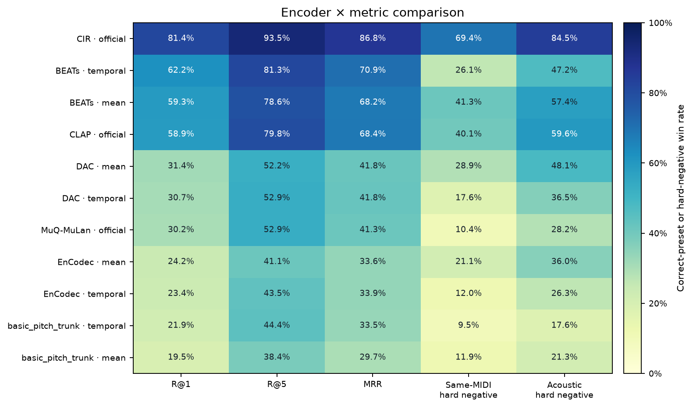
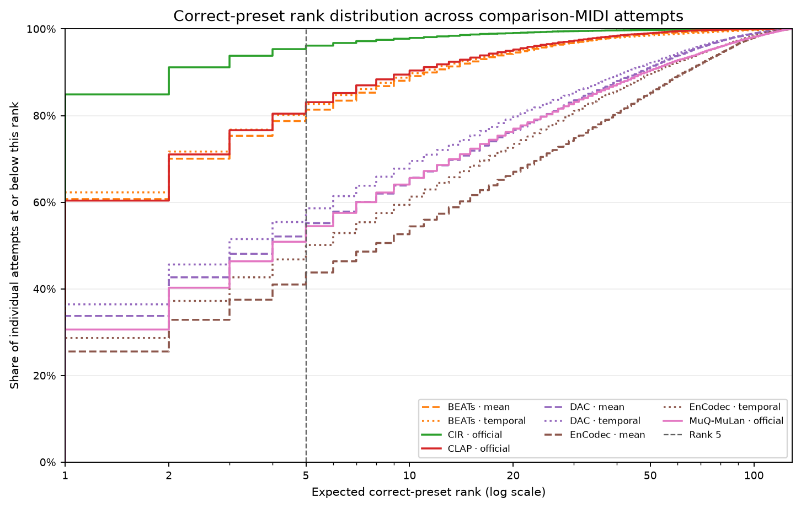
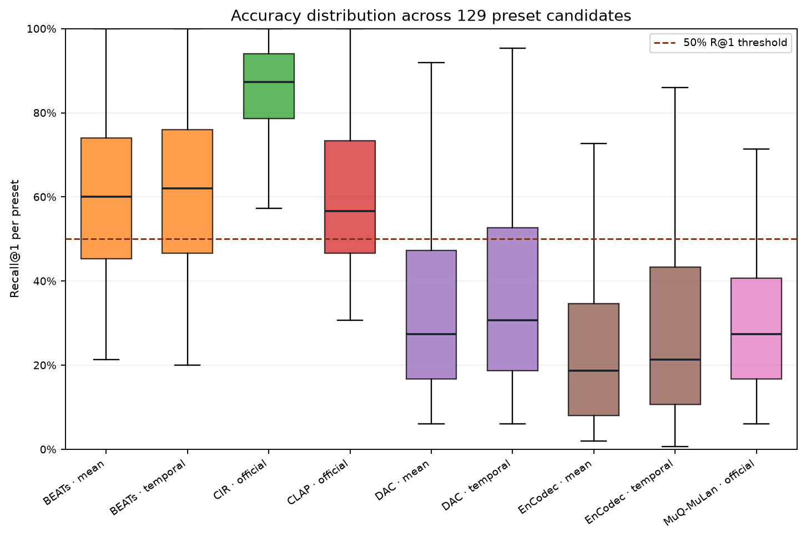
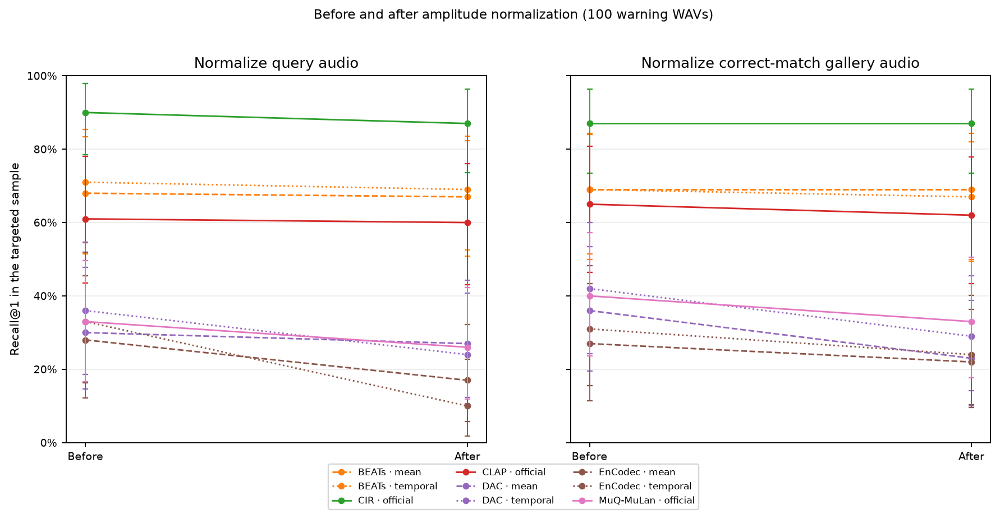
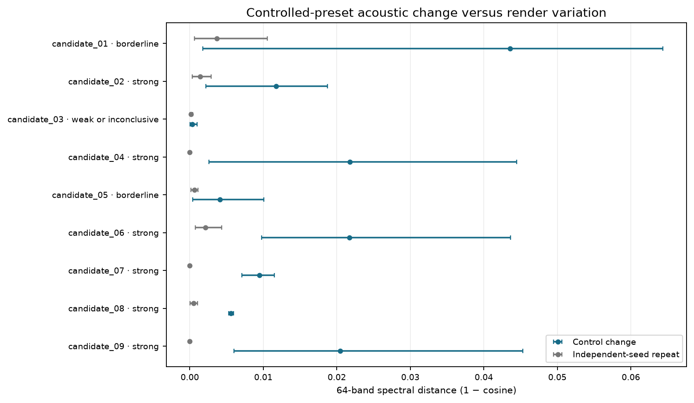

# Frozen audio encoder retrieval benchmark

Issues: [#152](https://github.com/noisedoctrine/obruxo/issues/152) baseline and [#155](https://github.com/noisedoctrine/obruxo/issues/155) follow-up. This report compares frozen pretrained representations on Vital presets and existing MIDI performances. No synthesis controls are predicted, tuned, or optimized.

## Results and recommendation

**Primary expanded-cohort result:** CIR single-timbre AST (official_clip) ranked the correct preset first in 81.4% of cross-MIDI queries (n=6,450 queries, 129 candidate presets; 50 MIDI performances from `train`, distinct from the earlier validation-source MIDI cohort). This ranks frozen representations across 7 model families; it is retrieval evidence, not a reconstruction result.

### Expanded held-out performance cohort: 50 selected MIDI IDs; 50 with evaluated queries; 6450 common-gallery episodes
Validation preset gallery: 131 verified states; performances sourced from `train`. Reserved test and confirmation sources used: **no**.
Performance selection: deterministic coverage-balanced sample of 50 from 96 compatible IDs; 46 sampled out and 0 exact-ID overlaps excluded.

Selected-excerpt diversity: 24 monophonic / 26 polyphonic; 30 held, 20 phrased; median pitch 29–89; variable velocity in 25/50; expressive events in 2 sustain, 0 pitch bend, and 0 other CC/pressure excerpts.

| Frozen representation | R@1 [crossed 95% CI] | R@5 | MRR | Same-MIDI hard-negative win | Acoustic hard-negative win |
|---|---:|---:|---:|---:|---:|
| CIR single-timbre AST — official_clip (768-D) | 81.4% [75.3%, 87.1%] | 93.5% | 86.8% | 69.4% (n=6,450) | 84.5% (n=6,450) |
| BEATs iter3+ AS2M — temporal_pyramid_8 (12288-D) | 62.2% [53.7%, 70.9%] | 81.3% | 70.9% | 26.1% (n=6,450) | 47.2% (n=6,450) |
| BEATs iter3+ AS2M — masked_mean (768-D) | 59.3% [50.3%, 68.8%] | 78.6% | 68.2% | 41.3% (n=6,450) | 57.4% (n=6,450) |
| LAION-CLAP Music HTSAT-base — official_clip (512-D) | 58.9% [50.3%, 67.9%] | 79.8% | 68.4% | 40.1% (n=6,450) | 59.6% (n=6,450) |
| Descript Audio Codec 44.1 kHz — masked_mean (1024-D) | 31.4% [24.9%, 38.7%] | 52.2% | 41.8% | 28.9% (n=6,450) | 48.1% (n=6,450) |
| Descript Audio Codec 44.1 kHz — temporal_pyramid_8 (16384-D) | 30.7% [24.3%, 37.1%] | 52.9% | 41.8% | 17.6% (n=6,450) | 36.5% (n=6,450) |
| MuQ-MuLan — official_clip (512-D) | 30.2% [24.7%, 36.0%] | 52.9% | 41.3% | 10.4% (n=6,450) | 28.2% (n=6,450) |
| Meta EnCodec 24 kHz — masked_mean (128-D) | 24.2% [18.2%, 30.5%] | 41.1% | 33.6% | 21.1% (n=6,450) | 36.0% (n=6,450) |
| Meta EnCodec 24 kHz — temporal_pyramid_8 (2048-D) | 23.4% [17.9%, 29.0%] | 43.5% | 33.9% | 12.0% (n=6,450) | 26.3% (n=6,450) |
| Spotify Basic Pitch contour trunk — temporal_pyramid_8 (11264-D) | 21.9% [16.6%, 27.3%] | 44.4% | 33.5% | 9.5% (n=6,450) | 17.6% (n=6,450) |
| Spotify Basic Pitch contour trunk — masked_mean (704-D) | 19.5% [14.3%, 25.2%] | 38.4% | 29.7% | 11.9% (n=6,450) | 21.3% (n=6,450) |
| Random chance | 0.8% (fixed) | 3.9% | 4.2% | — | — |

Paired crossed-cluster Recall@1 differences from the leading family representation (`cir_ast:official_clip`; best pooling per family):

| Comparator | ΔR@1 (percentage points) | Crossed MIDI × preset-family 95% CI |
|---|---:|---:|
| `beats_iter3_plus:temporal_pyramid_8` | +19.2 | [+14.8, +24.1]  |
| `clap_music:official_clip` | +22.5 | [+17.8, +27.5]  |
| `dac_44khz:masked_mean` | +50.0 | [+43.7, +56.4]  |
| `muq_mulan:official_clip` | +51.2 | [+46.4, +56.2]  |
| `encodec_24khz:masked_mean` | +57.2 | [+51.2, +63.1]  |
| `basic_pitch_trunk:temporal_pyramid_8` | +59.5 | [+53.8, +65.3]  |

Basic Pitch's strongest pooling arm reached 21.9% R@1 [16.6%, 27.3%] and placed first on 0 of 50 MIDI performances. The paired CIR-minus-Basic-Pitch gap was +59.5 percentage points [+53.8, +65.3]. These retrieval results do not support prioritizing this transcription-trained trunk for a later timbre-reconstruction screen.

The table gives the headline retrieval measures on the shared candidate gallery. R@1 uncertainty is crossed over preset family and MIDI performance (2,000 bootstrap replicates); the heading gives the episode and independent-performance denominators. Hard-negative rates are descriptive proportions with query denominators. Query-audio quality and correct-match gallery quality are broken out below. For the full candidate gallery, the report gives the count and fraction of warned renders rather than labeling all candidates with one bucket. These are descriptive associations: warning status can covary with preset acoustics.

**Query-render QA strata:** clean: `cir_ast:official_clip` 79.4% [73.8%, 85.2%] (q=3,778; 50 MIDI IDs); warning: `cir_ast:official_clip` 84.2% [79.7%, 89.2%] (q=2,672; 50 MIDI IDs). These are per-stratum MIDI-cluster intervals; accepted warning status is associated with the rendered preset and does not imply a causal quality effect.

**Render-quality diagnostics** (R@1 clean / warning; these buckets are descriptive):

| Encoder arm | Query WAV | Correct-match gallery WAV | Warned candidates across all 129-candidate galleries |
|---|---:|---:|---|
| `basic_pitch_trunk:masked_mean` | 14.4% (n=3,778) / 26.6% (n=2,672) | 14.2% (n=3,951) / 27.8% (n=2,499) | 38.7% of candidates on average (6,450/6,450 galleries contain a warning) |
| `basic_pitch_trunk:temporal_pyramid_8` | 16.1% (n=3,778) / 30.0% (n=2,672) | 15.9% (n=3,951) / 31.2% (n=2,499) | 38.7% of candidates on average (6,450/6,450 galleries contain a warning) |

**Per-performance ranking stability** (best observed pooling within each family and condition; bootstrap resamples 50 MIDI IDs):

| Encoder family | Common-gallery arm; R@1; first-place performances; bootstrap top-rank probability | Mixed-gallery arm; R@1; first-place performances; bootstrap top-rank probability |
|---|---|---|
| Spotify Basic Pitch contour trunk | `basic_pitch_trunk:temporal_pyramid_8`; 21.9%; 0/50; 0.0% | `basic_pitch_trunk:temporal_pyramid_8`; 21.9%; 0/50; 0.0% |
| BEATs iter3+ AS2M | `beats_iter3_plus:temporal_pyramid_8`; 62.2%; 1/50; 0.0% | `beats_iter3_plus:masked_mean`; 55.3%; 0/50; 0.0% |
| CIR single-timbre AST | `cir_ast:official_clip`; 81.4%; 47/50; 100.0% | `cir_ast:official_clip`; 80.6%; 50/50; 100.0% |
| LAION-CLAP Music HTSAT-base | `clap_music:official_clip`; 58.9%; 0/50; 0.0% | `clap_music:official_clip`; 55.0%; 0/50; 0.0% |
| Descript Audio Codec 44.1 kHz | `dac_44khz:masked_mean`; 31.4%; 0/50; 0.0% | `dac_44khz:masked_mean`; 32.9%; 0/50; 0.0% |
| Meta EnCodec 24 kHz | `encodec_24khz:masked_mean`; 24.2%; 0/50; 0.0% | `encodec_24khz:temporal_pyramid_8`; 24.6%; 0/50; 0.0% |
| MuQ-MuLan | `muq_mulan:official_clip`; 30.2%; 0/50; 0.0% | `muq_mulan:official_clip`; 26.2%; 0/50; 0.0% |

Pooling is selected descriptively within each evaluated condition; the primary common-gallery table above lists every arm. Top-rank probabilities compare all scored arms within the condition.

The 81.4% headline is the primary common-gallery assignment. Issue #155 reuses those same queries and preset targets, rotates only the gallery-MIDI assignment in three deterministic rounds, and reports that paired average separately.

### Plain-English readout

In the separate test of three comparison-MIDI assignments, CIR single-timbre AST retrieved the correct preset at rank one for 84.9% of queries, followed by BEATs iter3+ AS2M at 62.3%. The paired CIR–BEATs gap was +22.6 percentage points [+19.4, +25.8]. It ranked first for 50 of 50 MIDI performances (100.0% top-rank probability). Across individual attempts in the three comparison-MIDI rounds, CIR's median expected rank was 1.0, with 3.9% of attempts at expected rank above 5; Meta EnCodec 24 kHz masked_mean had the largest far-failure share (56.2%). Only 1/129 CIR presets fell below 50% R@1 across the 50 excerpts, compared with 111/129 for Meta EnCodec 24 kHz masked_mean. In the 100-WAV gain-normalization sample, the largest query-ranking drop was Meta EnCodec 24 kHz temporal pyramid (-23.0 points; paired 95% interval [-40.5, -8.5]); this small, warning-enriched sample does not estimate corpus-wide accuracy. The automated screen prepared 9 preset candidates with before/after/repeat listening examples; its consistency screen labels 6 strong, 2 borderline, 1 weak or inconclusive; weak/inconclusive examples: candidate_03 (2/4 contexts); the definitive controlled diagnostic is waiting for the user's review and selection.

### Visual summaries

**Encoder × metric heatmap**

All evaluated arms on the 50-performance cohort; colors show the retrieval and hard-negative percentages from the table.

**Correct-preset rank distribution**

CDF of individual attempts from the three MIDI assignments; repeated attempts remain grouped for the table's crossed uncertainty estimates.

**Per-preset accuracy distributions**

Each box summarizes preset Recall@1 after averaging assignment rounds per MIDI; the dashed line marks the 50% difficult-preset threshold.

**Before/after normalization comparison**

Recall@1 for the targeted 100-WAV amplitude-warning sample, split by query versus correct-match gallery role; this sample is not a corpus-wide estimate.

**Controlled-preset acoustic differences**

Mean change and independent-seed repeat distances with four-context min–max ranges; this is a spectral screen, not an audibility judgment.

## Issue #155 diagnostic results

The primary 50-performance comparison above includes Basic Pitch. The three-offset, rank-failure, and gain-normalization follow-up below is the earlier six-family run; it does not report Basic Pitch sensitivity on those supplementary tests.

### Comparison-MIDI assignments

The original four-MIDI result is preserved as the baseline. We also reassigned the common comparison MIDI three times (deterministic offsets 1, 7 and 19) using all 50 existing excerpts. Each search still ranks the same 129 preset candidates, and the query and gallery play different MIDI excerpts. The 6,450 query inputs repeat across assignments. R@1, R@5 and MRR averages combine each query's three assignments; rank-distribution metrics below use all three attempts and keep them together in the crossed bootstrap.

| Encoder arm | Offset 1 R@1 [crossed 95% CI] / R@5 / MRR | Offset 7 R@1 [crossed 95% CI] / R@5 / MRR | Offset 19 R@1 [crossed 95% CI] / R@5 / MRR | Three-assignment query average |
|---|---:|---:|---:|---:|
| `beats_iter3_plus:masked_mean` | 60.2% [52.8%, 67.4%] / 81.4% / 69.8% | 61.8% [54.4%, 68.8%] / 81.7% / 70.9% | 60.2% [52.5%, 68.0%] / 81.1% / 69.7% | 60.7% [55.6%, 66.1%] / 81.4% / 70.1% |
| `beats_iter3_plus:temporal_pyramid_8` | 62.7% [55.8%, 69.8%] / 83.2% / 71.9% | 63.0% [55.9%, 70.0%] / 82.6% / 72.0% | 61.0% [53.6%, 68.6%] / 82.3% / 70.6% | 62.3% [57.4%, 67.1%] / 82.7% / 71.5% |
| `cir_ast:official_clip` | 84.9% [80.2%, 89.0%] / 96.3% / 89.8% | 85.6% [81.0%, 89.6%] / 96.3% / 90.2% | 84.2% [79.2%, 88.6%] / 95.9% / 89.4% | 84.9% [81.4%, 88.1%] / 96.1% / 89.8% |
| `clap_music:official_clip` | 59.9% [52.3%, 67.3%] / 82.3% / 70.0% | 61.4% [54.3%, 68.1%] / 84.2% / 71.5% | 59.8% [52.7%, 67.0%] / 82.8% / 70.1% | 60.4% [55.3%, 65.3%] / 83.1% / 70.5% |
| `dac_44khz:masked_mean` | 35.2% [28.7%, 41.7%] / 56.4% / 45.6% | 33.4% [27.3%, 39.3%] / 54.4% / 44.0% | 32.7% [26.5%, 38.6%] / 54.7% / 43.6% | 33.8% [29.2%, 38.4%] / 55.2% / 44.4% |
| `dac_44khz:temporal_pyramid_8` | 37.5% [30.9%, 44.1%] / 59.5% / 48.2% | 36.1% [30.3%, 42.0%] / 58.6% / 47.1% | 35.7% [29.1%, 42.1%] / 57.8% / 46.5% | 36.4% [31.5%, 41.2%] / 58.6% / 47.3% |
| `encodec_24khz:masked_mean` | 27.1% [21.4%, 33.4%] / 45.7% / 36.8% | 25.6% [20.1%, 31.1%] / 43.3% / 35.1% | 24.0% [18.8%, 29.5%] / 42.4% / 33.8% | 25.5% [21.1%, 30.3%] / 43.8% / 35.2% |
| `encodec_24khz:temporal_pyramid_8` | 29.6% [23.3%, 35.9%] / 51.1% / 40.5% | 27.7% [22.6%, 33.1%] / 49.6% / 38.7% | 28.6% [23.0%, 34.6%] / 49.6% / 39.1% | 28.7% [24.1%, 33.4%] / 50.1% / 39.5% |
| `muq_mulan:official_clip` | 30.3% [25.1%, 35.7%] / 54.2% / 41.9% | 31.0% [26.1%, 36.3%] / 55.1% / 42.6% | 30.6% [25.2%, 36.1%] / 54.1% / 42.0% | 30.6% [26.5%, 34.8%] / 54.5% / 42.2% |

Each assignment round used 50 gallery MIDI excerpts and held query/preset pairs fixed; the gallery candidate count ranged 129–129 after render and feature checks. The averaged three-round R@1 change from the preserved four-MIDI baseline was:

| Arm | Paired ΔR@1, three-round average minus four-MIDI baseline (95% crossed CI) |
|---|---:|
| `beats_iter3_plus:masked_mean` | +1.5 pp [-7.1, +9.4] |
| `beats_iter3_plus:temporal_pyramid_8` | +0.1 pp [-7.6, +7.8] |
| `cir_ast:official_clip` | +3.5 pp [-1.5, +8.5] |
| `clap_music:official_clip` | +1.5 pp [-6.3, +9.0] |
| `dac_44khz:masked_mean` | +2.4 pp [-3.9, +8.1] |
| `dac_44khz:temporal_pyramid_8` | +5.8 pp [+0.8, +10.8] |
| `encodec_24khz:masked_mean` | +1.3 pp [-4.0, +6.4] |
| `encodec_24khz:temporal_pyramid_8` | +5.3 pp [+1.3, +9.2] |
| `muq_mulan:official_clip` | +0.4 pp [-3.9, +4.6] |

Paired CIR minus BEATs temporal-pyramid Recall@1 by assignment (95% crossed performance × preset-family intervals): offset 1: +22.1 pp [+17.6, +26.9]; offset 7: +22.5 pp [+18.0, +27.1]; offset 19: +23.2 pp [+18.4, +28.1]; query-averaged: +22.6 pp [+19.4, +25.8].
Observed top arm by round: offset 1: `cir_ast:official_clip`; offset 7: `cir_ast:official_clip`; offset 19: `cir_ast:official_clip`. Assignment repeats are correlated, not additional performances.

Performance-level rank stability (50 MIDI identities; the aggregate-best pooling arm is held fixed across rounds; 2,000 MIDI-cluster bootstrap replicates):

| Encoder family | Arm | Offset 1: R@1; first-place MIDIs; top-rank probability | Offset 7: R@1; first-place MIDIs; top-rank probability | Offset 19: R@1; first-place MIDIs; top-rank probability | Query-averaged: R@1; first-place MIDIs; top-rank probability |
|---|---|---:|---:|---:|---:|
| `beats_iter3_plus` | `beats_iter3_plus:temporal_pyramid_8` | 62.7%; 3/50; 0.0% | 63.0%; 0/50; 0.0% | 61.0%; 2/50; 0.0% | 62.3%; 0/50; 0.0% |
| `cir_ast` | `cir_ast:official_clip` | 84.9%; 48/50; 100.0% | 85.6%; 50/50; 100.0% | 84.2%; 49/50; 100.0% | 84.9%; 50/50; 100.0% |
| `clap_music` | `clap_music:official_clip` | 59.9%; 0/50; 0.0% | 61.4%; 1/50; 0.0% | 59.8%; 1/50; 0.0% | 60.4%; 0/50; 0.0% |
| `dac_44khz` | `dac_44khz:temporal_pyramid_8` | 37.5%; 0/50; 0.0% | 36.1%; 0/50; 0.0% | 35.7%; 0/50; 0.0% | 36.4%; 0/50; 0.0% |
| `encodec_24khz` | `encodec_24khz:temporal_pyramid_8` | 29.6%; 0/50; 0.0% | 27.7%; 0/50; 0.0% | 28.6%; 0/50; 0.0% | 28.7%; 0/50; 0.0% |
| `muq_mulan` | `muq_mulan:official_clip` | 30.3%; 0/50; 0.0% | 31.0%; 0/50; 0.0% | 30.6%; 0/50; 0.0% | 30.6%; 0/50; 0.0% |

### How retrieval fails

Rank distributions and near/far shares use each of the three assignment attempts for 6,450 paired preset × MIDI queries (19,350 attempts per encoder). Rank is the average position among tied scores; near misses have expected rank >1 and ≤5, and far failures have expected rank >5. Crossed bootstrap resamples 50 MIDI performances and 129 preset-family clusters, keeping a query's three assignment attempts together and using the same resamples for every encoder.

| Encoder arm | Median expected rank per attempt [95% crossed CI] | 90th-percentile expected rank per attempt [95% crossed CI] | Near-miss attempts (expected rank >1 to 5) | Far-failure attempts (expected rank >5) |
|---|---:|---:|---:|---:|
| `beats_iter3_plus:masked_mean` | 1.0 [1.0, 1.0] | 12.0 [9.0, 15.0] | 20.6% [18.3%, 23.0%] | 18.6% [15.1%, 22.3%] |
| `beats_iter3_plus:temporal_pyramid_8` | 1.0 [1.0, 1.0] | 11.0 [8.0, 14.0] | 20.4% [18.0%, 22.7%] | 17.3% [14.1%, 20.9%] |
| `cir_ast:official_clip` | 1.0 [1.0, 1.0] | 2.0 [2.0, 3.0] | 11.3% [9.1%, 13.5%] | 3.9% [2.6%, 5.4%] |
| `clap_music:official_clip` | 1.0 [1.0, 1.0] | 10.0 [8.0, 13.0] | 22.7% [20.4%, 25.0%] | 16.9% [13.8%, 20.3%] |
| `dac_44khz:masked_mean` | 4.0 [3.0, 5.0] | 47.0 [38.0, 54.0] | 21.4% [19.3%, 23.5%] | 44.8% [39.7%, 50.0%] |
| `dac_44khz:temporal_pyramid_8` | 3.0 [2.0, 4.0] | 43.0 [35.0, 50.0] | 22.2% [20.3%, 24.0%] | 41.4% [36.3%, 46.4%] |
| `encodec_24khz:masked_mean` | 8.0 [6.0, 11.0] | 63.0 [56.0, 70.0] | 18.2% [16.4%, 20.1%] | 56.2% [51.2%, 61.3%] |
| `encodec_24khz:temporal_pyramid_8` | 5.0 [4.0, 7.0] | 51.0 [43.0, 59.0] | 21.5% [19.4%, 23.4%] | 49.9% [44.7%, 55.2%] |
| `muq_mulan:official_clip` | 4.0 [3.0, 6.0] | 49.0 [42.0, 56.0] | 23.9% [22.3%, 25.5%] | 45.5% [40.8%, 50.1%] |

Per-preset accuracy averages Recall@1 across three assignment attempts within each preset × MIDI pair, then across the 50 unique MIDI inputs for each preset, and summarizes the 129 preset accuracies. The difficult-preset threshold is below 50% correct across MIDI inputs; intervals resample MIDI and preset-family clusters.

| Encoder arm | Median Per-preset R@1 [95% crossed CI] | 10th-percentile Per-preset R@1 [95% crossed CI] | Presets below 50% R@1 (count / total; share CI) |
|---|---:|---:|---:|
| `beats_iter3_plus:masked_mean` | 60.0% [53.3%, 66.0%] | 36.5% [30.4%, 43.7%] | 41/129 (31.8% [19.4%, 44.2%]) |
| `beats_iter3_plus:temporal_pyramid_8` | 62.0% [55.3%, 68.7%] | 36.9% [31.2%, 44.7%] | 40/129 (31.0% [18.6%, 41.1%]) |
| `cir_ast:official_clip` | 87.3% [82.7%, 90.7%] | 68.7% [62.0%, 74.4%] | 1/129 (0.8% [0.0%, 3.9%]) |
| `clap_music:official_clip` | 56.7% [50.7%, 64.0%] | 40.5% [34.0%, 45.3%] | 43/129 (33.3% [19.4%, 48.1%]) |
| `dac_44khz:masked_mean` | 27.3% [21.3%, 34.0%] | 11.9% [8.0%, 15.3%] | 103/129 (79.8% [70.5%, 86.0%]) |
| `dac_44khz:temporal_pyramid_8` | 30.7% [24.0%, 37.3%] | 13.3% [8.7%, 16.0%] | 93/129 (72.1% [63.6%, 80.6%]) |
| `encodec_24khz:masked_mean` | 18.7% [12.7%, 23.3%] | 5.2% [2.7%, 7.3%] | 111/129 (86.0% [77.5%, 90.7%]) |
| `encodec_24khz:temporal_pyramid_8` | 21.3% [16.7%, 27.3%] | 5.9% [2.7%, 8.5%] | 103/129 (79.8% [71.3%, 86.8%]) |
| `muq_mulan:official_clip` | 27.3% [22.0%, 32.0%] | 11.3% [7.3%, 13.9%] | 107/129 (82.9% [76.0%, 91.5%]) |

For query-WAV quality, clean and warning labels are mutually exclusive. Correct-match gallery-WAV groups overlap: a unique preset × query-MIDI pair is counted in each label seen across the three assignments. The groups overlap for 1,296 pairs, and their union contains 6,450 pairs. Here n is unique pairs and m is assignment observations.
Render-quality results for the expanded comparison-MIDI assignments (each encoder uses the same queries and candidates; assignment rounds are averaged within query before confidence intervals):

| Encoder arm | Query WAV R@1: clean / warning | Correct-match gallery WAV R@1: clean / warning (overlap allowed) | Mean warned candidates / fraction of 129 (fraction CI) |
|---|---|---|---:|
| `beats_iter3_plus:masked_mean` | clean 55.2% [49.3%, 60.8%] (n=3,778 unique pairs; m=11,334 assignment observations) / warning 68.6% [62.6%, 74.2%] (n=2,672 unique pairs; m=8,016 assignment observations) | clean 55.6% [49.7%, 61.0%] (n=4,390 unique pairs; m=11,334 assignment observations) / warning 65.9% [59.9%, 71.8%] (n=3,356 unique pairs; m=8,016 assignment observations) | 53.4 / 0.414 [0.398, 0.433] |
| `beats_iter3_plus:temporal_pyramid_8` | clean 56.6% [51.0%, 62.0%] (n=3,778 unique pairs; m=11,334 assignment observations) / warning 70.2% [64.2%, 75.8%] (n=2,672 unique pairs; m=8,016 assignment observations) | clean 57.0% [51.4%, 62.1%] (n=4,390 unique pairs; m=11,334 assignment observations) / warning 66.9% [60.4%, 72.7%] (n=3,356 unique pairs; m=8,016 assignment observations) | 53.4 / 0.414 [0.398, 0.433] |
| `cir_ast:official_clip` | clean 82.9% [78.7%, 86.6%] (n=3,778 unique pairs; m=11,334 assignment observations) / warning 87.7% [84.1%, 90.8%] (n=2,672 unique pairs; m=8,016 assignment observations) | clean 82.8% [78.5%, 86.4%] (n=4,390 unique pairs; m=11,334 assignment observations) / warning 86.2% [82.5%, 89.3%] (n=3,356 unique pairs; m=8,016 assignment observations) | 53.4 / 0.414 [0.398, 0.433] |
| `clap_music:official_clip` | clean 55.6% [50.1%, 60.7%] (n=3,778 unique pairs; m=11,334 assignment observations) / warning 67.2% [61.5%, 72.3%] (n=2,672 unique pairs; m=8,016 assignment observations) | clean 56.2% [50.8%, 61.3%] (n=4,390 unique pairs; m=11,334 assignment observations) / warning 63.5% [57.6%, 69.1%] (n=3,356 unique pairs; m=8,016 assignment observations) | 53.4 / 0.414 [0.398, 0.433] |
| `dac_44khz:masked_mean` | clean 30.0% [25.3%, 35.4%] (n=3,778 unique pairs; m=11,334 assignment observations) / warning 39.0% [32.3%, 46.0%] (n=2,672 unique pairs; m=8,016 assignment observations) | clean 29.4% [24.6%, 34.4%] (n=4,390 unique pairs; m=11,334 assignment observations) / warning 35.2% [28.7%, 41.5%] (n=3,356 unique pairs; m=8,016 assignment observations) | 53.4 / 0.414 [0.398, 0.433] |
| `dac_44khz:temporal_pyramid_8` | clean 31.5% [26.3%, 37.0%] (n=3,778 unique pairs; m=11,334 assignment observations) / warning 43.5% [36.3%, 50.6%] (n=2,672 unique pairs; m=8,016 assignment observations) | clean 31.0% [25.7%, 36.4%] (n=4,390 unique pairs; m=11,334 assignment observations) / warning 39.7% [33.0%, 46.4%] (n=3,356 unique pairs; m=8,016 assignment observations) | 53.4 / 0.414 [0.398, 0.433] |
| `encodec_24khz:masked_mean` | clean 19.9% [15.7%, 24.6%] (n=3,778 unique pairs; m=11,334 assignment observations) / warning 33.5% [26.9%, 40.4%] (n=2,672 unique pairs; m=8,016 assignment observations) | clean 19.9% [15.7%, 24.5%] (n=4,390 unique pairs; m=11,334 assignment observations) / warning 28.9% [22.7%, 35.6%] (n=3,356 unique pairs; m=8,016 assignment observations) | 53.4 / 0.414 [0.398, 0.433] |
| `encodec_24khz:temporal_pyramid_8` | clean 21.6% [17.1%, 26.6%] (n=3,778 unique pairs; m=11,334 assignment observations) / warning 38.6% [31.1%, 46.0%] (n=2,672 unique pairs; m=8,016 assignment observations) | clean 21.5% [17.0%, 26.1%] (n=4,390 unique pairs; m=11,334 assignment observations) / warning 34.1% [27.5%, 41.0%] (n=3,356 unique pairs; m=8,016 assignment observations) | 53.4 / 0.414 [0.398, 0.433] |
| `muq_mulan:official_clip` | clean 25.6% [21.5%, 29.9%] (n=3,778 unique pairs; m=11,334 assignment observations) / warning 37.7% [32.0%, 43.8%] (n=2,672 unique pairs; m=8,016 assignment observations) | clean 25.5% [21.5%, 29.6%] (n=4,390 unique pairs; m=11,334 assignment observations) / warning 35.4% [29.9%, 41.0%] (n=3,356 unique pairs; m=8,016 assignment observations) | 53.4 / 0.414 [0.398, 0.433] |
A long tail or high float peak is not an automatic failure. These descriptive strata do not establish that a warning caused a ranking change.

### Audio quality checks

**A — Original audio:** the 7-family benchmark above uses 6,480 accepted cached clips, with the original four-MIDI results retained. The supplementary analyses below retain their original six-family coverage until the Basic Pitch extension completes.
**B — Clean queries:** we re-summarized the existing cached-feature episode scores for queries whose WAVs had no QA warning. No model inference was repeated for this slice.

| Encoder arm | Clean-query R@1 [crossed 95% CI] / R@5 / MRR | Queries |
|---|---:|---:|
| `beats_iter3_plus:masked_mean` | 54.1% [43.6%, 64.0%] / 75.1% / 63.9% | 3,778 |
| `beats_iter3_plus:temporal_pyramid_8` | 57.1% [47.2%, 66.6%] / 77.8% / 66.7% | 3,778 |
| `cir_ast:official_clip` | 79.4% [72.2%, 85.8%] / 92.9% / 85.5% | 3,778 |
| `clap_music:official_clip` | 54.6% [44.7%, 63.7%] / 76.4% / 64.6% | 3,778 |
| `dac_44khz:masked_mean` | 27.5% [20.1%, 34.9%] / 48.4% / 38.0% | 3,778 |
| `dac_44khz:temporal_pyramid_8` | 24.2% [18.3%, 30.8%] / 46.6% / 35.7% | 3,778 |
| `encodec_24khz:masked_mean` | 19.3% [13.3%, 26.2%] / 35.7% / 28.8% | 3,778 |
| `encodec_24khz:temporal_pyramid_8` | 16.6% [11.6%, 22.1%] / 35.4% / 26.9% | 3,778 |
| `muq_mulan:official_clip` | 26.0% [20.1%, 32.3%] / 48.2% / 37.0% | 3,778 |
Paired clean-query CIR minus BEATs temporal-pyramid ΔR@1: +22.3 pp [+17.1, +28.0].

For a stricter check, we recomputed ranks after removing every warned candidate render and retained only clean query/correct-match pairs. This leaves 3,690 distinct queries (10,051 observations across the correlated assignment rounds); each query uses the same clean candidate set for all encoders, with 19–87 candidates.

| Encoder arm | Clean-gallery R@1 [crossed 95% CI] / R@5 / MRR | Clean queries |
|---|---:|---:|
| `beats_iter3_plus:masked_mean` | 60.6% [55.1%, 65.9%] / 82.9% / 70.4% | 3,690 |
| `beats_iter3_plus:temporal_pyramid_8` | 61.6% [56.1%, 66.6%] / 84.0% / 71.5% | 3,690 |
| `cir_ast:official_clip` | 86.5% [82.8%, 89.8%] / 97.0% / 91.1% | 3,690 |
| `clap_music:official_clip` | 61.2% [55.9%, 66.5%] / 85.2% / 71.7% | 3,690 |
| `dac_44khz:masked_mean` | 34.9% [29.4%, 40.3%] / 58.5% / 46.5% | 3,690 |
| `dac_44khz:temporal_pyramid_8` | 35.3% [29.8%, 40.9%] / 59.3% / 47.1% | 3,690 |
| `encodec_24khz:masked_mean` | 23.7% [18.9%, 28.6%] / 44.3% / 34.6% | 3,690 |
| `encodec_24khz:temporal_pyramid_8` | 25.4% [20.5%, 30.8%] / 50.3% / 37.7% | 3,690 |
| `muq_mulan:official_clip` | 30.2% [25.9%, 34.8%] / 56.9% / 43.0% | 3,690 |
Paired clean-gallery CIR minus BEATs temporal-pyramid ΔR@1: +24.8 pp [+20.8, +29.0].
Clean/warning status is descriptive and may track preset acoustics; neither slice establishes a causal render-quality effect.

**C — Gain-reduced warning sample:** a deterministic, stratified sample of 100 WAVs was drawn from 1,531 accepted amplitude-warning renders. Copies were reduced linearly to a 0.95 peak and all 6 encoder families re-embedded only those copies; original cached features supplied the unchanged queries/candidates. This is a sensitivity sample, not a corpus-wide accuracy estimate.

| Encoder arm | Representation cosine distance (95% crossed CI) | Query R@1 before→after; changed / fixed / newly wrong | Correct gallery candidate R@1 before→after; changed / fixed / newly wrong | Δ target margin ×100 (cosine points; query / gallery) |
|---|---:|---:|---:|---:|
| `beats_iter3_plus:masked_mean` | 0.0034 [0.0019, 0.0051] | 68.0%→67.0% (Δ -1.0 pp [-8.2, +4.8]); 5 / 1 / 2 | 69.0%→69.0% (Δ +0.0 pp [+0.0, +0.0]); 0 / 0 / 0 | -0.29 [-0.64, +0.05] / -0.22 [-0.47, +0.02] |
| `beats_iter3_plus:temporal_pyramid_8` | 0.0030 [0.0017, 0.0045] | 71.0%→69.0% (Δ -2.0 pp [-8.2, +0.0]); 4 / 0 / 2 | 69.0%→67.0% (Δ -2.0 pp [-8.5, +0.0]); 2 / 0 / 2 | -0.27 [-0.53, -0.05] / -0.12 [-0.31, +0.06] |
| `cir_ast:official_clip` | 0.0152 [0.0098, 0.0208] | 90.0%→87.0% (Δ -3.0 pp [-9.8, +0.0]); 4 / 0 / 3 | 87.0%→87.0% (Δ +0.0 pp [+0.0, +0.0]); 0 / 0 / 0 | -1.62 [-2.82, -0.61] / -1.34 [-2.14, -0.61] |
| `clap_music:official_clip` | 0.0303 [0.0186, 0.0444] | 61.0%→60.0% (Δ -1.0 pp [-10.3, +8.5]); 17 / 3 / 4 | 65.0%→62.0% (Δ -3.0 pp [-13.8, +6.7]); 9 / 3 / 6 | -1.57 [-2.87, -0.23] / -0.78 [-2.03, +0.55] |
| `dac_44khz:masked_mean` | 0.0916 [0.0486, 0.1431] | 30.0%→27.0% (Δ -3.0 pp [-18.8, +12.2]); 53 / 9 / 12 | 36.0%→23.0% (Δ -13.0 pp [-28.9, +1.3]); 21 / 4 / 17 | -5.24 [-14.12, +2.02] / -3.23 [-9.19, +2.86] |
| `dac_44khz:temporal_pyramid_8` | 0.0518 [0.0245, 0.0864] | 36.0%→24.0% (Δ -12.0 pp [-28.3, +3.1]); 48 / 4 / 16 | 42.0%→29.0% (Δ -13.0 pp [-28.6, +1.4]); 21 / 4 / 17 | -3.70 [-7.02, -0.96] / -2.32 [-5.04, +0.21] |
| `encodec_24khz:masked_mean` | 0.0023 [0.0013, 0.0034] | 28.0%→17.0% (Δ -11.0 pp [-25.0, +0.9]); 57 / 2 / 13 | 27.0%→22.0% (Δ -5.0 pp [-19.0, +8.7]); 17 / 6 / 11 | -0.32 [-0.58, -0.09] / -0.08 [-0.27, +0.09] |
| `encodec_24khz:temporal_pyramid_8` | 0.0056 [0.0033, 0.0085] | 33.0%→10.0% (Δ -23.0 pp [-40.5, -8.5]); 60 / 1 / 24 | 31.0%→24.0% (Δ -7.0 pp [-22.1, +6.3]); 17 / 5 / 12 | -0.93 [-1.53, -0.42] / -0.05 [-0.38, +0.29] |
| `muq_mulan:official_clip` | 0.0262 [0.0131, 0.0437] | 33.0%→26.0% (Δ -7.0 pp [-16.7, +0.0]); 23 / 0 / 7 | 40.0%→33.0% (Δ -7.0 pp [-20.4, +4.4]); 13 / 3 / 10 | -1.47 [-3.11, -0.08] / -1.67 [-3.56, -0.05] |
Mean applied gain was -4.2 dB; adjusted peaks were at most 0.950. No limiter, compression, clipping, or other DSP was used.

### Controlled-preset shortlist: awaiting user selection

The encoder-blind scan checked 129 render-qualified presets. Active control candidates were found in 89 filter, 129 envelope, and 11 routed-LFO presets. It selected 9 presets across four short/long held/phrased excerpts (72 changed/repeat renders; 3 envelope, 3 filter, 3 routed lfo).
Screen evidence labels: 6 strong, 2 borderline, 1 weak or inconclusive. Strong means the spectral change exceeded independent-seed repeat variation in every context; borderline means all but one context with median change/repeat ratio ≥3; weak or inconclusive means those criteria were not met. These labels do not establish audibility.
The acoustic screen compares each changed source-seed render with an unchanged-preset independent-seed repeat. Presets were sampled by parameter-value quantiles before measuring effect, so encoder scores and unusually large effects did not determine inclusion. Listening WAVs and exact preset/control mappings are in the ignored local `outputs/issue155-controlled-candidates/controlled_candidate_shortlist.private.md`; the shortlist remains for review, and the definitive multi-encoder controlled diagnostic has not been run.

| Candidate | Control family | Screen evidence | Mean changed-audio distance | Mean repeat distance | Change exceeds repeat |
|---|---|---|---:|---:|---:|
| candidate_01 | filter | borderline | 0.04358 | 0.00366 | 3/4 |
| candidate_02 | filter | strong | 0.01171 | 0.00139 | 4/4 |
| candidate_03 | filter | weak or inconclusive | 0.00031 | 0.00015 | 2/4 |
| candidate_04 | envelope | strong | 0.02176 | 0.00000 | 4/4 |
| candidate_05 | envelope | borderline | 0.00409 | 0.00061 | 3/4 |
| candidate_06 | envelope | strong | 0.02171 | 0.00215 | 4/4 |
| candidate_07 | routed_lfo | strong | 0.00947 | 0.00000 | 4/4 |
| candidate_08 | routed_lfo | strong | 0.00561 | 0.00050 | 4/4 |
| candidate_09 | routed_lfo | strong | 0.02045 | 0.00000 | 4/4 |
Distances use the independent 64-band spectral descriptor; these four-context screens have no human audibility threshold or between-preset uncertainty estimate.
### Earlier 12-MIDI validation-source cohort: 12 selected MIDI IDs; 12 with evaluated queries; 1548 common-gallery episodes
Validation preset gallery: 131 verified states; performances sourced from `validation`. Reserved test and confirmation sources used: **no**.
Selected-excerpt diversity: 4 monophonic / 8 polyphonic; 8 held, 4 phrased; median pitch 48–77; variable velocity in 3/12; expressive events in 0 sustain, 0 pitch bend, and 0 other CC/pressure excerpts.

| Frozen representation | R@1 [crossed 95% CI] | R@5 | MRR | Same-MIDI hard-negative win | Acoustic hard-negative win |
|---|---:|---:|---:|---:|---:|
| LAION-CLAP Music HTSAT-base — official_clip (512-D) | 70.7% [57.0%, 82.7%] | 88.9% | 78.7% | 47.9% (n=1,548) | 68.5% (n=1,548) |
| Descript Audio Codec 44.1 kHz — temporal_pyramid_8 (16384-D) | 36.6% [26.6%, 47.3%] | 60.2% | 47.4% | 26.9% (n=1,548) | 45.5% (n=1,548) |
| MuQ-MuLan — official_clip (512-D) | 36.5% [26.6%, 47.0%] | 64.5% | 49.2% | 11.7% (n=1,548) | 30.2% (n=1,548) |
| Descript Audio Codec 44.1 kHz — masked_mean (1024-D) | 31.4% [22.2%, 41.5%] | 53.5% | 42.1% | 28.9% (n=1,548) | 47.3% (n=1,548) |
| Meta EnCodec 24 kHz — temporal_pyramid_8 (2048-D) | 29.8% [21.1%, 39.6%] | 51.3% | 40.9% | 18.3% (n=1,548) | 33.9% (n=1,548) |
| Meta EnCodec 24 kHz — masked_mean (128-D) | 24.5% [15.2%, 34.6%] | 42.1% | 34.1% | 21.3% (n=1,548) | 34.4% (n=1,548) |
| Random chance | 0.8% (fixed) | 3.9% | 4.2% | — | — |

Paired crossed-cluster Recall@1 differences from the leading family representation (`clap_music:official_clip`; best pooling per family):

| Comparator | ΔR@1 (percentage points) | Crossed MIDI × preset-family 95% CI |
|---|---:|---:|
| `dac_44khz:temporal_pyramid_8` | +34.1 | [+23.5, +44.4]  |
| `muq_mulan:official_clip` | +34.2 | [+27.5, +41.3]  |
| `encodec_24khz:temporal_pyramid_8` | +40.9 | [+29.9, +51.9]  |

The table gives the headline retrieval measures on the shared candidate gallery. R@1 uncertainty is crossed over preset family and MIDI performance (2,000 bootstrap replicates); the heading gives the episode and independent-performance denominators. Hard-negative rates are descriptive proportions with query denominators. Query-audio quality and correct-match gallery quality are broken out below. For the full candidate gallery, the report gives the count and fraction of warned renders rather than labeling all candidates with one bucket. These are descriptive associations: warning status can covary with preset acoustics.

**Query-render QA strata:** clean: `clap_music:official_clip` 66.0% [52.9%, 79.7%] (q=941; 12 MIDI IDs); warning: `clap_music:official_clip` 78.1% [65.9%, 88.2%] (q=607; 12 MIDI IDs). These are per-stratum MIDI-cluster intervals; accepted warning status is associated with the rendered preset and does not imply a causal quality effect.

**Per-performance ranking stability** (best observed pooling within each family and condition; bootstrap resamples 12 MIDI IDs):

| Encoder family | Common-gallery arm; R@1; first-place performances; bootstrap top-rank probability | Mixed-gallery arm; R@1; first-place performances; bootstrap top-rank probability |
|---|---|---|
| LAION-CLAP Music HTSAT-base | `clap_music:official_clip`; 70.7%; 12/12; 100.0% | `clap_music:official_clip`; 64.8%; 12/12; 100.0% |
| Descript Audio Codec 44.1 kHz | `dac_44khz:temporal_pyramid_8`; 36.6%; 0/12; 0.0% | `dac_44khz:temporal_pyramid_8`; 38.8%; 0/12; 0.0% |
| Meta EnCodec 24 kHz | `encodec_24khz:temporal_pyramid_8`; 29.8%; 0/12; 0.0% | `encodec_24khz:temporal_pyramid_8`; 29.6%; 0/12; 0.0% |
| MuQ-MuLan | `muq_mulan:official_clip`; 36.5%; 0/12; 0.0% | `muq_mulan:official_clip`; 31.1%; 0/12; 0.0% |

Pooling is selected descriptively within each evaluated condition; the primary common-gallery table above lists every arm. Top-rank probabilities compare all scored arms within the condition.

Observed expanded-cohort lead: `cir_ast:official_clip`. It ranked first on 47/50 individual MIDI performances and led in 100.0% of 2,000 performance-cluster resamples. Earlier 12-MIDI validation-source cohort leader: `clap_music:official_clip`; the earlier and expanded cohorts use different MIDI pools, so this is contextual rather than a paired stability comparison. Crossed-cluster ΔR@1 versus `beats_iter3_plus:temporal_pyramid_8` is +19.2 percentage points [+14.8, +24.1]. Use `cir_ast:official_clip` as the lead and `beats_iter3_plus:temporal_pyramid_8` as a comparator for the later 14-output reconstruction screen. Keep CLAP Music as an established reference in that screen.

**Largest descriptive performance strata for the expanded-cohort lead:**

- query-to-gallery pitch/register gap: lowest `13+ semitones` 73.9% [67.4%, 79.6%], 4386 queries / 34 MIDI IDs; highest `0-5 semitones` 99.8% [99.5%, 100.0%], 645 queries / 5 MIDI IDs.
- performance articulation: lowest `held` 79.1% [72.2%, 85.9%], 3870 queries / 30 MIDI IDs; highest `phrased` 84.7% [77.0%, 92.4%], 2580 queries / 20 MIDI IDs.
- query polyphony: lowest `monophonic` 76.6% [68.1%, 85.1%], 3096 queries / 24 MIDI IDs; highest `polyphonic` 85.7% [79.8%, 91.3%], 3354 queries / 26 MIDI IDs.
These are exploratory subgroup contrasts; the intervals resample MIDI IDs and do not imply a causal effect.

All 7 encoder families have expanded-cohort retrieval results on 6,450 identical common-gallery episodes per family.
No Vital controls are predicted or trained in this representation-only benchmark (0 outputs; all source controls stay fixed). The linked [vital_control_inventory.jsonl](./vital_control_inventory.jsonl) is the canonical per-field inventory.
The expanded performance IDs came from the permitted `train` source split; 0 exact MIDI identities overlapping the original cohort were excluded. This is held out from the original MIDI IDs but remains within PresetShare source MIDI, not an external live-performance sample. The score is frozen retrieval on newly rendered audio, not reconstruction quality.
The acoustic top-5 negatives are selected by an independent spectral descriptor, not human-verified perceptual labels. Query and correct-match gallery quality are reported separately; warned candidates are counted within each full gallery.
The expanded gallery contained no known multi-state lineage or alias neighbors, so the known source-lineage negative check had zero eligible negatives.

**Scope:** retrieval only. No current OBRUXO CNN baseline, shared-model training, source-label warm start, direct patch optimization, audio-loss training, or reconstruction head was run.

## Controlled preset perturbations

This secondary diagnostic uses one original validation preset, three single-control perturbations, 50 MIDI performances, and source/independently randomized Vital renders for each version. It reports cross-MIDI identity retrieval, same-MIDI retrieval against a different random seed, and perturbation distance relative to the identical-preset repeat distance. Every query uses a source-seeded render and its gallery uses independent-seed renders; exact query audio is excluded from every gallery. MIDI-cluster intervals summarize variation for this one preset and do not generalize across presets or controls.
The expanded-cohort lead `cir_ast:official_clip` scored among the four controlled versions as filter cutoff 90.0% [82.0%, 98.0%]; amplitude attack 72.0% [60.0%, 84.0%]; routed LFO frequency 50.0% [36.0%, 64.0%] (95% MIDI-cluster intervals, 50 performances; one preset).
R@5 is a four-version ceiling and is not interpreted. The LFO arm changes one selected routed frequency field; no phase or modulation route is optimized.
MIDI excerpt properties: 50 MIDI IDs; polyphony 1–7, median pitch 29–89, clip length 3.00–8.00s, median note duration 0.04–5.03s, variable velocity 25/50, articulation 30 held / 20 phrased. The original source carried 5 inherited Vital schema diagnostics ({"vital.parameter.unknown": 5}); perturbations introduced 0 new diagnostics. Velocity ranges are recorded, but velocity response was not isolated. The independent 64-bin log-frequency audio descriptor has no human audibility threshold. The lfo_2-routed LFO frequency perturbation had audio-descriptor distance 0.000699 [95% MIDI-cluster CI 0.000478, 0.000991]; it exceeded identical-preset seed-repeat distance on 0.4 of excerpts. This tests a routed LFO rate change, not phase reconstruction or full temporal-control recovery.
The linked [vital_control_inventory_controlled.jsonl](./vital_control_inventory_controlled.jsonl) records every exact Vital control/instance for each version (979 rows per version). No model predicts or optimizes these controls; each perturbation is manually specified, with every other source value held fixed.

### Original source preset

| Measure | Result or coverage | Output count | Update method / training signal |
|---|---:|---:|---|
| Applied Vital field | source preset unchanged | 0 | manual perturbation; no training, labels, gradients, or loss |
| BEATs iter3+ AS2M — masked_mean cross-MIDI variant retrieval | R@1 0.3800 [0.24, 0.52]; R@5 1.0000; MRR 0.6467 (50 queries) | 768-D | frozen backbone; cosine retrieval |
| BEATs iter3+ AS2M — masked_mean same-MIDI independent-seed control | R@1 0.7400 [0.69, 0.79]; MRR 0.8675 | 768-D | distinct source/independent seed renders; query excluded |
| BEATs iter3+ AS2M — masked_mean identical-preset seed-repeat distance | 0.0064 [0.005461, 0.007414] | 768-D | same source preset/MIDI; varied Vital seed |
| BEATs iter3+ AS2M — temporal_pyramid_8 cross-MIDI variant retrieval | R@1 0.2800 [0.16, 0.42]; R@5 1.0000; MRR 0.5983 (50 queries) | 12288-D | frozen backbone; cosine retrieval |
| BEATs iter3+ AS2M — temporal_pyramid_8 same-MIDI independent-seed control | R@1 0.7650 [0.715, 0.81]; MRR 0.8800 | 12288-D | distinct source/independent seed renders; query excluded |
| BEATs iter3+ AS2M — temporal_pyramid_8 identical-preset seed-repeat distance | 0.0122 [0.010764, 0.0137] | 12288-D | same source preset/MIDI; varied Vital seed |
| CIR single-timbre AST — official_clip cross-MIDI variant retrieval | R@1 0.3600 [0.22, 0.5]; R@5 1.0000; MRR 0.6417 (50 queries) | 768-D | frozen backbone; cosine retrieval |
| CIR single-timbre AST — official_clip same-MIDI independent-seed control | R@1 0.7450 [0.7, 0.79]; MRR 0.8708 | 768-D | distinct source/independent seed renders; query excluded |
| CIR single-timbre AST — official_clip identical-preset seed-repeat distance | 0.0441 [0.040611, 0.047636] | 768-D | same source preset/MIDI; varied Vital seed |
| LAION-CLAP Music HTSAT-base — official_clip cross-MIDI variant retrieval | R@1 0.2400 [0.12, 0.36]; R@5 1.0000; MRR 0.5683 (50 queries) | 512-D | frozen backbone; cosine retrieval |
| LAION-CLAP Music HTSAT-base — official_clip same-MIDI independent-seed control | R@1 0.7350 [0.685, 0.785]; MRR 0.8642 | 512-D | distinct source/independent seed renders; query excluded |
| LAION-CLAP Music HTSAT-base — official_clip identical-preset seed-repeat distance | 0.0400 [0.033171, 0.048484] | 512-D | same source preset/MIDI; varied Vital seed |
| Descript Audio Codec 44.1 kHz — masked_mean cross-MIDI variant retrieval | R@1 0.2600 [0.14, 0.38]; R@5 1.0000; MRR 0.5683 (50 queries) | 1024-D | frozen backbone; cosine retrieval |
| Descript Audio Codec 44.1 kHz — masked_mean same-MIDI independent-seed control | R@1 0.6200 [0.555, 0.685]; MRR 0.7858 | 1024-D | distinct source/independent seed renders; query excluded |
| Descript Audio Codec 44.1 kHz — masked_mean identical-preset seed-repeat distance | 0.0085 [0.007049, 0.010177] | 1024-D | same source preset/MIDI; varied Vital seed |
| Descript Audio Codec 44.1 kHz — temporal_pyramid_8 cross-MIDI variant retrieval | R@1 0.3000 [0.18, 0.44]; R@5 1.0000; MRR 0.5900 (50 queries) | 16384-D | frozen backbone; cosine retrieval |
| Descript Audio Codec 44.1 kHz — temporal_pyramid_8 same-MIDI independent-seed control | R@1 0.5950 [0.535, 0.655]; MRR 0.7725 | 16384-D | distinct source/independent seed renders; query excluded |
| Descript Audio Codec 44.1 kHz — temporal_pyramid_8 identical-preset seed-repeat distance | 0.0118 [0.009893, 0.014161] | 16384-D | same source preset/MIDI; varied Vital seed |
| Meta EnCodec 24 kHz — masked_mean cross-MIDI variant retrieval | R@1 0.0800 [0.02, 0.16]; R@5 1.0000; MRR 0.4667 (50 queries) | 128-D | frozen backbone; cosine retrieval |
| Meta EnCodec 24 kHz — masked_mean same-MIDI independent-seed control | R@1 0.7150 [0.655, 0.77]; MRR 0.8450 | 128-D | distinct source/independent seed renders; query excluded |
| Meta EnCodec 24 kHz — masked_mean identical-preset seed-repeat distance | 0.0000 [3.8e-05, 5.2e-05] | 128-D | same source preset/MIDI; varied Vital seed |
| Meta EnCodec 24 kHz — temporal_pyramid_8 cross-MIDI variant retrieval | R@1 0.1200 [0.04, 0.22]; R@5 1.0000; MRR 0.4700 (50 queries) | 2048-D | frozen backbone; cosine retrieval |
| Meta EnCodec 24 kHz — temporal_pyramid_8 same-MIDI independent-seed control | R@1 0.6150 [0.55, 0.675]; MRR 0.7821 | 2048-D | distinct source/independent seed renders; query excluded |
| Meta EnCodec 24 kHz — temporal_pyramid_8 identical-preset seed-repeat distance | 0.0007 [0.000608, 0.000698] | 2048-D | same source preset/MIDI; varied Vital seed |
| MuQ-MuLan — official_clip cross-MIDI variant retrieval | R@1 0.3800 [0.26, 0.52]; R@5 1.0000; MRR 0.6317 (50 queries) | 512-D | frozen backbone; cosine retrieval |
| MuQ-MuLan — official_clip same-MIDI independent-seed control | R@1 0.7250 [0.675, 0.775]; MRR 0.8517 | 512-D | distinct source/independent seed renders; query excluded |
| MuQ-MuLan — official_clip identical-preset seed-repeat distance | 0.0249 [0.019934, 0.030122] | 512-D | same source preset/MIDI; varied Vital seed |
| Global settings ❌ 0 / 562 | fixed source except the listed field | 0 | fixed original preset input; no supervision or loss |
| Oscillators and voices ❌ 0 / 88 | fixed source except the listed field | 0 | fixed original preset input; no supervision or loss |
| Filters ❌ 0 / 53 | fixed source except the listed field | 0 | fixed original preset input; no supervision or loss |
| Envelopes ❌ 0 / 54 | fixed source except the listed field | 0 | fixed original preset input; no supervision or loss |
| LFOs and modulation ❌ 0 / 170 | fixed source except the listed field | 0 | fixed original preset input; no supervision or loss |
| Effects ❌ 0 / 46 | fixed source except the listed field | 0 | fixed original preset input; no supervision or loss |
| Wavetables, curves and samples ❌ 0 / 6 | fixed source except the listed field | 0 | fixed original preset input; no supervision or loss |

### Filter cutoff perturbation

| Measure | Result or coverage | Output count | Update method / training signal |
|---|---:|---:|---|
| Applied Vital field | filter_1_cutoff: 8 → 33.6 raw (0.000 → 0.200 normalized) | 0 | manual perturbation; no training, labels, gradients, or loss |
| BEATs iter3+ AS2M — masked_mean cross-MIDI variant retrieval | R@1 0.7200 [0.58, 0.84]; R@5 1.0000; MRR 0.8183 (50 queries) | 768-D | frozen backbone; cosine retrieval |
| BEATs iter3+ AS2M — masked_mean same-MIDI independent-seed control | R@1 0.7400 [0.69, 0.79]; MRR 0.8675 | 768-D | distinct source/independent seed renders; query excluded |
| BEATs iter3+ AS2M — masked_mean perturbation distance / fraction exceeding repeat | 0.0723 [0.064615, 0.080357] / 1.0000 [1.0, 1.0] | 768-D | distance from original at same MIDI/seed; bootstrap by MIDI |
| BEATs iter3+ AS2M — temporal_pyramid_8 cross-MIDI variant retrieval | R@1 0.7000 [0.58, 0.82]; R@5 1.0000; MRR 0.7983 (50 queries) | 12288-D | frozen backbone; cosine retrieval |
| BEATs iter3+ AS2M — temporal_pyramid_8 same-MIDI independent-seed control | R@1 0.7650 [0.715, 0.81]; MRR 0.8800 | 12288-D | distinct source/independent seed renders; query excluded |
| BEATs iter3+ AS2M — temporal_pyramid_8 perturbation distance / fraction exceeding repeat | 0.1005 [0.092792, 0.108489] / 1.0000 [1.0, 1.0] | 12288-D | distance from original at same MIDI/seed; bootstrap by MIDI |
| CIR single-timbre AST — official_clip cross-MIDI variant retrieval | R@1 0.9000 [0.82, 0.98]; R@5 1.0000; MRR 0.9317 (50 queries) | 768-D | frozen backbone; cosine retrieval |
| CIR single-timbre AST — official_clip same-MIDI independent-seed control | R@1 0.7450 [0.7, 0.79]; MRR 0.8708 | 768-D | distinct source/independent seed renders; query excluded |
| CIR single-timbre AST — official_clip perturbation distance / fraction exceeding repeat | 0.3298 [0.306267, 0.35382] / 1.0000 [1.0, 1.0] | 768-D | distance from original at same MIDI/seed; bootstrap by MIDI |
| LAION-CLAP Music HTSAT-base — official_clip cross-MIDI variant retrieval | R@1 0.6400 [0.5, 0.78]; R@5 1.0000; MRR 0.7717 (50 queries) | 512-D | frozen backbone; cosine retrieval |
| LAION-CLAP Music HTSAT-base — official_clip same-MIDI independent-seed control | R@1 0.7350 [0.685, 0.785]; MRR 0.8642 | 512-D | distinct source/independent seed renders; query excluded |
| LAION-CLAP Music HTSAT-base — official_clip perturbation distance / fraction exceeding repeat | 0.1087 [0.095936, 0.123112] / 1.0000 [1.0, 1.0] | 512-D | distance from original at same MIDI/seed; bootstrap by MIDI |
| Descript Audio Codec 44.1 kHz — masked_mean cross-MIDI variant retrieval | R@1 0.6800 [0.54, 0.8]; R@5 1.0000; MRR 0.7667 (50 queries) | 1024-D | frozen backbone; cosine retrieval |
| Descript Audio Codec 44.1 kHz — masked_mean same-MIDI independent-seed control | R@1 0.6200 [0.555, 0.685]; MRR 0.7858 | 1024-D | distinct source/independent seed renders; query excluded |
| Descript Audio Codec 44.1 kHz — masked_mean perturbation distance / fraction exceeding repeat | 0.1793 [0.14381, 0.214155] / 1.0000 [1.0, 1.0] | 1024-D | distance from original at same MIDI/seed; bootstrap by MIDI |
| Descript Audio Codec 44.1 kHz — temporal_pyramid_8 cross-MIDI variant retrieval | R@1 0.7800 [0.66, 0.88]; R@5 1.0000; MRR 0.8500 (50 queries) | 16384-D | frozen backbone; cosine retrieval |
| Descript Audio Codec 44.1 kHz — temporal_pyramid_8 same-MIDI independent-seed control | R@1 0.5950 [0.535, 0.655]; MRR 0.7725 | 16384-D | distinct source/independent seed renders; query excluded |
| Descript Audio Codec 44.1 kHz — temporal_pyramid_8 perturbation distance / fraction exceeding repeat | 0.0357 [0.032301, 0.039249] / 0.9800 [0.94, 1.0] | 16384-D | distance from original at same MIDI/seed; bootstrap by MIDI |
| Meta EnCodec 24 kHz — masked_mean cross-MIDI variant retrieval | R@1 0.7000 [0.56, 0.82]; R@5 1.0000; MRR 0.7800 (50 queries) | 128-D | frozen backbone; cosine retrieval |
| Meta EnCodec 24 kHz — masked_mean same-MIDI independent-seed control | R@1 0.7150 [0.655, 0.77]; MRR 0.8450 | 128-D | distinct source/independent seed renders; query excluded |
| Meta EnCodec 24 kHz — masked_mean perturbation distance / fraction exceeding repeat | 0.0013 [0.001093, 0.001414] / 1.0000 [1.0, 1.0] | 128-D | distance from original at same MIDI/seed; bootstrap by MIDI |
| Meta EnCodec 24 kHz — temporal_pyramid_8 cross-MIDI variant retrieval | R@1 0.7400 [0.62, 0.86]; R@5 1.0000; MRR 0.8117 (50 queries) | 2048-D | frozen backbone; cosine retrieval |
| Meta EnCodec 24 kHz — temporal_pyramid_8 same-MIDI independent-seed control | R@1 0.6150 [0.55, 0.675]; MRR 0.7821 | 2048-D | distinct source/independent seed renders; query excluded |
| Meta EnCodec 24 kHz — temporal_pyramid_8 perturbation distance / fraction exceeding repeat | 0.0030 [0.002873, 0.003226] / 1.0000 [1.0, 1.0] | 2048-D | distance from original at same MIDI/seed; bootstrap by MIDI |
| MuQ-MuLan — official_clip cross-MIDI variant retrieval | R@1 0.6200 [0.48, 0.76]; R@5 1.0000; MRR 0.7417 (50 queries) | 512-D | frozen backbone; cosine retrieval |
| MuQ-MuLan — official_clip same-MIDI independent-seed control | R@1 0.7250 [0.675, 0.775]; MRR 0.8517 | 512-D | distinct source/independent seed renders; query excluded |
| MuQ-MuLan — official_clip perturbation distance / fraction exceeding repeat | 0.1150 [0.095218, 0.137388] / 1.0000 [1.0, 1.0] | 512-D | distance from original at same MIDI/seed; bootstrap by MIDI |
| Global settings ❌ 0 / 562 | fixed source except the listed field | 0 | fixed original preset input; no supervision or loss |
| Oscillators and voices ❌ 0 / 88 | fixed source except the listed field | 0 | fixed original preset input; no supervision or loss |
| Filters ✅ 1 / 53 | fixed source except the listed field | 0 | manual perturbation; no model output; no supervision or loss |
| Envelopes ❌ 0 / 54 | fixed source except the listed field | 0 | fixed original preset input; no supervision or loss |
| LFOs and modulation ❌ 0 / 170 | fixed source except the listed field | 0 | fixed original preset input; no supervision or loss |
| Effects ❌ 0 / 46 | fixed source except the listed field | 0 | fixed original preset input; no supervision or loss |
| Wavetables, curves and samples ❌ 0 / 6 | fixed source except the listed field | 0 | fixed original preset input; no supervision or loss |

### Amplitude envelope attack perturbation

| Measure | Result or coverage | Output count | Update method / training signal |
|---|---:|---:|---|
| Applied Vital field | env_1_attack: 0 → 0.475684 raw (0.000 → 0.200 normalized) | 0 | manual perturbation; no training, labels, gradients, or loss |
| BEATs iter3+ AS2M — masked_mean cross-MIDI variant retrieval | R@1 0.5200 [0.38, 0.66]; R@5 1.0000; MRR 0.6933 (50 queries) | 768-D | frozen backbone; cosine retrieval |
| BEATs iter3+ AS2M — masked_mean same-MIDI independent-seed control | R@1 0.7400 [0.69, 0.79]; MRR 0.8675 | 768-D | distinct source/independent seed renders; query excluded |
| BEATs iter3+ AS2M — masked_mean perturbation distance / fraction exceeding repeat | 0.0356 [0.027836, 0.044216] / 0.9800 [0.94, 1.0] | 768-D | distance from original at same MIDI/seed; bootstrap by MIDI |
| BEATs iter3+ AS2M — temporal_pyramid_8 cross-MIDI variant retrieval | R@1 0.5800 [0.44, 0.72]; R@5 1.0000; MRR 0.7433 (50 queries) | 12288-D | frozen backbone; cosine retrieval |
| BEATs iter3+ AS2M — temporal_pyramid_8 same-MIDI independent-seed control | R@1 0.7650 [0.715, 0.81]; MRR 0.8800 | 12288-D | distinct source/independent seed renders; query excluded |
| BEATs iter3+ AS2M — temporal_pyramid_8 perturbation distance / fraction exceeding repeat | 0.0411 [0.034767, 0.047573] / 1.0000 [1.0, 1.0] | 12288-D | distance from original at same MIDI/seed; bootstrap by MIDI |
| CIR single-timbre AST — official_clip cross-MIDI variant retrieval | R@1 0.7200 [0.6, 0.84]; R@5 1.0000; MRR 0.8317 (50 queries) | 768-D | frozen backbone; cosine retrieval |
| CIR single-timbre AST — official_clip same-MIDI independent-seed control | R@1 0.7450 [0.7, 0.79]; MRR 0.8708 | 768-D | distinct source/independent seed renders; query excluded |
| CIR single-timbre AST — official_clip perturbation distance / fraction exceeding repeat | 0.1203 [0.108013, 0.132703] / 1.0000 [1.0, 1.0] | 768-D | distance from original at same MIDI/seed; bootstrap by MIDI |
| LAION-CLAP Music HTSAT-base — official_clip cross-MIDI variant retrieval | R@1 0.6000 [0.46, 0.74]; R@5 1.0000; MRR 0.7500 (50 queries) | 512-D | frozen backbone; cosine retrieval |
| LAION-CLAP Music HTSAT-base — official_clip same-MIDI independent-seed control | R@1 0.7350 [0.685, 0.785]; MRR 0.8642 | 512-D | distinct source/independent seed renders; query excluded |
| LAION-CLAP Music HTSAT-base — official_clip perturbation distance / fraction exceeding repeat | 0.1061 [0.08982, 0.123686] / 0.9600 [0.9, 1.0] | 512-D | distance from original at same MIDI/seed; bootstrap by MIDI |
| Descript Audio Codec 44.1 kHz — masked_mean cross-MIDI variant retrieval | R@1 0.4800 [0.34, 0.62]; R@5 1.0000; MRR 0.6650 (50 queries) | 1024-D | frozen backbone; cosine retrieval |
| Descript Audio Codec 44.1 kHz — masked_mean same-MIDI independent-seed control | R@1 0.6200 [0.555, 0.685]; MRR 0.7858 | 1024-D | distinct source/independent seed renders; query excluded |
| Descript Audio Codec 44.1 kHz — masked_mean perturbation distance / fraction exceeding repeat | 0.0119 [0.009631, 0.014092] / 0.7000 [0.56, 0.82] | 1024-D | distance from original at same MIDI/seed; bootstrap by MIDI |
| Descript Audio Codec 44.1 kHz — temporal_pyramid_8 cross-MIDI variant retrieval | R@1 0.3400 [0.2, 0.48]; R@5 1.0000; MRR 0.5667 (50 queries) | 16384-D | frozen backbone; cosine retrieval |
| Descript Audio Codec 44.1 kHz — temporal_pyramid_8 same-MIDI independent-seed control | R@1 0.5950 [0.535, 0.655]; MRR 0.7725 | 16384-D | distinct source/independent seed renders; query excluded |
| Descript Audio Codec 44.1 kHz — temporal_pyramid_8 perturbation distance / fraction exceeding repeat | 0.0121 [0.010385, 0.01424] / 0.6200 [0.48, 0.74] | 16384-D | distance from original at same MIDI/seed; bootstrap by MIDI |
| Meta EnCodec 24 kHz — masked_mean cross-MIDI variant retrieval | R@1 0.4600 [0.32, 0.6]; R@5 1.0000; MRR 0.6250 (50 queries) | 128-D | frozen backbone; cosine retrieval |
| Meta EnCodec 24 kHz — masked_mean same-MIDI independent-seed control | R@1 0.7150 [0.655, 0.77]; MRR 0.8450 | 128-D | distinct source/independent seed renders; query excluded |
| Meta EnCodec 24 kHz — masked_mean perturbation distance / fraction exceeding repeat | 0.0001 [5.5e-05, 7.8e-05] / 0.8000 [0.68, 0.9] | 128-D | distance from original at same MIDI/seed; bootstrap by MIDI |
| Meta EnCodec 24 kHz — temporal_pyramid_8 cross-MIDI variant retrieval | R@1 0.4800 [0.34, 0.62]; R@5 1.0000; MRR 0.6583 (50 queries) | 2048-D | frozen backbone; cosine retrieval |
| Meta EnCodec 24 kHz — temporal_pyramid_8 same-MIDI independent-seed control | R@1 0.6150 [0.55, 0.675]; MRR 0.7821 | 2048-D | distinct source/independent seed renders; query excluded |
| Meta EnCodec 24 kHz — temporal_pyramid_8 perturbation distance / fraction exceeding repeat | 0.0007 [0.000657, 0.000789] / 0.8000 [0.68, 0.9] | 2048-D | distance from original at same MIDI/seed; bootstrap by MIDI |
| MuQ-MuLan — official_clip cross-MIDI variant retrieval | R@1 0.5800 [0.44, 0.72]; R@5 1.0000; MRR 0.7433 (50 queries) | 512-D | frozen backbone; cosine retrieval |
| MuQ-MuLan — official_clip same-MIDI independent-seed control | R@1 0.7250 [0.675, 0.775]; MRR 0.8517 | 512-D | distinct source/independent seed renders; query excluded |
| MuQ-MuLan — official_clip perturbation distance / fraction exceeding repeat | 0.0626 [0.054102, 0.071494] / 0.9200 [0.84, 0.98] | 512-D | distance from original at same MIDI/seed; bootstrap by MIDI |
| Global settings ❌ 0 / 562 | fixed source except the listed field | 0 | fixed original preset input; no supervision or loss |
| Oscillators and voices ❌ 0 / 88 | fixed source except the listed field | 0 | fixed original preset input; no supervision or loss |
| Filters ❌ 0 / 53 | fixed source except the listed field | 0 | fixed original preset input; no supervision or loss |
| Envelopes ✅ 1 / 54 | fixed source except the listed field | 0 | manual perturbation; no model output; no supervision or loss |
| LFOs and modulation ❌ 0 / 170 | fixed source except the listed field | 0 | fixed original preset input; no supervision or loss |
| Effects ❌ 0 / 46 | fixed source except the listed field | 0 | fixed original preset input; no supervision or loss |
| Wavetables, curves and samples ❌ 0 / 6 | fixed source except the listed field | 0 | fixed original preset input; no supervision or loss |

### Routed LFO frequency perturbation

| Measure | Result or coverage | Output count | Update method / training signal |
|---|---:|---:|---|
| Applied Vital field | lfo_2_frequency: 1 → 5 raw (0.500 → 0.750 normalized); lfo_2 → filter_1_resonance | 0 | manual perturbation; no training, labels, gradients, or loss |
| BEATs iter3+ AS2M — masked_mean cross-MIDI variant retrieval | R@1 0.3200 [0.2, 0.46]; R@5 1.0000; MRR 0.6350 (50 queries) | 768-D | frozen backbone; cosine retrieval |
| BEATs iter3+ AS2M — masked_mean same-MIDI independent-seed control | R@1 0.7400 [0.69, 0.79]; MRR 0.8675 | 768-D | distinct source/independent seed renders; query excluded |
| BEATs iter3+ AS2M — masked_mean perturbation distance / fraction exceeding repeat | 0.0066 [0.005373, 0.008098] / 0.4400 [0.32, 0.58] | 768-D | distance from original at same MIDI/seed; bootstrap by MIDI |
| BEATs iter3+ AS2M — temporal_pyramid_8 cross-MIDI variant retrieval | R@1 0.4000 [0.26, 0.54]; R@5 1.0000; MRR 0.6767 (50 queries) | 12288-D | frozen backbone; cosine retrieval |
| BEATs iter3+ AS2M — temporal_pyramid_8 same-MIDI independent-seed control | R@1 0.7650 [0.715, 0.81]; MRR 0.8800 | 12288-D | distinct source/independent seed renders; query excluded |
| BEATs iter3+ AS2M — temporal_pyramid_8 perturbation distance / fraction exceeding repeat | 0.0123 [0.010631, 0.01421] / 0.3800 [0.26, 0.52] | 12288-D | distance from original at same MIDI/seed; bootstrap by MIDI |
| CIR single-timbre AST — official_clip cross-MIDI variant retrieval | R@1 0.5000 [0.36, 0.64]; R@5 1.0000; MRR 0.7333 (50 queries) | 768-D | frozen backbone; cosine retrieval |
| CIR single-timbre AST — official_clip same-MIDI independent-seed control | R@1 0.7450 [0.7, 0.79]; MRR 0.8708 | 768-D | distinct source/independent seed renders; query excluded |
| CIR single-timbre AST — official_clip perturbation distance / fraction exceeding repeat | 0.0412 [0.03817, 0.044377] / 0.4400 [0.3, 0.58] | 768-D | distance from original at same MIDI/seed; bootstrap by MIDI |
| LAION-CLAP Music HTSAT-base — official_clip cross-MIDI variant retrieval | R@1 0.3400 [0.2, 0.48]; R@5 1.0000; MRR 0.6133 (50 queries) | 512-D | frozen backbone; cosine retrieval |
| LAION-CLAP Music HTSAT-base — official_clip same-MIDI independent-seed control | R@1 0.7350 [0.685, 0.785]; MRR 0.8642 | 512-D | distinct source/independent seed renders; query excluded |
| LAION-CLAP Music HTSAT-base — official_clip perturbation distance / fraction exceeding repeat | 0.0391 [0.032493, 0.046802] / 0.4400 [0.3, 0.58] | 512-D | distance from original at same MIDI/seed; bootstrap by MIDI |
| Descript Audio Codec 44.1 kHz — masked_mean cross-MIDI variant retrieval | R@1 0.1600 [0.06, 0.26]; R@5 1.0000; MRR 0.5133 (50 queries) | 1024-D | frozen backbone; cosine retrieval |
| Descript Audio Codec 44.1 kHz — masked_mean same-MIDI independent-seed control | R@1 0.6200 [0.555, 0.685]; MRR 0.7858 | 1024-D | distinct source/independent seed renders; query excluded |
| Descript Audio Codec 44.1 kHz — masked_mean perturbation distance / fraction exceeding repeat | 0.0099 [0.007551, 0.012784] / 0.5000 [0.36, 0.64] | 1024-D | distance from original at same MIDI/seed; bootstrap by MIDI |
| Descript Audio Codec 44.1 kHz — temporal_pyramid_8 cross-MIDI variant retrieval | R@1 0.2000 [0.1, 0.32]; R@5 1.0000; MRR 0.5317 (50 queries) | 16384-D | frozen backbone; cosine retrieval |
| Descript Audio Codec 44.1 kHz — temporal_pyramid_8 same-MIDI independent-seed control | R@1 0.5950 [0.535, 0.655]; MRR 0.7725 | 16384-D | distinct source/independent seed renders; query excluded |
| Descript Audio Codec 44.1 kHz — temporal_pyramid_8 perturbation distance / fraction exceeding repeat | 0.0120 [0.010025, 0.014529] / 0.4800 [0.34, 0.62] | 16384-D | distance from original at same MIDI/seed; bootstrap by MIDI |
| Meta EnCodec 24 kHz — masked_mean cross-MIDI variant retrieval | R@1 0.1800 [0.08, 0.28]; R@5 1.0000; MRR 0.5467 (50 queries) | 128-D | frozen backbone; cosine retrieval |
| Meta EnCodec 24 kHz — masked_mean same-MIDI independent-seed control | R@1 0.7150 [0.655, 0.77]; MRR 0.8450 | 128-D | distinct source/independent seed renders; query excluded |
| Meta EnCodec 24 kHz — masked_mean perturbation distance / fraction exceeding repeat | 0.0000 [4e-05, 5.9e-05] / 0.6000 [0.46, 0.74] | 128-D | distance from original at same MIDI/seed; bootstrap by MIDI |
| Meta EnCodec 24 kHz — temporal_pyramid_8 cross-MIDI variant retrieval | R@1 0.1600 [0.08, 0.26]; R@5 1.0000; MRR 0.5017 (50 queries) | 2048-D | frozen backbone; cosine retrieval |
| Meta EnCodec 24 kHz — temporal_pyramid_8 same-MIDI independent-seed control | R@1 0.6150 [0.55, 0.675]; MRR 0.7821 | 2048-D | distinct source/independent seed renders; query excluded |
| Meta EnCodec 24 kHz — temporal_pyramid_8 perturbation distance / fraction exceeding repeat | 0.0007 [0.000602, 0.000717] / 0.4600 [0.32, 0.6] | 2048-D | distance from original at same MIDI/seed; bootstrap by MIDI |
| MuQ-MuLan — official_clip cross-MIDI variant retrieval | R@1 0.3000 [0.18, 0.44]; R@5 1.0000; MRR 0.5600 (50 queries) | 512-D | frozen backbone; cosine retrieval |
| MuQ-MuLan — official_clip same-MIDI independent-seed control | R@1 0.7250 [0.675, 0.775]; MRR 0.8517 | 512-D | distinct source/independent seed renders; query excluded |
| MuQ-MuLan — official_clip perturbation distance / fraction exceeding repeat | 0.0255 [0.019883, 0.032278] / 0.4600 [0.32, 0.6] | 512-D | distance from original at same MIDI/seed; bootstrap by MIDI |
| Global settings ❌ 0 / 562 | fixed source except the listed field | 0 | fixed original preset input; no supervision or loss |
| Oscillators and voices ❌ 0 / 88 | fixed source except the listed field | 0 | fixed original preset input; no supervision or loss |
| Filters ❌ 0 / 53 | fixed source except the listed field | 0 | fixed original preset input; no supervision or loss |
| Envelopes ❌ 0 / 54 | fixed source except the listed field | 0 | fixed original preset input; no supervision or loss |
| LFOs and modulation ✅ 1 / 170 | fixed source except the listed field | 0 | manual perturbation; no model output; no supervision or loss |
| Effects ❌ 0 / 46 | fixed source except the listed field | 0 | fixed original preset input; no supervision or loss |
| Wavetables, curves and samples ❌ 0 / 6 | fixed source except the listed field | 0 | fixed original preset input; no supervision or loss |

## Baselines

| Condition | MIDI-only R@1 / R@5 / MRR | Family bootstrap 95% interval for R@1 | Random R@1 / R@5 / MRR |
|---|---:|---:|---:|
| Common gallery MIDI | not applicable: query MIDI source states are outside the validation preset gallery | not applicable | 0.0078 / 0.0388 / 0.0422 |
| Mixed gallery MIDI | not applicable: query MIDI source states are outside the validation preset gallery | not applicable | 0.0078 / 0.0388 / 0.0422 |

## Evaluation protocol

The primary condition uses one common, existing gallery MIDI per episode and a query render of the same target preset on another existing MIDI. Query/gallery MIDI IDs differ; selection rotates deterministically. Every admitted `validation` preset is paired with all 50 compatible MIDI performances from `train`, making multiple cross-renders per preset. Gallery candidates are all admitted source states. The mixed-gallery condition uses a deterministic candidate-specific MIDI assignment and is reported separately. A same-MIDI different-patch negative check compares each cross-MIDI positive against other patches rendered on the query MIDI. Known frozen lineage groups are reported as family-level retrieval; confidence intervals resample family, performance identity, and crossed family/performance units.

Metrics use cosine similarity over FP32 cached vectors; candidate sets and query episodes are paired across available arms. Acoustic hard negatives are selected independently of the tested encoders using cosine similarity over normalized 64-bin log-frequency power spectra of the target query and same-MIDI candidate renders; each encoder’s cross-MIDI positive is then compared against the five nearest such negatives on that query MIDI. The report includes exact-state and family-level Recall@1, Recall@5, MRR, family-cluster 95% bootstrap intervals, MIDI-only metadata and random baselines, and strata for polyphony, articulation, expression, source-lineage group size, pitch gap, duration, and note density. Sequence outputs include a valid-frame mean and an 8-bin ordered mean/std pyramid. No pooling or similarity setting is selected on reserved test labels.

This benchmark uses new Vital renders only; source WAVs are not used as model inputs or mixed with renders.

## Execution status

The retrieval gallery contains 131 verified `validation` presets. The permitted `train` MIDI pool contains 50 performances; reserved test sources were not used.
Vital render QA accepted 6,480 of 6,550 planned requests. Accepted warning flags: 1,531 amplitude above unit range, 1,579 tail rms above warning; warned renders remain in the main comparison and are analyzed separately above.
The primary results use 6,450 paired queries per measured arm and 129 common preset candidates across 7 encoder families. Retrieval results are frozen-feature cosine rankings; they do not measure reconstruction quality.

### Render and feature coverage

| Condition | Planned | Render-QA accepted | Excluded | Common across measured encoders |
|---|---:|---:|---:|---:|
| cross_midi_common_gallery | 6,550 | 6,450 | 100 | 6,450 |
| cross_midi_mixed_gallery | 6,550 | 6,450 | 100 | 6,450 |

### Encoder checkpoints and representations

| Encoder family | Checkpoint and SHA-256 | Representation and output size | Terms / execution |
|---|---|---|---|
| Spotify Basic Pitch contour trunk | `obruxo/basic_pitch_icassp_2022.pt` ([source](https://github.com/spotify/basic-pitch)); SHA-256 `6c8869af67af45472827bb68b4d1a99e78fe3d5e7b6dd41132ac5df609f0cb55` | masked mean 704-D; temporal pyramid 11,264-D | Apache-2.0; executed |
| LAION-CLAP Music HTSAT-base | `lukewys/laion_clap/music_audioset_epoch_15_esc_90.14.pt` ([source](https://huggingface.co/lukewys/laion_clap)); SHA-256 `fae3e9c087f2909c28a09dc31c8dfcdacbc42ba44c70e972b58c1bd1caf6dedd` | official audio clip embedding; 512-D | CC0-1.0; executed |
| MuQ-MuLan | `OpenMuQ/MuQ-MuLan-large/pytorch_model.bin` ([source](https://huggingface.co/OpenMuQ/MuQ-MuLan-large)); SHA-256 `fe56bc76aa587d2431c0c416d63f4c857d43ef7678ee6933fbf307b46af9d938` | official audio embedding; 512-D | CC BY-NC 4.0; non-commercial research use only, weights not redistributed; executed |
| CIR single-timbre AST | `Google Drive: ICASSP26_inst-direct-with-data-aug_final.pt` ([source](https://github.com/gwendal-lv/CIR)); SHA-256 `b08996e4c42511e69af7245695d735d85585a2c41e49ab1fdc67dc308c604bbb` | mean of final CLS and distillation tokens; 768-D | terms unresolved; evaluated for authorized local non-commercial research; executed |
| BEATs iter3+ AS2M | `lpepino/beats_ckpts/BEATs_iter3_plus_AS2M.pt` ([source](https://huggingface.co/lpepino/beats_ckpts)); SHA-256 `d43cbfad4d7b56381c061d7a24774f908d4d94c72961f6eb1d9090ff18cd8d34` | masked mean 768-D; temporal pyramid 12,288-D | terms unresolved; evaluated for authorized local non-commercial research; executed |
| Meta EnCodec 24 kHz | `facebook/encodec_24khz` ([source](https://huggingface.co/facebook/encodec_24khz)); SHA-256 `304c7656c7f978fa9d6838fbc7312108d2345ba6b1b816c8599653da8a71bdb3` | masked mean 128-D; temporal pyramid 2,048-D | MIT; executed |
| Descript Audio Codec 44.1 kHz | `descript/dac_44khz` ([source](https://huggingface.co/descript/dac_44khz)); SHA-256 `128180a5e4d41ceabfeb952b687fb9da7cf468c2291acf5be9cadb5ab091cc46` | masked mean 1,024-D; temporal pyramid 16,384-D | MIT; executed |

Checkpoint files remain local and are not included in the repository. The BEATs and CIR checkpoint terms remain unresolved for any use beyond this authorized research evaluation.

Report figures were generated with Matplotlib `3.11.0` from cached evaluation and shortlist results.
