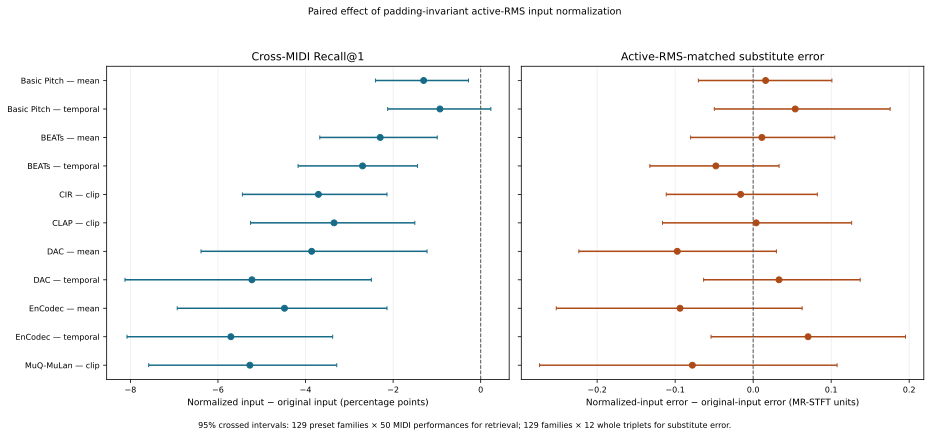
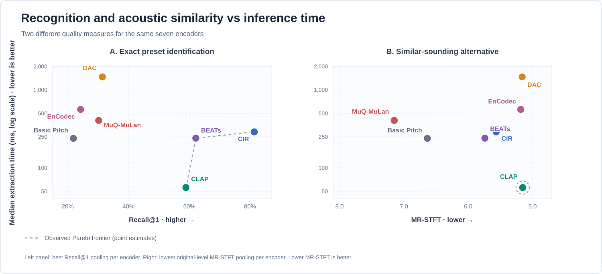

# Frozen audio encoders — visual summary

**Encoder decision: CIR first, CLAP second.** Use CIR as the primary frozen encoder for the next Vital patch-reconstruction experiments; retain CLAP as the faster alternative. The other five families remain benchmark references, not active development candidates. This is a practical choice across recognition, gain-matched substitute quality and inference cost, not a claim that either model wins every individual metric.

**The three-MIDI test in one example:** Start with preset **A** playing MIDI 1. Each encoder searches alternative presets playing MIDI 2, selecting one, say **B**. Then compare **A and B playing MIDI 3**, unseen during selection. The closest possible catalog alternative and a random alternative provide reference points.

## 1. Is recognising a preset the same as finding a good substitute?

**This chart uses the earlier original-level acoustic score.** CIR recognises the exact preset most reliably (81.4% Recall@1). CLAP and DAC mean had lower substitute error under the recordings' original levels (5.15–5.16 versus 5.56 for CIR), but this ordering depends on overall gain. With original encoder inputs and **active-RMS-matched acoustic scoring**, CIR scores 3.398 versus CLAP's 3.656 (lower is better). DAC temporal scores 3.375 but has only 30.7% exact-preset Recall@1. These close acoustic scores do not establish a statistically certain ranking; the encoder decision uses recognition, matched acoustic error and inference cost together.

The first chart includes all seven encoder families, including Basic Pitch and MuQ-MuLan. Charts 2–5 focus on the five remaining families; their Pareto frontiers use those five only.

<!-- issue164-active-rms-summary:start -->
## Does input loudness normalization change the comparison?

A single fixed active-RMS target of 0.02536 (-31.92 dBFS) changed Recall@1 by a median -3.7 points across the 11 arms. In the separate acoustic test, candidate gain was matched only while scoring A3 against B3; input normalization was applied before encoding. Lower active-RMS MR-STFT error is closer audio, though it remains sensitive to pitch, timing, and envelope as well as timbre.

The chart shows paired changes with 95% intervals for the follow-up encoder set; Basic Pitch and MuQ-MuLan remain in the seven-family introductory comparison. The left panel isolates the effect of normalizing each encoder input on retrieval. The right panel holds active-RMS candidate matching fixed; positive values mean normalized embeddings selected alternatives with lower acoustic error. This scoring-time gain match is different from input normalization and does not alter cached embeddings.
<!-- issue164-active-rms-summary:end -->

## 2. How do recognition and sound similarity trade off against inference time?

**Left:** CIR gives the highest exact-preset recall; CLAP is much faster, with lower recall. **Right (historical original-level acoustic score):** CLAP has the lowest recorded-level error and fastest inference (56 ms) among the five displayed families. The dashed frontier uses that older score; CLAP does not lead the active-RMS-matched comparison.

## 3. What changes under whole-clip gain matching?

In the earlier #161 analysis, CLAP leads with the recordings' original levels, while **DAC temporal and CIR lead after whole-clip RMS matching**. That gain change is applied only while scoring audio. Issue #164 above separately normalizes encoder inputs with a sliding active-RMS measure and reports its own active-RMS-matched acoustic score.

## 4. Does preset sensitivity help recognition or sound similarity?

**Left:** DAC mean has the strongest preset-versus-MIDI separation but far weaker exact-preset recall than CIR. **Right (historical original-level acoustic score):** DAC's strong separation accompanies competitive substitute error under the original recording levels. Sensitivity alone does not outweigh CIR's retrieval results or establish reconstruction quality.

## 5. What are the recognition and sound-similarity tradeoffs in memory?

**Left:** CIR reaches the best recall at about **0.40 GiB** peak XPU allocation. **Right (historical original-level acoustic score):** CLAP's lower recorded-level error comes at roughly twice CIR's memory (**0.79 GiB**); EnCodec uses less memory (**0.24 GiB**) but has substantially weaker exact-preset recall. Prefer the active-RMS-matched results for the current acoustic comparison.

## Practical conclusion

**Advance CIR first and CLAP second.** CIR leads preset identification and remains among the strongest substitute finders after acoustic gain matching; CLAP offers the more economical alternative. The remaining five encoder families do not offer a compelling enough combined advantage to justify including them in the next reconstruction experiments. DAC temporal has a slightly better matched-error point estimate than CIR, and BEATs temporal slightly exceeds CLAP's recall, but neither single-metric exception overturns the development shortlist.

**Keep input normalization optional.** It makes retrieval nearly insensitive to ±6 dB changes in gain, but reduces exact-preset recall and does not demonstrably improve gain-matched substitute quality. The next test is whether CIR or CLAP leads to better *playable Vital patches*, ideally assessed on held-out audio with listening comparisons; this benchmark does not answer that question.

*Source data:* [full technical report](FROZEN_ENCODER_RETRIEVAL_RESULTS.md) · [active-RMS comparison](issue164_active_rms_results.json) · [substitution results](issue161_substitution_results.json) · [preset/MIDI sensitivity](issue157_sensitivity_results.json) · [standardized efficiency benchmark](model_efficiency_benchmark.json).

*Scope:* Seven frozen encoder families, 11 representations, 129 preset families and 50 MIDI performances. The substitute test uses 12 three-MIDI triplets; latency and memory use 128 matched recordings, batch 1, FP32 on Intel Arc XPU. Acoustic similarity is measured with MR-STFT rather than listening judgments. No model training or new rendering was done for this summary.
