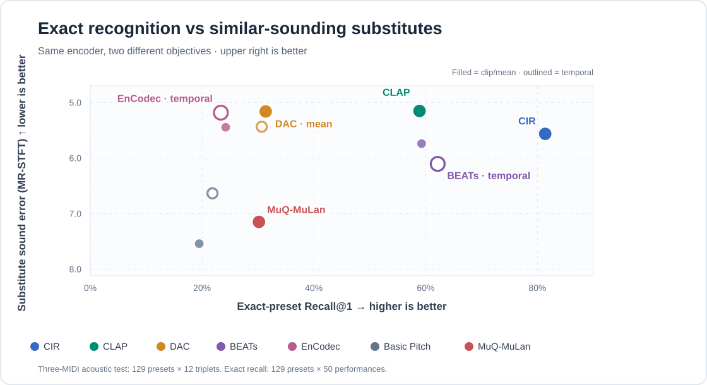
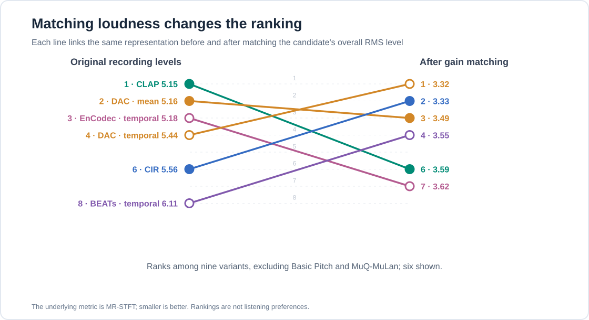
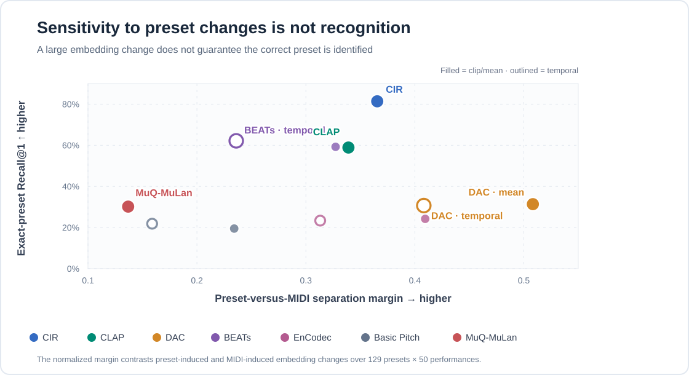
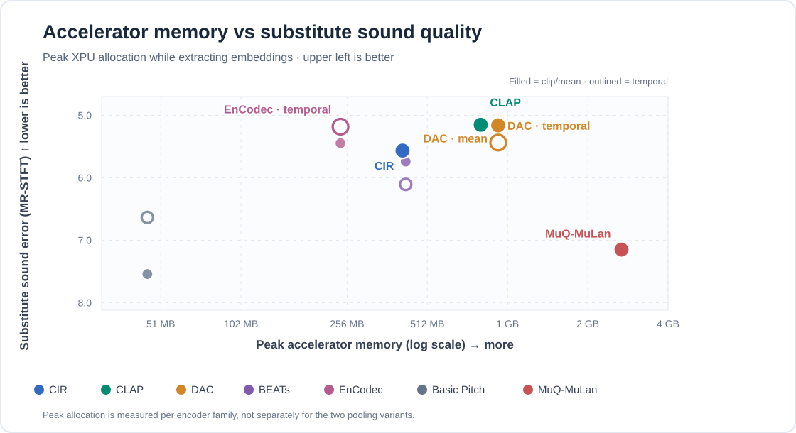

# Frozen audio encoders — visual summary

**Main finding:** CIR is strongest at **recognising the exact preset**. CLAP, DAC and EnCodec are competitive at **finding a different preset that sounds similar**; CLAP is substantially faster than DAC. Those are different strengths, not a single overall ranking.

**The three-MIDI test in one example:** Start with preset **A** playing MIDI 1. Each encoder searches alternative presets playing MIDI 2, selecting one, say **B**. Then compare **A and B playing MIDI 3**, unseen during selection. The closest possible catalog alternative and a random alternative provide reference points.

<!-- issue164-active-rms-summary:start -->
## Does input loudness normalization change the comparison?

A single fixed active-RMS target of 0.02536 (-31.92 dBFS) changed Recall@1 by a median -3.7 points across the 11 arms. In the separate acoustic test, candidate gain was matched only while scoring A3 against B3; input normalization was applied before encoding. Lower active-RMS MR-STFT error is closer audio, though it remains sensitive to pitch, timing, and envelope as well as timbre.

The chart shows paired changes with 95% intervals for the follow-up encoder set; Basic Pitch and MuQ-MuLan remain in the introductory comparison above. The left panel isolates the effect of normalizing each encoder input on retrieval. The right panel holds active-RMS candidate matching fixed; positive values mean normalized embeddings selected alternatives with lower acoustic error. This scoring-time gain match is different from input normalization and does not alter cached embeddings.
<!-- issue164-active-rms-summary:end -->

## 1. Is recognising a preset the same as finding a good substitute?

CIR finds the **same preset** most reliably (81.4% Recall@1). But CLAP and DAC mean select **different presets** with lower average sound error (5.15–5.16 versus 5.56 for CIR). CLAP's measured advantage over CIR is not conclusive on this sample.

The first chart includes all seven encoder families, including Basic Pitch and MuQ-MuLan. Charts 2–5 focus on the five remaining families; their Pareto frontiers use those five only.

## 2. How do recognition and sound similarity trade off against inference time?

**Left:** CIR gives the highest exact-preset recall; CLAP is much faster, with lower recall. **Right:** CLAP has both the lowest measured acoustic error and the fastest inference (56 ms). The dashed frontier marks nondominated choices among the five displayed families; the acoustic advantage is not conclusive.

## 3. What changes under whole-clip gain matching?

In the earlier #161 analysis, CLAP leads with the recordings' original levels, while **DAC temporal and CIR lead after whole-clip RMS matching**. That gain change is applied only while scoring audio. Issue #164 above separately normalizes encoder inputs with a sliding active-RMS measure and reports its own active-RMS-matched acoustic score.

## 4. Does preset sensitivity help recognition or sound similarity?

**Left:** DAC mean has the strongest preset-versus-MIDI separation but far weaker exact-preset recall than CIR. **Right:** DAC's strong separation comes with competitive substitute-sound error. Sensitivity is informative, but not a substitute for measuring either outcome directly.

## 5. What are the recognition and sound-similarity tradeoffs in memory?

**Left:** CIR reaches the best recall at about **0.40 GiB** peak XPU allocation. **Right:** CLAP's lower measured substitute error comes at roughly twice CIR's memory (**0.79 GiB**); EnCodec uses less memory (**0.24 GiB**) with slightly higher acoustic error.

## Practical conclusion

**Use CIR as the reference for preset identification; keep CLAP as the fast catalog-substitution candidate.** DAC is informative for timbre analysis but expensive for direct inference. None of these tests demonstrates that a representation can predict a new playable Vital patch.

*Source data:* [full technical report](FROZEN_ENCODER_RETRIEVAL_RESULTS.md) · [active-RMS comparison](issue164_active_rms_results.json) · [substitution results](issue161_substitution_results.json) · [preset/MIDI sensitivity](issue157_sensitivity_results.json) · [standardized efficiency benchmark](model_efficiency_benchmark.json).

*Scope:* Seven frozen encoder families, 11 representations, 129 preset families and 50 MIDI performances. The substitute test uses 12 three-MIDI triplets; latency and memory use 128 matched recordings, batch 1, FP32 on Intel Arc XPU. Acoustic similarity is measured with MR-STFT rather than listening judgments. No model training or new rendering was done for this summary.
