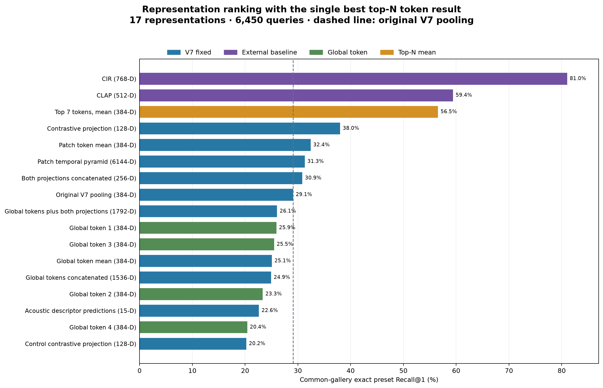

# V7 representation ranking with the best top-N token result

The chart compares the fixed V7 representations and baselines, four individual global tokens, and the single best top-N patch-token representation by common-gallery Recall@1 on all 6,450 Issue 167 queries (129 preset families × 50 MIDI performances). Each bar label includes its vector size. Higher is better.

The top-token combinations contribute only their single best tested choice: N=7 with mean pooling (384-D). The 256 individual patch positions are left out here; see the separate [position sweep](VITAL_JEPA_V7_PATCH_TOKEN_SWEEP.md).

The top patch positions and top-N winner were selected using the same full cohort; their full-cohort scores are exploratory. The five-fold held-out results are available in [the token-count report](VITAL_JEPA_V7_PATCH_OOS_CURVES.md).

[All 17 ranked values as CSV](issue169_v7_all_representations.csv) · [Machine-readable results](issue169_v7_all_representations.json) · [Full-size PDF](issue169_v7_all_representations.pdf)
