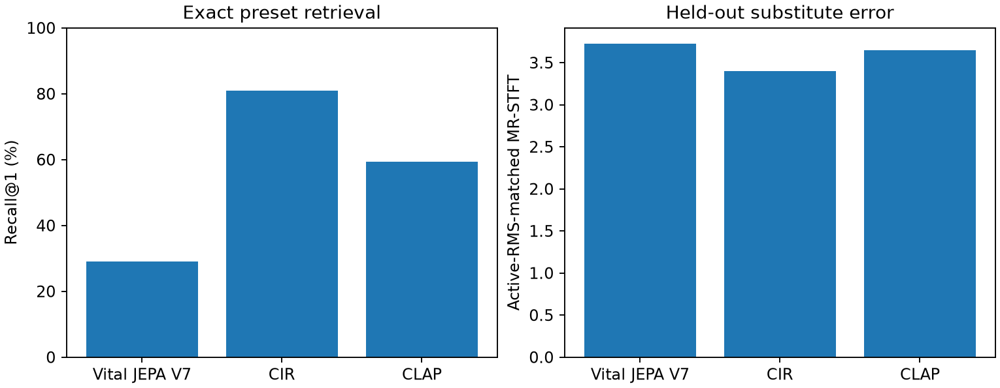

# Vital JEPA V7 compared with CIR and CLAP

V7 retrieved the exact preset first for **29.1%** of common-gallery queries and had a mean substitute error of **3.727**. CIR had the highest Recall@1 and CIR had the lowest substitute error. Defer V7 pending parent-disjoint evidence of an advantage for inverse-model training.

Retrieval used 129 preset families and 50 distinct MIDI performances, for 6,450 queries and 129 candidates per gallery protocol. Substitution used 1,548 choices across 12 triplets and 36 distinct MIDI performances. Lower active-RMS-matched MR-STFT means a closer spectral match on the withheld performance.

| Encoder | Common R@1 (95% CI) | R@5 | R@10 | Mixed R@1 / 5 / 10 | Substitute error (95% CI) | Substitute mean rank / 128 |
| --- | ---: | ---: | ---: | ---: | ---: | ---: |
| Vital JEPA V7 | 29.1% [23.0%, 35.6%] | 54.1% | 67.0% | 29.5% / 49.9% / 61.6% | 3.727 [3.520, 3.967] | 39.0 |
| CIR | 81.0% [74.7%, 86.6%] | 93.6% | 96.5% | 80.9% / 93.9% / 96.9% | 3.403 [3.214, 3.630] | 30.6 |
| CLAP | 59.4% [50.8%, 67.7%] | 79.9% | 87.4% | 55.0% / 75.8% / 83.7% | 3.650 [3.485, 3.840] | 36.5 |

The best available substitute under the scorer averaged 2.132. The fixed random choice averaged 4.928.

- V7 vs. CIR had a paired Recall@1 difference of -51.9 pp [-57.5, -46.2] and substitute error difference of +0.324 [+0.119, +0.538].
- V7 vs. CLAP had a paired Recall@1 difference of -30.3 pp [-36.3, -24.5] and substitute error difference of +0.077 [-0.145, +0.312].

## Preset and MIDI sensitivity

Preset dominance is the share of anchored comparisons where changing the preset moved the embedding farther than changing the MIDI.

| Encoder | Preset distance | MIDI distance | Normalized margin | Preset-dominant share | Preset / MIDI / interaction variance |
| --- | ---: | ---: | ---: | ---: | ---: |
| Vital JEPA V7 | 0.407 | 0.192 | +0.341 | 82.4% | 58.3% / 10.6% / 31.2% |
| CIR | 0.959 | 0.471 | +0.366 | 98.2% | 52.3% / 1.8% / 45.8% |
| CLAP | 0.601 | 0.303 | +0.340 | 90.2% | 54.9% / 9.3% / 35.7% |

## Evidence limits

In each of the two published V7 source corpora, 96 of the 129 evaluation families matched a parent preset SHA-256. Published manifests lack exact training split membership. The inherited V4 source corpus also had 96 parent matches. The intervals resample preset families and MIDI performances for retrieval, and preset families and triplets for substitution. They cover sampling variation in this cohort. Reconstruction and listening quality remain unmeasured. [Published parent manifests](https://huggingface.co/datasets/duckking032/vital/tree/08e84bcd0b4f8ee90e493d26780853e025e81df6)

## Execution and reproducibility

This is a frozen representation benchmark with zero predicted or editable Vital controls. [Canonical Vital inventory](vital_control_inventory.jsonl)

Recovered 6,450 matched recordings using the original renderer, assignments and QA. 1,747 matched the historical WAV hashes. All encoders used the same recovered WAVs. The acoustic scorer reused 0 compatible triplet matrices and rebuilt 12.

V7 used the SHA-locked Apache-2.0 step 16,000 checkpoint. The local 384-dimensional adapter uses 22.05 kHz stereo, a leading six-second crop or zero padding, energy-preserving mid/side, Hann/HTK log-mel features, pre-norm GELU and residual mean pooling of global and patch tokens from the online encoder. Framing, mel conventions, transformer settings and pooling are local implementation choices based on the released config and tensor layout. [Pinned release](https://huggingface.co/duckking032/vital-jepa-v7/commit/e5ebdfb02dd107c15125b12c1bb4af03a7e31592)

Resource measurement used the original 128-recording list, the Intel XPU, FP32, batch size 1, four warm-ups and three timed passes per encoder. V7's mel frontend runs on the CPU. Its encoder runs on the XPU. Runtime versions and checkpoint hashes are in the result JSON.

| Encoder | Median / P90 latency (ms) | Throughput (audio s / wall s) | Peak process RAM (GiB) | Peak XPU allocation (GiB) |
| --- | ---: | ---: | ---: | ---: |
| Vital JEPA V7 | 46.1 / 65.4 | 160.4 | 1.36 | 0.06 |
| CIR | 229.6 / 273.8 | 33.9 | 1.97 | 0.40 |
| CLAP | 87.4 / 93.0 | 91.8 | 3.68 | 0.79 |

[Machine-readable results](issue167_v7_results.json) · [Benchmark commands](../README.md#issue-167-vital-jepa-v7)

The run retains its assignments, WAV receipts, embeddings, acoustic score matrices and timing rows under the ignored Issue #167 output directory. The temporary STFT tensors and render timing probe WAVs were removed after their measurements were recorded.
