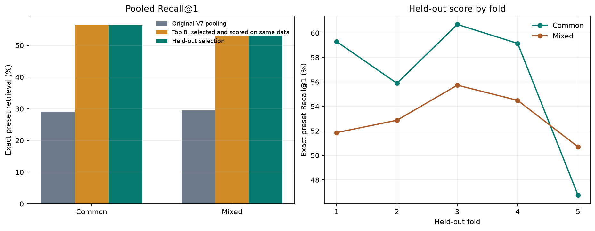

# V7 patch-token selection on held-out MIDI performances

Selecting patch positions, pooling method, and N using only other performances retained **56.4% common-gallery** and **53.1% mixed-gallery** Recall@1 across held-out performances. That matches the same-data top-eight result closely, so the token-selection finding carries over to unseen MIDI performances in this benchmark.

This checks whether choosing patch tokens on one set of MIDI performances carries over to different performances. Each fold uses 40 of the 50 performances to rank positions, then choose mean or concatenation and N (1–8) by common-gallery Recall@1. The selected setting is scored on the remaining 10 performances. The encoder and audio cache are reused; no audio was rendered.

## Held-out results

| Gallery | Out-of-fold R@1 | Original V7 on same queries | Difference | Episodes |
| --- | ---: | ---: | ---: | ---: |
| Common | 56.4% | 29.1% | +27.3 pp | 6,450 |
| Mixed | 53.1% | 29.5% | +23.6 pp | 6,450 |

## Fold-by-fold choices

Positions use mel:time coordinates in the 8 × 32 patch grid.

| Fold | Held-out MIDI count | Chosen method | N | Positions (mel:time) | Train common R@1 | Held-out common R@1 | Held-out mixed R@1 |
| ---: | ---: | --- | ---: | --- | ---: | ---: | ---: |
| 1 | 10 | mean | 8 | 7:0, 6:0, 5:0, 4:0, 3:0, 2:0, 0:0, 1:0 | 55.8% | 59.3% | 51.9% |
| 2 | 10 | mean | 8 | 7:0, 6:0, 5:0, 4:0, 3:0, 2:0, 0:0, 1:0 | 56.6% | 55.9% | 52.9% |
| 3 | 10 | mean | 7 | 7:0, 6:0, 5:0, 4:0, 3:0, 2:0, 0:0 | 55.5% | 60.7% | 55.7% |
| 4 | 10 | mean | 8 | 7:0, 6:0, 5:0, 4:0, 3:0, 2:0, 0:0, 1:0 | 55.8% | 59.1% | 54.5% |
| 5 | 10 | mean | 7 | 7:0, 6:0, 5:0, 4:0, 3:0, 2:0, 0:0 | 59.0% | 46.7% | 50.7% |

## How often positions were selected

| Mel patch | Time patch | Folds selected |
| ---: | ---: | ---: |
| 0 | 0 | 5 / 5 |
| 1 | 0 | 5 / 5 |
| 2 | 0 | 5 / 5 |
| 3 | 0 | 5 / 5 |
| 4 | 0 | 5 / 5 |
| 5 | 0 | 5 / 5 |
| 6 | 0 | 5 / 5 |
| 7 | 0 | 5 / 5 |

## Interpretation

The pooled held-out score estimates the complete selection procedure, including choosing positions, pooling method, and N. The split holds query performances out; gallery references follow the benchmark definition and can reuse MIDI performances across folds. So this tests whether selection generalizes to unseen query performances within this preset set, not to a fully separate audio corpus, new presets, or listening similarity.

Position frequencies show whether the same patches are repeatedly chosen. Five folds provide a useful check but limited evidence for fine-grained uncertainty; fold results are shown individually.

[Machine-readable results](issue169_v7_patch_oos.json) · [Earlier same-cohort top-N sweep](VITAL_JEPA_V7_PATCH_TOPN.md)
