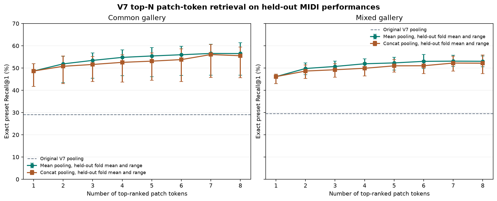

# Held-out V7 patch-token results by token count

The chart reports Recall@1 averaged over five held-out folds for each token count. Error bars show the lowest to highest fold, not a confidence interval.

Each fold ranks token positions using 40 MIDI performances, then evaluates the top N on the remaining 10. This is done independently for mean pooling and concatenation.

The dashed line is the original V7 pooling score on the same query episodes. Galleries follow the benchmark definition and may reuse MIDI performances across folds.

| N | Mean common R@1 (fold mean; min–max) | Mean mixed R@1 (fold mean; min–max) | Concat common R@1 (fold mean; min–max) | Concat mixed R@1 (fold mean; min–max) |
| ---: | ---: | ---: | ---: | ---: |
| 1 | 48.7% (41.7%–51.9%) | 46.1% (43.0%–47.3%) | 48.7% (41.7%–51.9%) | 46.1% (43.0%–47.3%) |
| 2 | 51.9% (43.5%–55.3%) | 49.8% (47.1%–52.3%) | 50.8% (42.9%–55.4%) | 48.6% (45.3%–51.4%) |
| 3 | 53.4% (45.4%–56.7%) | 50.7% (48.4%–53.1%) | 51.6% (43.9%–55.2%) | 49.2% (45.8%–51.9%) |
| 4 | 54.8% (46.5%–58.1%) | 51.9% (49.2%–54.2%) | 52.5% (43.7%–56.0%) | 49.9% (46.4%–52.6%) |
| 5 | 55.4% (46.1%–59.2%) | 52.3% (49.1%–54.8%) | 53.1% (44.5%–56.8%) | 51.0% (48.1%–53.8%) |
| 6 | 56.0% (46.7%–59.8%) | 53.0% (49.8%–56.1%) | 53.8% (44.0%–58.6%) | 51.0% (47.5%–53.5%) |
| 7 | 56.5% (46.7%–60.7%) | 53.1% (50.7%–55.7%) | 56.0% (45.7%–60.5%) | 52.2% (48.6%–55.3%) |
| 8 | 56.5% (46.8%–61.3%) | 53.0% (50.5%–55.3%) | 55.5% (45.7%–59.5%) | 52.2% (47.5%–55.8%) |

## Reading the result

The bars show variation across five specific folds. They are ranges, not statistical confidence intervals. The held-out result estimates performance on new query performances within this preset set; it does not establish performance on a separate audio corpus, new presets, or listener-rated timbre similarity.

[Machine-readable fold results](issue169_v7_patch_oos.json) · [Earlier same-cohort sweep](VITAL_JEPA_V7_PATCH_TOPN.md)
