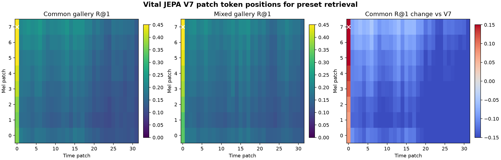

# Vital JEPA V7 individual patch tokens

The strongest patch position was **mel 7, time 0**. Its common-gallery Recall@1 was **48.7%** (95% interval 41.3% to 55.6%), a paired change of +19.6 percentage points (+14.0 to +24.9).

Each of the 256 patch positions is evaluated independently as a 384-D vector, comparing the same grid position across query and gallery recordings. The 6,450 queries, 129 candidates, and two gallery assignments are reused from Issue 167.

## Highest common-gallery positions

| Rank | Mel patch | Time patch | R@1 | R@5 | R@10 | Mixed R@1 | Paired common R@1 change vs original |
| ---: | ---: | ---: | ---: | ---: | ---: | ---: | ---: |
| 1 | 7 | 0 | 48.7% | 71.0% | 79.8% | 46.1% | +19.6 [+14.0, +24.9] pp |
| 2 | 6 | 0 | 47.8% | 69.8% | 78.9% | 45.3% | +18.7 [+13.1, +24.6] pp |
| 3 | 5 | 0 | 44.8% | 68.1% | 77.3% | 43.1% | +15.7 [+10.0, +21.0] pp |
| 4 | 4 | 0 | 42.4% | 64.8% | 74.7% | 40.4% | +13.3 [+7.5, +18.7] pp |
| 5 | 3 | 0 | 40.5% | 61.8% | 71.5% | 39.0% | +11.4 [+5.7, +16.8] pp |
| 6 | 2 | 0 | 37.3% | 58.7% | 68.8% | 36.0% | +8.2 [+2.9, +13.0] pp |
| 7 | 0 | 0 | 36.6% | 55.1% | 65.3% | 33.5% | +7.5 [+1.4, +13.3] pp |
| 8 | 1 | 0 | 35.8% | 55.3% | 65.3% | 32.9% | +6.7 [+1.1, +11.9] pp |
| 9 | 7 | 6 | 24.4% | 44.9% | 56.4% | 22.4% | -4.7 [-9.0, -0.9] pp |
| 10 | 7 | 13 | 23.2% | 44.1% | 54.8% | 21.6% | -5.9 [-10.5, -1.4] pp |
| 11 | 7 | 3 | 23.1% | 44.8% | 56.9% | 22.1% | -6.0 [-10.6, -1.4] pp |
| 12 | 6 | 6 | 22.6% | 42.5% | 53.5% | 20.6% | -6.5 [-10.7, -2.8] pp |

## Limits

A position indexes a frequency by time patch in the model's flattened 8 by 32 grid. All tokens have attended to the full input through the transformer, so an individual position does not isolate only its local spectrogram patch. The score measures preset retrieval on this cohort, not listener-rated timbre similarity. Family and performance cluster intervals describe this cohort; possible training-set parent overlap remains as reported in Issue 167.

[Full per-position results](issue169_v7_patch_tokens.json) · [Representation sweep](VITAL_JEPA_V7_REPRESENTATION_SWEEP.md)
