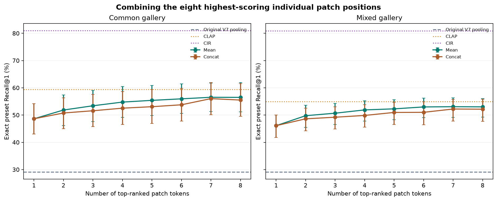

# Combining the top V7 patch tokens

The eight positions were selected by their individual common-gallery Recall@1 on these same 6,450 queries. The combined results are exploratory and likely optimistic. A separate cohort is needed to confirm the token ranking.

Position order, from strongest to eighth strongest: 7:0, 6:0, 5:0, 4:0, 3:0, 2:0, 0:0, 1:0 (mel:time).

| N | Mean dimensions | Mean common R@1 / 5 / 10 | Mean mixed R@1 | Concat dimensions | Concat common R@1 / 5 / 10 | Concat mixed R@1 |
| ---: | ---: | ---: | ---: | ---: | ---: | ---: |
| 1 | 384 | 48.7% / 71.0% / 79.8% | 46.1% | 384 | 48.7% / 71.0% / 79.8% | 46.1% |
| 2 | 384 | 51.9% / 74.4% / 82.6% | 49.8% | 768 | 50.8% / 73.1% / 81.4% | 48.6% |
| 3 | 384 | 53.4% / 75.8% / 84.2% | 50.7% | 1152 | 51.6% / 74.0% / 82.3% | 49.2% |
| 4 | 384 | 54.8% / 77.1% / 85.1% | 51.9% | 1536 | 52.5% / 74.9% / 82.7% | 49.9% |
| 5 | 384 | 55.4% / 77.8% / 85.6% | 52.3% | 1920 | 53.1% / 75.7% / 83.2% | 51.0% |
| 6 | 384 | 56.0% / 78.3% / 85.7% | 53.0% | 2304 | 53.8% / 75.5% / 83.4% | 51.0% |
| 7 | 384 | 56.5% / 79.4% / 86.2% | 53.1% | 2688 | 56.0% / 77.1% / 84.4% | 52.2% |
| 8 | 384 | 56.5% / 79.3% / 86.1% | 53.0% | 3072 | 55.5% / 76.9% / 84.4% | 52.2% |

## Interpretation

Each token is a contextual output at one mel/time position after full self-attention. The combined vectors compare the same selected positions between recordings. Mean pooling keeps 384 dimensions. Concatenation preserves all selected token outputs and increases dimension by 384 per token. Cosine scoring normalizes each vector.

The individual positions were selected and the combinations evaluated on the same cohort, so the apparent best N should be treated as a screening result. The score measures exact preset retrieval and cannot alone establish which combination produces the closest-sounding alternate preset.

[Machine-readable results](issue169_v7_patch_topn.json) · [Per-position sweep](VITAL_JEPA_V7_PATCH_TOKEN_SWEEP.md)
