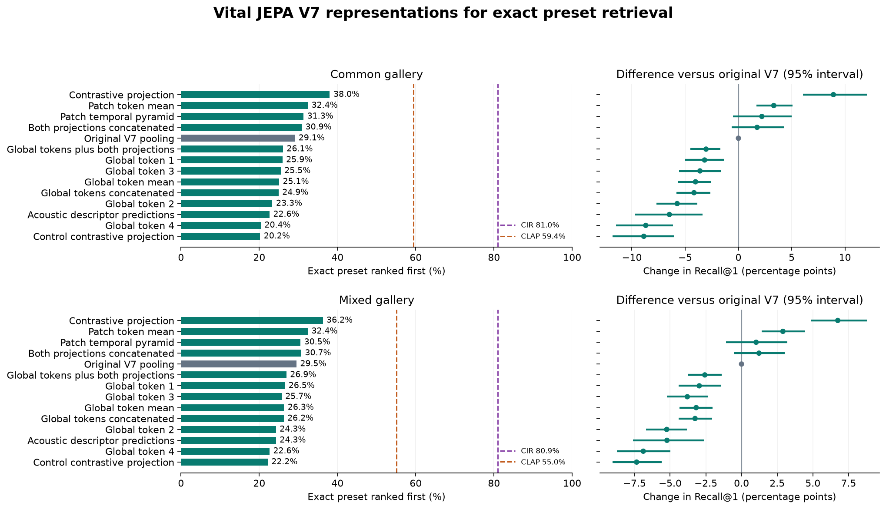

# Vital JEPA V7 representation sweep

The best tested V7 representation on the common gallery was the **mean of the seven patch tokens selected by the out-of-sample fold procedure** at **56.5% Recall@1** (384 dimensions), versus **29.1%** for original V7 pooling. Contrastive projection reached **38.0%** and the full-grid patch-token mean **32.4%**. The selected representations were then carried into Issue 169 Stage 2 for acoustic substitute and preset/MIDI sensitivity evaluation; see the [Stage 2 findings](VITAL_JEPA_V7_STAGE2.md).

Each protocol searched 129 candidates for 6,450 queries from 129 preset families and 50 distinct MIDI performances. All scores use the same Issue 167 recordings and gallery assignments. Higher recall is better.

| Representation | Dimensions | Common R@1 / 5 / 10 | Mixed R@1 / 5 / 10 |
| --- | ---: | ---: | ---: |
| Contrastive projection | 128 | 38.0% / 65.7% / 77.6% | 36.2% / 60.8% / 73.3% |
| Control contrastive projection | 128 | 20.2% / 44.4% / 57.7% | 22.2% / 42.8% / 55.8% |
| Both projections concatenated | 256 | 30.9% / 57.2% / 69.1% | 30.7% / 53.9% / 66.0% |
| Global tokens concatenated | 1536 | 24.9% / 47.5% / 60.7% | 26.2% / 44.4% / 55.8% |
| Global token 1 | 384 | 25.9% / 48.4% / 61.7% | 26.5% / 46.1% / 57.5% |
| Global token 2 | 384 | 23.3% / 46.4% / 59.3% | 24.3% / 43.7% / 54.2% |
| Global token 3 | 384 | 25.5% / 47.3% / 60.4% | 25.7% / 44.2% / 55.0% |
| Global token 4 | 384 | 20.4% / 40.7% / 52.9% | 22.6% / 39.6% / 49.7% |
| Patch token mean | 384 | 32.4% / 58.6% / 71.1% | 32.4% / 54.0% / 66.0% |
| Global token mean | 384 | 25.1% / 48.6% / 61.5% | 26.3% / 45.2% / 56.7% |
| Acoustic descriptor predictions | 15 | 22.6% / 50.4% / 65.2% | 24.3% / 48.9% / 63.4% |
| Global tokens plus both projections | 1792 | 26.1% / 49.6% / 63.2% | 26.9% / 46.0% / 57.3% |
| Patch temporal pyramid | 6144 | 31.3% / 58.5% / 71.5% | 30.5% / 51.2% / 62.9% |
| Original V7 pooling | 384 | 29.1% / 54.1% / 67.0% | 29.5% / 49.9% / 61.6% |
| CIR | — | 81.0% / 93.6% / 96.5% | 80.9% / 93.9% / 96.9% |
| CLAP | — | 59.4% / 79.9% / 87.4% | 55.0% / 75.8% / 83.7% |

## Evidence limits

The intervals resample preset families and MIDI performances and describe this cohort. The Issue 167 corpus audit found 96 of 129 preset families matched parent hashes in V7 source corpora. Exact training split membership remains unavailable. This is an exploratory comparison of frozen representations.

## Execution and reproducibility

All retained WAVs passed their receipt hash checks. One encoder pass per WAV produced the cached 260 × 384 FP32 tensors. The original pooling was replayed and compared with the Issue 167 per-query recall. CIR and CLAP reuse their Issue 167 ranks.

The checkpoint contains `aux_projection` and `control_delta_projection` with 128 outputs each, and distinct acoustic feature and delta heads with 15 outputs each. The contrastive objectives and per-sound acoustic evaluation in the model lineage support trying the contrastive and acoustic feature heads on one clip. The release leaves their exact V7 input and activation undocumented. Both probes use the global mean plus patch mean described for V5, with the saved LayerNorm and linear layers and a local GELU choice. [V5 model card](https://huggingface.co/duckking032/vital-jepa-v5)

The control projection is stored as `control_delta_projection`. Control ID, sign, magnitude and effect heads accept its 128-dimensional output by shape, and the released config uses mutation pairs. The release provides no forward code that establishes whether this projection takes one clip or a mutation pair. To complete the requested retrieval rows, we apply it to each clip's global-plus-patch mean. Treat it and both concatenations containing it as diagnostic only, since that single-clip input is unverified. Pitch and articulation heads take 384 values and are consistent with clip predictions. The release lists a spatial loss but the checkpoint contains no named spatial head. The acoustic delta head likewise has no verified standalone input.

The requested eight representations are all included, along with a patch temporal pyramid because the existing encoders also report that pooling. The temporal pyramid averages the eight mel patches at each time step and uses the prior eight-bin mean and population standard deviation recipe. The bins use complete time patches up to the source duration (capped by the model's patch grid). The plain patch mean uses the entire fixed grid, as in the original V7 pooling. Cached tokens have already attended across the model input.

No Vital controls are predicted or edited. [Release materials](https://huggingface.co/duckking032/vital-jepa-v7/tree/main) · [Issue 167 comparison](VITAL_JEPA_V7_COMPARISON.md) · [Machine-readable results](issue169_v7_retrieval_results.json)
