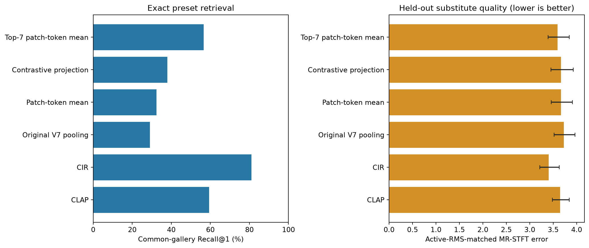

# Issue 169 Stage 2: acoustic substitutes and sensitivity

Of the three selected V7 representations, the top-7 patch-token mean ranked best for exact preset retrieval and had the lowest substitute error, narrowly ahead of the contrastive projection and patch-token mean. CIR remained stronger on both exact retrieval and the spectral substitute score. Across all six representations, preset changes usually moved embeddings farther than MIDI changes.

Retrieval covers 6,450 queries from 129 presets × 50 MIDI performances. Substitute selection covers 129 preset families across 12 fixed MIDI triplets (1,548 selections per representation): MIDI 1 and 2 select an alternative from 128 different-family presets, and MIDI 3 scores it. Lower active-RMS-matched MR-STFT error means a closer spectral match on MIDI 3. Intervals resample preset families and triplets for acoustic error, and preset families and MIDI performances for sensitivity.

| Representation | Dimensions | Common R@1 | Mixed R@1 | Substitute error (95% interval) | Mean rank / 128 |
| --- | ---: | ---: | ---: | ---: | ---: |
| Top-7 patch-token mean | 384 | 56.5% | 53.1% | 3.594 [3.390, 3.844] | 35.8 |
| Contrastive projection | 128 | 38.0% | 36.2% | 3.665 [3.453, 3.929] | 37.7 |
| Patch-token mean | 384 | 32.4% | 32.4% | 3.669 [3.458, 3.909] | 38.3 |
| Original V7 pooling | 384 | 29.1% | 29.5% | 3.727 [3.520, 3.967] | 39.0 |
| CIR | 768 | 81.0% | 80.9% | 3.403 [3.214, 3.630] | 30.6 |
| CLAP | 512 | 59.4% | 55.0% | 3.650 [3.485, 3.840] | 36.5 |

Best available substitute: 2.132. Fixed random choice: 4.928.

## Paired substitute differences

Negative error difference means the first representation selected a closer-sounding substitute than the comparator.

| Selected representation | Comparator | Error difference (95% interval) |
| --- | --- | ---: |
| Top-7 patch-token mean | Original V7 pooling | -0.133 [-0.306, +0.033] |
| Top-7 patch-token mean | CIR | +0.191 [+0.003, +0.383] |
| Top-7 patch-token mean | CLAP | -0.056 [-0.251, +0.161] |
| Contrastive projection | Original V7 pooling | -0.062 [-0.221, +0.095] |
| Contrastive projection | CIR | +0.262 [+0.075, +0.460] |
| Contrastive projection | CLAP | +0.015 [-0.159, +0.210] |
| Patch-token mean | Original V7 pooling | -0.058 [-0.138, +0.023] |
| Patch-token mean | CIR | +0.265 [+0.068, +0.473] |
| Patch-token mean | CLAP | +0.018 [-0.181, +0.241] |

## Preset and MIDI sensitivity

Preset-dominant share is the portion of anchored comparisons where changing the preset moved the embedding farther than changing the MIDI. Higher share means preset identity more often dominates performance changes; it does not by itself guarantee good substitute retrieval.

| Representation | Preset distance | MIDI distance | Normalized margin | Preset-dominant share | Variance from preset / MIDI / interaction |
| --- | ---: | ---: | ---: | ---: | ---: |
| Top-7 patch-token mean | 0.516 [0.494, 0.536] | 0.204 [0.184, 0.222] | +0.433 [+0.390, +0.477] | 91.7% [89.3%, 94.0%] | 63.7% / 6.9% / 29.3% |
| Contrastive projection | 0.566 [0.545, 0.586] | 0.253 [0.228, 0.280] | +0.396 [+0.353, +0.439] | 87.9% [85.0%, 90.5%] | 58.9% / 6.8% / 34.3% |
| Patch-token mean | 0.423 [0.400, 0.445] | 0.194 [0.173, 0.214] | +0.358 [+0.309, +0.406] | 83.8% [80.0%, 87.4%] | 59.4% / 10.3% / 30.3% |
| Original V7 pooling | 0.407 [0.383, 0.430] | 0.192 [0.172, 0.213] | +0.341 [+0.291, +0.390] | 82.4% [78.4%, 86.0%] | 58.3% / 10.6% / 31.2% |
| CIR | 0.959 [0.952, 0.965] | 0.471 [0.437, 0.508] | +0.366 [+0.332, +0.400] | 98.2% [97.3%, 98.9%] | 52.3% / 1.8% / 45.8% |
| CLAP | 0.601 [0.577, 0.624] | 0.303 [0.275, 0.330] | +0.340 [+0.299, +0.382] | 90.2% [87.1%, 93.0%] | 54.9% / 9.3% / 35.7% |

## What this supports

Among V7 candidates, carry the top-7 patch-token mean forward if choosing one for the next V7-specific evaluation; retain CIR as the stronger external reference. The top-7 error interval overlaps those for the contrastive projection, patch-token mean, original V7, and CLAP, so the small error differences do not establish that it sounds better. These are frozen-embedding comparisons, not patch reconstruction or listening tests. The acoustic score is a spectral proxy. The split and five-fold retrieval review support using unseen query performances, but 96 of 129 evaluation preset families have parent hashes in the published V7 source corpora, and exact training membership is unavailable. Treat these results as exploratory for unseen presets.

No audio was rendered and no encoder was run in this stage. The three selected V7 representations were derived from the verified cached encoder outputs; CIR, CLAP, original V7 vectors, triplets, WAV receipts, and all 12 active-RMS acoustic matrices were reused.

No Vital controls are predicted or edited. [Canonical frozen-control inventory](vital_control_inventory.jsonl) · [Retrieval stage](VITAL_JEPA_V7_REPRESENTATION_SWEEP.md) · [Machine-readable Stage 2 results](issue169_v7_stage2_results.json)
