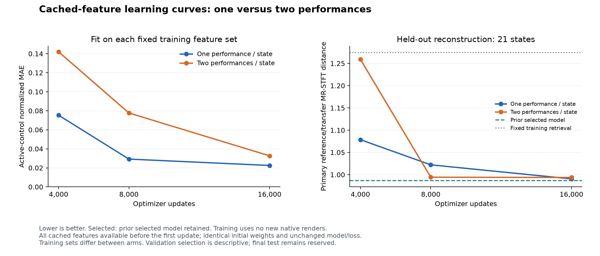

# Optimization duration with cached training features

Experiment declared 2026-10-11; completed artifacts verified and report finalized 2026-10-13. This follows the [controlled two-view experiment](TWO_VIEW_RESULTS.md) and tests whether additional optimization improves held-out reconstruction without generating more training audio. It retains the narrow nine-control/two-category vocabulary, 205 training states, 21 validation states and 30 reserved final-test states.

**The previous two-view model remains selected.** Its primary validation distance is 0.9870; the best new checkpoint, one performance at 16,000 updates, scores 0.9906. Longer optimization improves both cached arms relative to their own 4,000-update checkpoints, but does not improve the selected primary score. The two-performance curve changes little after 8,000 updates while training fit continues to improve. This supports testing training-state coverage next within the same vocabulary; it does not establish the cause of the remaining generalization gap.

The [declared plan](data/cached_curve_plan.json) fixes both arms, 4,000/8,000/16,000-update checkpoints, the incumbent, validation recipes, retrieval bank, primary metric and tie order before training. [TRAINER.md](../TRAINER.md#longer-learning-curves-from-cached-features) gives reproduction instructions. The [machine-readable report](data/cached_curve_summary.json) records configurations, all metrics, planned comparisons, source hashes and artifact checksums.

## What the experiment changes

Both arms start from fresh model and optimizer state, with seed 0 and identical initial weights. The single-performance arm uses the original 205 feature records; the two-performance arm uses the verified 410-record set. Every cached record is available before the first optimizer update. Within each arm, the features, targets, audio identities and replay population stay fixed throughout the curve.

This differs from the incumbent's training schedule, which started with 205 records and added the second performances during its first 820 updates. The cached two-performance checkpoint at 4,000 updates controls for that scheduling change. Comparisons between 4,000, 8,000 and 16,000 updates within an arm assess optimization duration; comparing a later checkpoint only with the incumbent would combine both changes.

The architecture, independent supervised loss, frozen Basic Pitch frontend, float32 precision, learning rate 0.001, batch size 32 and four CPU threads are unchanged. The learning rate is constant throughout. Each arm declares 16,000 total updates and saves segments at the planned checkpoints through ordinary recovery. It does not edit a completed 4,000-update run's contract to continue its weights.

Replay capacity is 410 examples with a 32 MiB feature limit. Retained payloads are 7.56 MiB and 15.12 MiB. The accepted-example targets already equal the seeded populations, so the renderer never starts. No new audio is synthesized or new frontend features extracted during training. The same 205 training states supply both arms; training uses reference performances only.

## Training and compute

| Arm | Updates | Training active-control MAE | Categorical accuracy | Supervised loss | Segment time |
|---|---:|---:|---:|---:|---:|
| One performance | 4,000 | 0.075339 | 100% | 0.010994 | 29.13 s |
| One performance | 8,000 | 0.029213 | 100% | 0.001640 | 29.63 s |
| One performance | 16,000 | 0.022509 | 100% | 0.001078 | 76.83 s |
| Two performances | 4,000 | 0.142026 | 98.05% | 0.120361 | 38.12 s |
| Two performances | 8,000 | 0.077684 | 100% | 0.011752 | 41.14 s |
| Two performances | 16,000 | 0.032623 | 100% | 0.001872 | 81.78 s |

The second segment adds 4,000 updates and the third adds 8,000. Metrics use each arm's unchanged full feature population; the two arms have different populations. Both show substantial additional training-set fit after 4,000 updates. These numbers alone do not establish improved reconstruction of unseen states.

The six training segments total **296.64 seconds**, about **4.94 minutes**. Measured orchestration, including between-segment setup and checks, is 346.34 seconds. Peak sampled training process-tree RSS is 750,305,280 bytes, about 716 MiB; sampling can miss short peaks and shared pages can be counted more than once. Native training renders and new feature extractions are both zero. No paid compute, GPU, Colab session or WAV archive is used.

Both initial model states have SHA-256 `91e6968ae5e73529ff43ce4f64c2927339573172b65a130dca89ee03ba2181b7`. The one-performance 4,000-update model exactly reproduces the previous matched control's weights. Frozen frontend weights stay unchanged. Retained-feature digests remain constant across all checkpoints in each arm, and source-checkpoint hashes match the declaration. The [training verification record](../outputs/cached-curve-training-verification-20261011.json) preserves these checks.

## Evaluation

Seven candidates share each validation source buffer: the incumbent followed by single/two-performance checkpoints at 4,000, 8,000 and 16,000 updates. The original 205-record training retrieval bank stays fixed. The evaluator also renders the fixed template and source repeats. Seven candidates on 21 states require 462 uninterrupted native renders, with audio retained only for the current case.

The primary score is the equal-weight reference/transfer MR-STFT mean per state. A prediction is made from reference audio alone and the same patch is reused on the reserved transfer performance. Every planned case must be scored in both roles to qualify for selection. The lowest complete mean wins; ties prefer the incumbent, then fewer updates in the declared input order.

Planned paired comparisons include two minus one at matched update counts, longer training minus 4,000 updates within each arm, each new candidate minus the incumbent, and each candidate minus fixed retrieval. Paired state-bootstrap intervals use 2,000 resamples and seed 0. They are descriptive validation intervals without adjustment for selection, multiple comparisons or repeated development on the same small validation set. This single-seed result does not establish final-test or release quality.

All **462 planned native renders passed QA**, with all 21 states scored in both roles for every method. No failed case, retry or resumed case was needed. Evaluation took 1,136.22 recorded seconds, about **18.94 minutes**; summed native-render wall time was 1,118.94 seconds. Training segments plus evaluation total **23.88 recorded CPU minutes**, excluding setup and artifact verification. Local CPU remains sufficient for this experiment; a faster optimizer would leave the native evaluation cost largely intact.

## Validation results

Lower distance is better. `One` and `Two` below refer to the number of cached reference performances per training state. The incumbent introduced its second performances during training and has 4,000 updates.

| Candidate | Reference distance | Transfer distance | Primary mean |
|---|---:|---:|---:|
| **Incumbent, retained** | **0.9307** | **1.0432** | **0.9870** |
| One, 4,000 | 1.0214 | 1.1359 | 1.0786 |
| Two, 4,000 | 1.2235 | 1.2950 | 1.2592 |
| One, 8,000 | 0.9453 | 1.0990 | 1.0222 |
| Two, 8,000 | 0.9517 | 1.0369 | 0.9943 |
| One, 16,000 | 0.9162 | 1.0649 | 0.9906 |
| Two, 16,000 | 0.9581 | 1.0293 | 0.9937 |
| Fixed training retrieval, 205 records | 1.0762 | 1.4729 | 1.2746 |
| Fixed pilot template | 2.9275 | 3.2747 | 3.1011 |
| Source repeat, diagnostic floor | 0.0000 | 0.0000 | 0.0000 |

Within the one-performance arm, the primary mean falls 8.2% from 4,000 to 16,000 updates. Within the two-performance arm, it falls 21.1%, with almost all of that change reached by 8,000 updates: the subsequent change is just 0.00063, about 0.06%. These are observed means, not evidence that every state improves. The best new single-performance model has lower reference error than the incumbent but higher transfer error; the longest two-performance model shows the opposite tradeoff. The declared equal-weight primary retains the incumbent.

The following table includes every planned model-to-model contrast. Differences are the first model minus the second; negative values favor the first. Wins count states with a lower primary score, out of 21; there are no ties.

| Planned contrast | Mean paired difference | Descriptive 95% interval | State wins |
|---|---:|---|---:|
| Two 4,000 minus One 4,000 | 0.1806 | [0.0050, 0.3889] | 7 / 21 |
| Two 8,000 minus One 8,000 | -0.0278 | [-0.1794, 0.1196] | 9 / 21 |
| Two 16,000 minus One 16,000 | 0.0032 | [-0.1387, 0.1450] | 11 / 21 |
| One 8,000 minus One 4,000 | -0.0565 | [-0.1801, 0.0595] | 15 / 21 |
| One 16,000 minus One 4,000 | -0.0881 | [-0.1880, 0.0116] | 14 / 21 |
| Two 8,000 minus Two 4,000 | -0.2649 | [-0.5653, -0.0617] | 14 / 21 |
| Two 16,000 minus Two 4,000 | -0.2655 | [-0.5769, -0.0266] | 13 / 21 |
| One 4,000 minus incumbent | 0.0917 | [-0.0111, 0.1899] | 6 / 21 |
| Two 4,000 minus incumbent | 0.2723 | [0.1035, 0.4656] | 5 / 21 |
| One 8,000 minus incumbent | 0.0352 | [-0.0857, 0.1625] | 9 / 21 |
| Two 8,000 minus incumbent | 0.0074 | [-0.1480, 0.1449] | 10 / 21 |
| One 16,000 minus incumbent | 0.0036 | [-0.1240, 0.1352] | 11 / 21 |
| Two 16,000 minus incumbent | 0.0067 | [-0.1744, 0.1776] | 9 / 21 |

The two-performance arm's improvement over its cached 4,000-update checkpoint has intervals below zero at both later checkpoints. The one-performance duration comparisons include zero. At 8,000 and 16,000 updates, the two-versus-one intervals also include zero. This experiment provides no clear advantage for a second performance at those budgets. It also shows that the cached 4,000-update schedule performs worse than the incumbent schedule for this seed; that difference should not be attributed to optimizer duration.

| Candidate minus fixed retrieval | Mean paired difference | Descriptive 95% interval | State wins |
|---|---:|---|---:|
| Incumbent | -0.2876 | [-0.4916, -0.0526] | 17 / 21 |
| One, 4,000 | -0.1959 | [-0.4034, 0.0456] | 14 / 21 |
| Two, 4,000 | -0.0153 | [-0.3214, 0.3776] | 14 / 21 |
| One, 8,000 | -0.2524 | [-0.4037, -0.0889] | 20 / 21 |
| Two, 8,000 | -0.2802 | [-0.4874, -0.0809] | 16 / 21 |
| One, 16,000 | -0.2840 | [-0.4779, -0.0857] | 18 / 21 |
| Two, 16,000 | -0.2809 | [-0.4882, -0.0756] | 16 / 21 |

The incumbent retains its 22.6% mean reduction versus fixed retrieval. Its per-state reference and transfer scores, and those of the repeated one-performance control, reproduce the previous comparison exactly. Source repeats also match for these cases. These are checks on this run, not a general guarantee of native bit determinism.

## Parameter and signal-level diagnostics

Active-control MAE uses normalized stored values, with detune/filter errors masked when those controls are inactive in the source target. Parameters are secondary diagnostics because different patches can sound alike. Relative RMS measures signal-level error, not calibrated perceived loudness.

| Candidate | Active-control MAE | Unison accuracy | Filter accuracy | Reference relative RMS | Transfer relative RMS |
|---|---:|---:|---:|---:|---:|
| Incumbent | 0.1938 | 81.0% (17/21) | 100% | 0.2867 | 0.2632 |
| One, 4,000 | 0.2110 | 71.4% (15/21) | 100% | 0.3256 | 0.2762 |
| Two, 4,000 | 0.2076 | 61.9% (13/21) | 100% | 0.4400 | 0.3853 |
| One, 8,000 | 0.2065 | 66.7% (14/21) | 95.2% (20/21) | 0.2796 | 0.2270 |
| Two, 8,000 | 0.1904 | 66.7% (14/21) | 100% | 0.2343 | 0.2202 |
| One, 16,000 | 0.2004 | 81.0% (17/21) | 100% | 0.2507 | 0.2596 |
| Two, 16,000 | 0.2021 | 61.9% (13/21) | 100% | 0.3109 | 0.2562 |

| Candidate | Attack MAE | Decay MAE | Sustain MAE | Release MAE | Oscillator-level MAE |
|---|---:|---:|---:|---:|---:|
| Incumbent | 0.1682 | 0.2315 | 0.2041 | 0.3325 | 0.1839 |
| One, 4,000 | 0.1922 | 0.3339 | 0.1778 | 0.2952 | 0.1453 |
| Two, 4,000 | 0.1982 | 0.2715 | 0.2011 | 0.2918 | 0.1661 |
| One, 8,000 | 0.1588 | 0.2901 | 0.1993 | 0.3134 | 0.1789 |
| Two, 8,000 | 0.1432 | 0.2441 | 0.2300 | 0.3183 | 0.1554 |
| One, 16,000 | 0.1724 | 0.2376 | 0.2399 | 0.3113 | 0.1568 |
| Two, 16,000 | 0.1452 | 0.2764 | 0.2499 | 0.3377 | 0.1765 |

The two-performance model at 8,000 updates has the lowest observed active-control and relative RMS errors, but these gains do not persist at 16,000. Its unison accuracy remains below the incumbent. Longer training reduces training MAE to 0.0225/0.0326 while validation MAE remains around 0.20; it does not solve the envelope or level gaps. Secondary scores therefore provide no consistent reason to override the declared primary selection. Full detune, pan, cutoff and resonance diagnostics are retained in the JSON report.

## Export and verification

The [selected inference bundle](../outputs/cached-curve-validation-20261011/selected-model.pt) is 1,585,110 bytes. Its model weights match the incumbent checkpoint, its frozen frontend passes verification, and its entire file is byte-identical to the previous selected export. SHA-256: `b9e374b150c07409097ea2dde0283679d48279815828be60e597d3ed132fc77d`.

The local artifacts include the [complete native comparison](../outputs/cached-curve-validation-20261011/summary.json), [pinned evaluation plan](../outputs/cached-curve-validation-20261011/plan.json), [training verification](../outputs/cached-curve-training-verification-20261011.json), [one-performance final checkpoint](../outputs/cached-curve-one-step16000-20261011/checkpoint.pt), [two-performance final checkpoint](../outputs/cached-curve-two-step16000-20261011/checkpoint.pt), and [example selected prediction](../outputs/cached-curve-validation-20261011/prediction-incumbent-000.vital). Outputs remain Git-ignored.

Current artifact checks passed for all six training segments and the complete evaluation: source and checkpoint hashes; common initialization; unchanged feature populations and run identities across resumed segments; zero new training renders/features; previous control-weight replication; frozen frontend; unchanged validation recipes and 205-record retrieval bank; declared candidate order in every case's native render log; 21 complete states per role; **147 schema-valid predicted presets**; and selected export weights. No training or evaluation WAV archive was written. The chart was visually checked.

The eight runtime source files used by this experiment match the previous experiment's hashes. That implementation passed **137 training/data-generation tests and Ruff** in the prior increment. This increment changes experiment artifacts and documentation only; the regression suite was not rerun. Current artifact validation is additional evidence, not a claim of a new test-suite execution.

## Next bounded experiment

Retain the incumbent and test more distinct authored training states within the same nine-control/two-category vocabulary. The current curves support investigating coverage before spending more updates on these fixed examples; they do not prove that more states will solve the gap. Keep architecture, frontend, loss and reference-performance policy fixed, and declare the state counts, update budget, render budget and comparisons before training.

The subsequent [pool-expansion increment](POOL_EXPANSION_READINESS.md), completed 2026-10-13, implements and tests that contract: it preserves existing split assignments and pins the original 21 validation state/performance pairs and 205-record retrieval bank while preparing 404 training states. All original final-test states remain reserved, together with the additional test draws. A larger pool changes pool/manifest/recipe identities, so cross-pool feature seeding and resume remain rejected; expanded candidates train fresh and compare through verified pool bindings. Replay stays within an explicit memory budget. Native training on the larger pool remains the next experiment.

Render new training examples on demand and discard audio after feature extraction. Use the local CPU until a measured compute constraint warrants another backend. The broad model, wider synthesis families, final-test evaluation, listening validation and Linux/Colab native qualification remain open.
