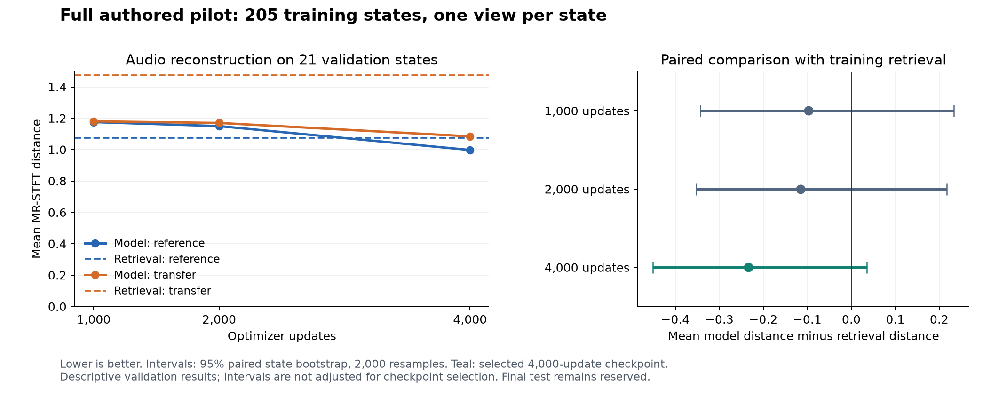

# Full authored-pilot learning curve

Experiment declared and trained: 2026-10-09. Evaluation and recovery completed: 2026-10-10.

The trainer now covers all **205 authored training states**, using one freshly rendered reference view per state and bounded feature replay. The fixed comparison uses all **21 validation states** at 1,000, 2,000 and 4,000 optimizer updates. The 30 final test states remain reserved. This is still the narrow oscillator/filter/envelope pilot, with nine continuous controls and two categorical outputs.

**The 4,000-update checkpoint has the lowest validation error:** 1.0406 versus 1.2746 for training-only retrieval on the primary reference/transfer mean, an 18.4% reduction. It wins on 17 of 21 states. The paired 95% bootstrap interval for its difference from retrieval still includes zero, so this is promising development evidence rather than conclusive superiority or release qualification.

The [declared plan](data/full_pilot_plan.json) fixes the training settings, checkpoints, evaluation population and selection rule. [TRAINER.md](../TRAINER.md#full-authored-split-learning-curve) provides reproduction commands; the [machine-readable report](data/full_pilot_summary.json) records identities, metrics, compute, recovery and artifact checksums.

## Training and compute

The state sampler covers each training state once before repeating, and rotates reference performances on successive epochs. This run used one epoch: 205 accepted views, 205 distinct states and 205 distinct audio buffers, with no logged rejection or render error. Training warmed up on 32 examples, then added one accepted view every four optimizer updates until reaching 205. The remaining updates reused those features. Training and retrieval used no held-out state or transfer performance.

The architecture remains the 355,806-parameter audio-only inverse model with frozen Basic Pitch weights and buffers. Training used CPU float32, four Torch threads, batch size 32 and AdamW at 0.001. The accepted-view limit was 205, the render-attempt budget 256, replay capacity 205 and replay byte limit 16 MiB. The retained feature payload was 7,925,300 bytes, about 7.56 MiB. Audio was rendered during training and discarded after feature extraction.

| Optimizer updates | Active-control normalized MAE | Categorical accuracy | Supervised loss | Fresh views in segment | Segment time |
|---|---:|---:|---:|---:|---:|
| 1,000 | 0.178014 | 93.41% | 0.292219 | 205 | 487.61 s |
| 2,000 | 0.147459 | 99.27% | 0.077305 | 0 | 12.96 s |
| 4,000 | 0.091661 | 100.00% | 0.016208 | 0 | 28.53 s |

These checkpoint metrics use the same 205 retained examples. The initial warmup metrics describe a smaller population and are not used as a fixed-set learning curve. All three segments share the same training contract and retrieval-feature digest. Frozen Basic Pitch weights and buffers remained unchanged.

Total recorded training time was **529.10 seconds**, about **8.82 minutes**. Optimizer work took 55.47 seconds and feature extraction 24.16 seconds. Peak sampled process-tree RSS was 965,414,912 bytes, about 921 MiB; this can count shared pages more than once. No GPU, paid compute, Colab session or WAV training archive was used. Local CPU remains sufficient for this scale; Linux/Colab native rendering remains unqualified.

## Evaluation and recovery

Each validation state contributes one fixed reference performance and one reserved transfer performance. A checkpoint predicts one patch from reference audio; that patch is reused under both performances. Sources and baselines are shared across checkpoints. Retrieval searches the same 205 training feature/target records with fixed branch scaling. The fixed template and source repeat provide additional comparisons.

The primary score is the equal-weight mean of reference and transfer MR-STFT distance per state. It combines spectral convergence and log-magnitude error at FFT sizes 512, 2,048 and 8,192. Lower is better; this is a spectral diagnostic, not a calibrated perceptual score. Selection requires every planned case to be scored in both roles. The lowest validation mean wins; ties choose the earlier checkpoint. Paired state-bootstrap intervals use 2,000 resamples and seed 0 and are descriptive, without correction for selecting among checkpoints.

The evaluation process stopped after 13 complete cases and seven logged renders of the next case. Recovery verified the original plan/checkpoint identities, all 13 completed result files, their render records, and 39 prediction files against the logged native request identities. Those complete cases were preserved. The unfinished case was restarted with all checkpoints so its reference audio remained shared.

All **301 logged render attempts passed QA**, seven more than the original uninterrupted budget of 294. The resumed segment performed 112 renders. Every method/role scored all 21 planned cases, with zero failed or unscorable cases. Both the original plan and the recovery deviation are retained. Completed failures are preserved during resume; only an unfinished case is repeated. Logged native-render wall time summed to 703.71 seconds, about 11.73 minutes. Total evaluation elapsed time cannot be reconstructed exactly across the interruption; the recorded value excludes some lost work and must not be treated as complete wall time.

## Validation results

| Method | Reference distance | Transfer distance | Primary mean |
|---|---:|---:|---:|
| Model, 1,000 updates | 1.1750 | 1.1801 | 1.1775 |
| Model, 2,000 updates | 1.1494 | 1.1696 | 1.1595 |
| **Model, 4,000 updates** | **0.9972** | **1.0840** | **1.0406** |
| Training-only retrieval, 205 examples | 1.0762 | 1.4729 | 1.2746 |
| Fixed pilot template | 2.9275 | 3.2747 | 3.1011 |
| Source repeat, diagnostic floor | 0.0000 | 0.0000 | 0.0000 |

| Checkpoint | Mean paired difference from retrieval | Descriptive 95% interval | State wins |
|---|---:|---|---:|
| 1,000 | -0.0970 | [-0.3432, 0.2335] | 16 / 21 |
| 2,000 | -0.1151 | [-0.3524, 0.2171] | 16 / 21 |
| 4,000 | -0.2339 | [-0.4509, 0.0357] | 17 / 21 |

The selected checkpoint improves the mean spectral score on both reference and transfer audio. It does not improve every diagnostic: reference relative RMS error is 0.3119 versus retrieval's 0.1279. Source repeats happened to be identical for these cases; this is not a general native determinism guarantee. The earlier four-state trainer smoke used a different evaluation population and retrieval memory, so its numbers are not a controlled before/after comparison.

On the 21 validation targets, the selected model's active-control normalized MAE is 0.1882, versus 0.0917 on retained training examples. Filter on/off accuracy is 100%, but unison-voice accuracy is only **61.9% (13/21)**. The largest active-control errors are envelope release (0.3314), filter resonance (0.3276 over ten active cases) and envelope decay (0.2531). These are secondary diagnostics; they were not used to select a different checkpoint.

## Export and next step

The [selected inference bundle](../outputs/full-pilot-validation-20261009/selected-model.pt) is 1,585,110 bytes and loads with the existing audio-only inference path. Its model weights match the selected 4,000-update checkpoint. All **63 predicted presets** across three checkpoints and 21 states pass the codec/schema checks and native evaluation. The bundle SHA-256 is `aecfc85227450a2e55482e044168f755cccf9a6b31feef93d3bc8d0e5b53f558`.

Local ignored artifacts include the [evaluation summary](../outputs/full-pilot-validation-20261009/summary.json), [recovery record](../outputs/full-pilot-validation-20261009/recovery-20261010.json), [4,000-update training checkpoint](../outputs/full-pilot-step4000-20261009/checkpoint.pt), and [example selected prediction](../outputs/full-pilot-validation-20261009/prediction-step_4000-000.vital). No training or evaluation WAV archive was written.

Verification: **132 training/data-generation tests passed**, and Ruff passed. Checks cover full-state sampling, bounded refresh, optimizer recovery, shared-source checkpoint comparisons, fixed retrieval identity, incomplete-case denominators, evaluation recovery and preservation of completed failures. The selected export's weights and all checkpoint-file hashes were verified after evaluation.

The planned next step was completed in the [controlled two-view experiment](TWO_VIEW_RESULTS.md) on 2026-10-11. It trains the same narrow vocabulary across two reference performances per state, keeps the validation population and retrieval comparator fixed, and reports unison, envelope and relative-RMS diagnostics. That report records the newly selected development checkpoint and the next optimization check. The broad final model and Linux/Colab renderer qualification remain future work.
