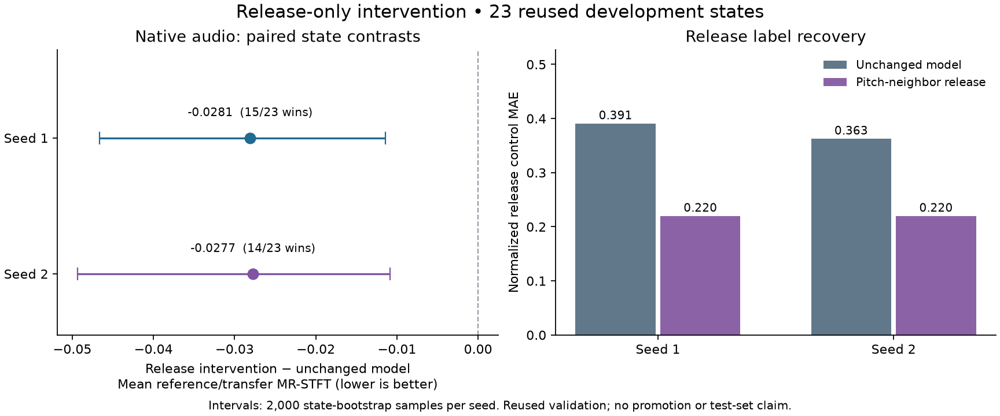

# Unison/release diagnostic and native intervention

Completed 2026-10-15 (Asia/Kuala_Lumpur). The release-only intervention improved mean native audio at both replication seeds. This supports a focused release-head experiment; it does not establish a finished model or justify promoting a retrieval override. The current seed-0 selected bundle remains byte-identical, and all 64 final-test states remain reserved.

## What the existing artifacts show

The [artifact analysis](data/unison_release_diagnostics.json) checks frozen checkpoint, replay, evaluation-case and prediction identities before comparing labels. All matched 205/404-state models fit training unison labels perfectly. Expanded training counts for 1/2/4 voices are 132/145/127. These observations do not support an ordinary class-imbalance or unfitted-classifier explanation.

Release shows a large training-to-validation gap. Errors below are normalized stored-control MAE, **not seconds**. The median baseline uses the corresponding training population only.

| Learning seed | Training states | Training release MAE | Original 21-state MAE | Later 23-state MAE | Training-median MAE on 23 |
|---|---:|---:|---:|---:|---:|
| 1 | 205 | 0.0613 | 0.3348 | 0.3479 | 0.2500 |
| 1 | 404 | 0.0430 | 0.3153 | 0.3907 | 0.2500 |
| 2 | 205 | 0.0186 | 0.3933 | 0.3354 | 0.2500 |
| 2 | 404 | 0.0451 | 0.3479 | 0.3625 | 0.2500 |

The expanded models' release prediction/target correlations on the 23-state panel are -0.2626 and -0.1907. Meanwhile, 2/4 and 3/5 newly incorrect unison cases still improve audio distance at seeds 1 and 2. Release-error change and audio-distance change correlate only 0.1410 and 0.1324. These are descriptive relationships, not evidence that the loss weights or any one branch caused the regressions.

## Frozen train-only feature probe

The [probe plan](data/cached_head_probe_plan.json) fixes one-neighbor retrieval with timbre, pitch and combined distances. Each query excludes its entire state; the 205- and 404-record replays each contain one view per training state. Float64 mean-square distance is computed per branch, and the combined arm adds the two branch means. First retained index breaks ties. Per-query majority/median controls also exclude the query state. No validation or test input, fitting, optimizer update or native render is used.

| Training states | Fixed method | Unison accuracy | Release MAE |
|---:|---|---:|---:|
| 205 | LOO majority / median | 0.4000 | 0.2447 |
| 205 | timbre | 0.5902 | 0.3066 |
| 205 | pitch | 0.6585 | 0.2253 |
| 205 | combined | 0.6195 | 0.3062 |
| 404 | LOO majority / median | 0.3589 | 0.2420 |
| 404 | timbre | 0.6287 | 0.3193 |
| 404 | pitch | 0.6906 | 0.1821 |
| 404 | combined | 0.6683 | 0.2838 |

[Full neighbor identities and results](data/cached_head_probe_summary.json) show useful release information in the pitch representation under this retrieval rule. This is a retrieval diagnostic, not a neural branch ablation. It does not justify dropping timbre features or reweighting labels by itself.

## Native release-only intervention

The [frozen native plan](data/release_intervention_plan.json), SHA-256 `41d91fdc018b8853bc41e4769464fc59165a8335584da9d6da2f52f60a50af6c`, was written before the first intervention render. It pins the runner and runtime source, original validation plan, checkpoints, replay/front-end identities, cases, performance pairs, input evidence and analysis rules.

For each expanded learning-seed-1/2 checkpoint, predict the original patch from reference audio, then replace only `env_1_release` with the release target of the nearest **training** pitch-feature record. Validation targets are used only to score the result. Every other preset field is checked for exact equality. The same patch is rendered under reference and transfer performances; MIDI stays in the evaluator.

The 23 cases are now **reused development validation**, not another fresh panel. Both unchanged models and interventions are rerendered alongside common sources and source repeats. The primary metric is the equal-weight mean of reference and transfer stereo MR-STFT per state. Lower is better. No model is fitted or exported.

| Learning seed | Unchanged model | Release override | Override minus model | Descriptive 95% state interval | Override wins |
|---|---:|---:|---:|---|---:|
| 1 | 0.9418 | 0.9137 | -0.0281 | [-0.0466, -0.0114] | 15/23 |
| 2 | 0.8779 | 0.8502 | -0.0277 | [-0.0494, -0.0108] | 14/23 |



The percentile intervals use 2,000 paired state-bootstrap resamples with seed 0. They describe within-seed variability on reused validation; they do not measure learning-seed uncertainty or establish confirmatory significance. Two learning seeds and 23 narrow authored states cannot establish general superiority. MR-STFT is a spectral diagnostic, not a calibrated perceptual score.

A native training-median release control was not rendered in this experiment. Any improvement therefore does not establish that pitch-conditioned lookup beats a simpler constant-release correction. Unison remains unchanged by design, so its generalization gap is still open.

| Seed | Method | Release MAE | Unison accuracy | Reference relative RMS error | Transfer relative RMS error |
|---|---|---:|---:|---:|---:|
| 1 | unchanged | 0.3907 | 0.8261 | 0.2816 | 0.2556 |
| 1 | release override | 0.2198 | 0.8261 | 0.2810 | 0.2563 |
| 2 | unchanged | 0.3625 | 0.7826 | 0.2289 | 0.2563 |
| 2 | release override | 0.2198 | 0.7826 | 0.2255 | 0.2558 |

## Integrity, compute and recovery

- All 23 planned cases, 276/276 native renders and 92/92 predicted presets passed. Every method has 23/23 reference and transfer scores; there are no failed/unscorable cases.
- All 46 baseline predictions reproduce the earlier preset bytes. All 46 source audio hashes and 92/92 baseline audio hashes match the earlier run. These are observations for these renders, not a universal bit-determinism promise.
- All 46 intervention/baseline pairs differ only in release. Source-repeat MR-STFT is zero in both roles. Checkpoints, frozen source/evidence and the retained selected model pass their hash checks.
- The native experiment took **18.72 recorded CPU minutes**, including setup and input verification; render-worker wall time summed to 17.76 minutes. The existing-artifact diagnostic took 88.11 seconds, and the cached-feature probe 7.02 seconds. These are local elapsed measurements, not isolated throughput benchmarks; local recovery tests overlapped part of the native run.
- Python 3.12.13, Torch 2.12.1+xpu used on **CPU**, four Torch threads, float32 frontend/model and float64 neighbor distances; one native worker, 30-second timeout, no retries. No new training features, optimizer updates, audio archive, paid compute or GPU allocation. Colab is unnecessary for this increment; Linux rendering still needs separate qualification.
- The plan allows 276 uninterrupted attempts and at most 12 extra attempts for recovery. None were needed. `--resume` verifies committed case/prediction/render hashes, reuses complete cases and rerenders the entire unfinished case. It stops at the total cap rather than silently extending the budget.

[Compact native results](data/release_intervention_summary.json) retain paired statistics, every case's neighbor and scores, denominators, input/output hashes and integrity counts. Full case JSON, preset bytes and native logs remain under ignored `research/training/outputs/release-intervention-20261015/`; audio is discarded.

## Reproduce and next decision

With the existing pinned local outputs available under `ARTIFACT_ROOT` and the documented native dependencies installed, run from the code checkout:

```sh
python research/training/release_probe.py \
  --plan research/training/reports/data/release_intervention_plan.json \
  --artifact-root ARTIFACT_ROOT \
  --output ARTIFACT_ROOT/research/training/outputs/release-intervention-reproduction
```

The output must be new, or use `--resume` for an interrupted output with the identical plan. Artifacts are intentionally local and are not downloaded by this runner. The exact earlier analysis scripts are [archived with their original layout instructions](scripts/README.md). Existing frozen plans and results remain unchanged.

Local verification: seven new focused tests cover held-out retrieval exclusion, duplicate-state rejection, branch selection/ties and preservation of other controls; three existing tests cover checked recovery and complete paired-statistic denominators. Ruff and Git whitespace checks pass. GitHub Actions remains disabled at the owner's request.

The next bounded training experiment should compare a regularized release predictor using the existing pitch features with the unchanged neural head and a training-median control. Select complexity and stopping rules using training-state folds, then freeze the native comparison before rendering. Keep other heads fixed, address unison generalization separately, and keep the final test split closed. No broader pool expansion or automatic model promotion follows from this diagnostic.
