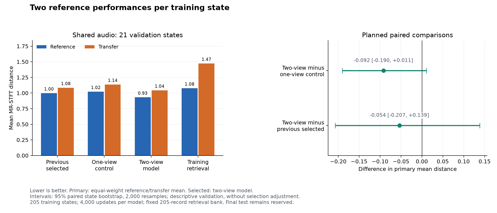

# Controlled two-performance training

Experiment declared 2026-10-10; training and evaluation completed 2026-10-11.

This experiment tests two reference performances per training state within the same narrow oscillator/filter/envelope vocabulary. It uses 205 training states, 21 validation states, nine continuous controls and two categorical outputs. The 30 final test states remain reserved. The [declared plan](data/two_view_plan.json) fixes the two training arms, previous selected checkpoint, evaluation population, retrieval source and selection rule before comparison.

**The two-view model has the lowest observed primary validation error:** 0.9870, versus 1.0786 for the matched single-view control and 1.0406 for the previous selected model. These are reductions of 8.5% and 5.2%, respectively. The reduction versus the fixed training-retrieval baseline is 22.6%. This supports selecting the two-view checkpoint for development within the pilot; the paired uncertainty and remaining parameter gaps are reported below.

[TRAINER.md](../TRAINER.md#reusing-features-for-a-controlled-two-performance-run) gives reproduction commands. The [machine-readable report](data/two_view_summary.json) records configurations, coverage, metrics, source hashes and artifact checksums. The [previous full-pilot report](FULL_PILOT_RESULTS.md) preserves the earlier learning curve.

## Controlled training design

Both new arms start with the exact 205 feature records retained by the previous selected checkpoint. Feature reuse resets model weights, optimizer state, RNG state and use counts. Both arms have identical initial metrics, model architecture and frozen Basic Pitch weights. Their training configurations differ only in accepted-example target:

- The single-view control trains from the 205 cached views and performs no new synthesis.
- The two-view arm adds 205 native renders during optimization, one every four updates. Each of the 205 training states ends with two distinct reference performances.

All 410 two-view records are distinct audio buffers, use training states and reference performances, and follow the complete recipe prefix. The first 205 feature tensors, targets, recipe IDs and audio hashes are unchanged from the seed. Coverage across the four reference performances is 103, 103, 102 and 102 views. No transfer performance or held-out state enters training.

The control is necessary because having all first views available before the first update differs from the original full-pilot run's gradual warmup. The previous selected checkpoint is evaluated as a third candidate. Both new models start from fresh weights; neither fine-tunes the previous model. Clips use the existing independent supervised loss; no paired consistency objective is added. The two-view treatment changes both performance coverage and draws per retained view under the same total update budget, so this experiment does not establish the effect at a larger optimization budget.

Both arms use 4,000 CPU float32 updates, seed 0, four Torch threads, batch size 32, AdamW at 0.001 and the unchanged 355,806-parameter model. Replay capacity is 410 examples with a 32 MiB limit. The accepted targets are 205 and 410; the recipe budget of 480 includes the 205 cached recipes. New-run summaries distinguish cached features from native attempts.

| Training arm | Retained views | New accepted renders | Active-control MAE | Categorical accuracy | Supervised loss | Recorded time |
|---|---:|---:|---:|---:|---:|---:|
| Single-view control | 205 | 0 | 0.075339 | 100% | 0.010994 | 37.44 s |
| Two-view | 410 | 205 | 0.128182 | 100% | 0.040617 | 619.82 s |

Training metrics describe different retained populations and should not be read as a fixed-set learning curve. The two-view run's initial metrics cover only its 205 cached views. The full retained feature payload is 15,850,600 bytes, about 15.12 MiB. Total recorded time for both new training arms is 657.26 seconds, about 10.95 minutes. The two-view run spends 62.83 seconds on optimizer work, 28.25 seconds on new features and 56.09 seconds on checkpoint saves and verification; these components overlap with native production and are not additive bottleneck estimates. Peak sampled process-tree RSS is 964,177,920 bytes, about 920 MiB, and can count shared pages more than once. These are observed development timings with some concurrent regression checks, not isolated performance benchmarks.

Audio is rendered in memory during training and discarded after feature extraction. All 205 new training renders passed QA with no rejection or error. No GPU, paid compute, Colab session or WAV training archive was used. Local CPU remains sufficient for this increment; Linux/Colab native rendering remains unqualified.

## Shared validation and selection

The named comparison uses the same validation state/reference/transfer recipes as the previous full-pilot experiment. Within each case, all candidates share source buffers and baseline renders. Each candidate predicts one patch from reference audio, then uses that patch for reference and reserved transfer performances. The explicit retrieval checkpoint pins the original 205 training records for every candidate, even though the two-view candidate has 410 training records.

The primary score is the equal-weight mean of reference and transfer MR-STFT distance per state. Lower is better. This combines spectral convergence and log-magnitude error at FFT sizes 512, 2,048 and 8,192; it is a spectral diagnostic, not a calibrated perceptual score. Selection requires all 21 states to be scorable in both roles. Lowest mean wins, with declared input order breaking ties.

The planned pairwise comparisons are two-view minus single-view control, two-view minus previous selected, and each candidate minus retrieval. Intervals use a paired state bootstrap, 2,000 resamples and seed 0. They are descriptive validation intervals, without adjustment for candidate selection or repeated development on the same validation set. This single-seed, small-state experiment cannot qualify a release.

All **294 planned evaluation renders passed QA**, scoring all 21 states in both roles for every method. No retry or recovery was required. Recorded evaluation time is 718.05 seconds, about 11.97 minutes; summed native-render wall time is 706.97 seconds. Both new training runs and this evaluation total 22.92 recorded minutes, excluding setup and artifact verification. Training plus evaluation required 499 new native renders.

## Validation results

| Method | Reference distance | Transfer distance | Primary mean |
|---|---:|---:|---:|
| Previous selected | 0.9972 | 1.0840 | 1.0406 |
| Single-view control | 1.0214 | 1.1359 | 1.0786 |
| **Two-view model** | **0.9307** | **1.0432** | **0.9870** |
| Training-only retrieval, 205 records | 1.0762 | 1.4729 | 1.2746 |
| Fixed pilot template | 2.9275 | 3.2747 | 3.1011 |
| Source repeat, diagnostic floor | 0.0000 | 0.0000 | 0.0000 |

| Planned comparison | Mean paired difference | Descriptive 95% interval | Candidate state wins |
|---|---:|---|---:|
| Two-view minus single-view control | -0.0917 | [-0.1899, 0.0111] | 15 / 21 |
| Two-view minus previous selected | -0.0537 | [-0.2069, 0.1386] | 13 / 21 |
| Two-view minus retrieval | -0.2876 | [-0.4916, -0.0526] | 17 / 21 |
| Single-view control minus retrieval | -0.1959 | [-0.4034, 0.0456] | 14 / 21 |
| Previous selected minus retrieval | -0.2339 | [-0.4509, 0.0357] | 17 / 21 |

The two-view model improves the mean spectral score on both performance roles, but its intervals against both model comparators include zero. Its interval against retrieval excludes zero in this descriptive analysis. The observed reduction justifies the declared development selection; it does not prove that adding a second view will consistently improve a new seed, a broader state population or final-test performance.

The previous selected model reproduces its earlier per-state reference and transfer scores exactly in this rerun. Source repeats also match their sources for these cases. These observations are useful checks on this experiment, not a general native determinism guarantee.

## Unison, envelopes and level diagnostics

Continuous MAE uses normalized stored control values and excludes controls inactive in the source target. It is secondary to rendered reconstruction: equivalent audio can have different parameters. Relative RMS measures signal-level error, not calibrated perceived loudness.

| Diagnostic | Previous selected | Single-view control | Two-view |
|---|---:|---:|---:|
| Active-control MAE | 0.1882 | 0.2110 | 0.1938 |
| Unison-voice accuracy | 61.9% (13/21) | 71.4% (15/21) | 81.0% (17/21) |
| Filter on/off accuracy | 100% | 100% | 100% |
| Envelope attack MAE | 0.1766 | 0.1922 | 0.1682 |
| Envelope decay MAE | 0.2531 | 0.3339 | 0.2315 |
| Envelope sustain MAE | 0.1517 | 0.1778 | 0.2041 |
| Envelope release MAE | 0.3314 | 0.2952 | 0.3325 |
| Reference relative RMS error | 0.3119 | 0.3256 | 0.2867 |
| Transfer relative RMS error | 0.2533 | 0.2762 | 0.2632 |

Unison, attack and decay improve against both model comparators. Sustain and release do not. Overall active-control error improves against the matched control but remains slightly worse than the previous selected model. The two-view model improves detune MAE to 0.1171 over 13 active states and resonance MAE to 0.2919 over ten active states; oscillator-level MAE worsens to 0.1839. Full per-control results remain in the machine-readable report.

Reference relative RMS improves versus both models but remains above retrieval's 0.1279. Transfer RMS improves versus the matched control but is slightly worse than the previous model. The two-view run therefore does not close the envelope and level gaps, despite its better primary spectral score and unison accuracy.

## Export, verification and next step

The [selected inference bundle](../outputs/two-view-validation-20261010/selected-model.pt) is 1,585,110 bytes and loads with the existing audio-only inference path. Its weights match the two-view checkpoint exactly. Bundle SHA-256: `b9e374b150c07409097ea2dde0283679d48279815828be60e597d3ed132fc77d`. All **63 predicted presets** across the three candidates pass codec/schema checks and native evaluation.

The local artifacts include the [two-view training checkpoint](../outputs/two-view-train-20261010/checkpoint.pt), [matched-control checkpoint](../outputs/two-view-control-20261010/checkpoint.pt), [complete evaluation summary](../outputs/two-view-validation-20261010/summary.json), [pinned evaluation plan](../outputs/two-view-validation-20261010/plan.json) and [example selected prediction](../outputs/two-view-validation-20261010/prediction-two_view-000.vital). These generated outputs remain Git-ignored. No training or evaluation WAV archive was written.

Verification: **137 training/data-generation tests passed**, Ruff passed, and the chart was visually checked. Tests cover feature-only seeding, reset learning state, rejected incomplete feature prefixes, frozen-frontend compatibility, exact retained-feature recovery after new ingestion, named comparison with fixed external retrieval, and checked evaluation resume. Artifact checks additionally verify all 205 states have two distinct reference views, unchanged initial feature records, identical initial metrics, fixed retrieval/validation identities, checkpoint checksums and the selected export's weights.

The subsequent [cached-feature learning curve](CACHED_CURVE_RESULTS.md), finalized 2026-10-13, completes the planned 4,000/8,000/16,000-update comparison using the 410-feature arm and matched 205-feature control. It retains this selected model: longer optimization improves both cached arms, but neither beats its primary validation score. No new training synthesis was required. The next experiment should test more distinct authored training states within the existing vocabulary, with verified pool expansion and fixed evaluation/retrieval cases. The broad final model, final-test evaluation and Linux/Colab renderer qualification remain open.
