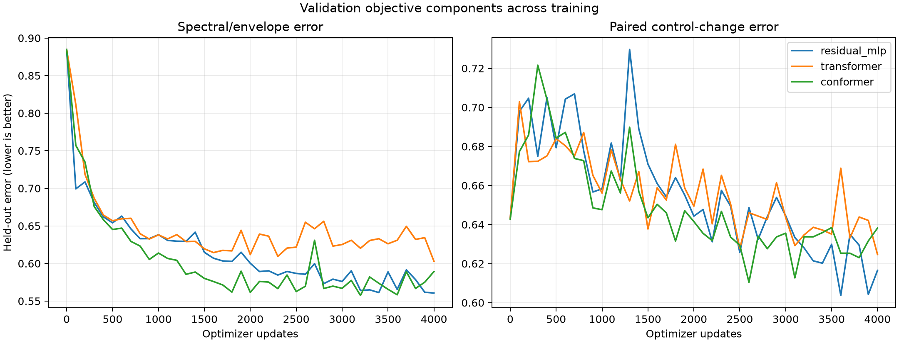

# Vital surrogate model selection

The **residual_mlp** had the lowest final held-out proxy loss; **conformer** had the lowest mean inverse error, but paired uncertainty does not establish a clear winner. This compares residual MLP, Transformer, and Conformer for forward audio prediction and direct patch recovery.

Lower held-out proxy loss means more accurate predicted stereo spectra/envelopes. Lower real-Vital MR-STFT means the synthesized audio is closer to the target.

## Primary results

| Model | Held-out proxy loss ↓ | Direct inverse MR-STFT ↓ | 95% crossed-cluster CI | Default start MR-STFT ↓ | Reduction vs default ↑ | Cases |
|---|---:|---:|---:|---:|---:|---:|
| residual_mlp | 0.7148 | 1.7080 | [1.5288, 1.9020] | 10.0038 | +8.2958 | 192/192 |
| transformer | 0.7592 | 1.8440 | [1.6310, 2.1477] | 10.0038 | +8.1598 | 192/192 |
| conformer | 0.7487 | 1.6573 | [1.4969, 1.8238] | 10.0038 | +8.3465 | 192/192 |

The direct inverse panel contains **96 fresh patch roots × 2 MIDI performances** = 192 planned cases, using 24 distinct performances (8 cases per performance). The independent proxy validation set contains **64 different roots × 2 performances** = 128 accepted paired targets (16 distinct performances; 256 accepted rendered clips). Both sets use exact known MIDI; all final-panel performances are new to training. The 417 pool test roots remain untouched.

The inverse starts from the same default patch for every model. It scores the same deterministic shortlist of 24 legal categorical combinations from target audio, keeps the best 6, then performs the same bounded continuous Adam search for each. Target category labels are not given to the optimizer.

### Validation loss curves

Each point shows a 100-update moving average of training loss and full-set held-out validation loss. The validation objective is spectral/envelope error plus 0.25 × paired control-change error, measured on the same 128 held-out patch/MIDI pairs at each checkpoint.

Lowest final proxy loss: **residual_mlp**. Lowest mean native inverse MR-STFT: **conformer**. These answer different questions; if they differ, a single winner is not established.

### Matched inverse-synthesis comparisons

| Paired contrast (first model minus second; lower is better) | Mean MR-STFT difference | 95% crossed-cluster interval |
|---|---:|---:|
| residual_mlp vs transformer | -0.1359 | [-0.4385, +0.1073] |
| residual_mlp vs conformer | +0.0507 | [-0.0923, +0.2067] |
| transformer vs conformer | +0.1867 | [-0.0087, +0.4701] |

Intervals use 10,000 crossed-cluster bootstrap draws: patch roots are resampled independently, and MIDI performances are resampled within style. A negative contrast favors the first model. They describe uncertainty across the sampled patches and performances, not new renderer versions or every hand-authored Vital preset.

## What this establishes

This is a direct model-selection test under one end-to-end inverse-synthesis policy, conditional on accurate MIDI. It measures which proxy leads to lower real-Vital audio error after discrete category selection and continuous refinement. The held-out curves separately measure forward audio prediction during training. Neither result evaluates MIDI transcription errors or performance on an independently authored preset population.

The expanded codec covers 21 Vital controls: 13 normalized continuous controls and 8 categorical controls. The model receives 33 conditioning slots and predicts audio features; it has no control-logit head. The inverse system selects categorical values by evaluating legal combinations and uses gradients only for continuous controls.

## Expanded Vital control scope

### residual_mlp control scope

| Control family | Changeable / total | Surrogate input slots |
|---|---:|---:|
| Global, voice and performance controls ❌ | 0 / 28 | 0 |
| Chorus, compression, delay, distortion, EQ, FX filter, flanger and phaser ❌ | 0 / 99 | 0 |
| Envelopes ✅ | 4 / 54 | 4 |
| Main filters ✅ | 4 / 32 | 6 |
| LFOs and random sources ❌ | 0 / 136 | 0 |
| Modulation routing and maps ❌ | 0 / 512 | 0 |
| Oscillator phase, warp, frame and routing controls ❌ | 0 / 69 | 0 |
| Oscillator pitch, level, pan, enable and unison ✅ | 8 / 21 | 12 |
| Reverb ✅ | 3 / 13 | 3 |
| Sampler and sample assets ❌ | 0 / 12 | 0 |
| Oscillator waveform assets ✅ | 2 / 3 | 8 |
| **Total** | **21 / 979** | **33** |

### transformer control scope

| Control family | Changeable / total | Surrogate input slots |
|---|---:|---:|
| Global, voice and performance controls ❌ | 0 / 28 | 0 |
| Chorus, compression, delay, distortion, EQ, FX filter, flanger and phaser ❌ | 0 / 99 | 0 |
| Envelopes ✅ | 4 / 54 | 4 |
| Main filters ✅ | 4 / 32 | 6 |
| LFOs and random sources ❌ | 0 / 136 | 0 |
| Modulation routing and maps ❌ | 0 / 512 | 0 |
| Oscillator phase, warp, frame and routing controls ❌ | 0 / 69 | 0 |
| Oscillator pitch, level, pan, enable and unison ✅ | 8 / 21 | 12 |
| Reverb ✅ | 3 / 13 | 3 |
| Sampler and sample assets ❌ | 0 / 12 | 0 |
| Oscillator waveform assets ✅ | 2 / 3 | 8 |
| **Total** | **21 / 979** | **33** |

### conformer control scope

| Control family | Changeable / total | Surrogate input slots |
|---|---:|---:|
| Global, voice and performance controls ❌ | 0 / 28 | 0 |
| Chorus, compression, delay, distortion, EQ, FX filter, flanger and phaser ❌ | 0 / 99 | 0 |
| Envelopes ✅ | 4 / 54 | 4 |
| Main filters ✅ | 4 / 32 | 6 |
| LFOs and random sources ❌ | 0 / 136 | 0 |
| Modulation routing and maps ❌ | 0 / 512 | 0 |
| Oscillator phase, warp, frame and routing controls ❌ | 0 / 69 | 0 |
| Oscillator pitch, level, pan, enable and unison ✅ | 8 / 21 | 12 |
| Reverb ✅ | 3 / 13 | 3 |
| Sampler and sample assets ❌ | 0 / 12 | 0 |
| Oscillator waveform assets ✅ | 2 / 3 | 8 |
| **Total** | **21 / 979** | **33** |

[Exact per-control inventory](data/issue173_surrogate_model_selection_controls.jsonl.gz)

## Execution and reproducibility

All three models were initialized from scratch with seed 174 and trained for 4,000 updates on the same 512 expanded-codec roots. Training reused the accepted cached Vital pairs: 1,024 basic and 1,022 expanded. Validation required 256 fresh native renders; the inverse panel required up to 576 optimized-patch renders plus 576 shared target, repeat, and default-start renders. The native renderer used DawDreamer 0.8.3 and Vital 1.6.4; exact package and plugin fingerprints are in the runtime manifest. The runtime validator used Vita 0.1.0 from the official PyPI CPython 3.12 Windows wheel because this checkout lacked the C++ toolchain needed to build the Git-pinned source.

[Loss-curve data](data/issue173_surrogate_validation_loss.csv.gz) · [Runtime environment and renderer provenance](data/issue173_surrogate_model_selection_runtime.json) · [Per-case inverse measurements](data/issue173_surrogate_model_selection_cases.csv.gz) · [Aggregate metrics](data/issue173_surrogate_model_selection_summary.json) · [Frozen plan and data provenance](data/issue173_surrogate_model_selection_plan.json.gz)

No architecture is separated by the paired intervals. Next, repeat the MLP and Conformer comparison on another seed with fresh patches and performances, then evaluate with transcribed MIDI.
