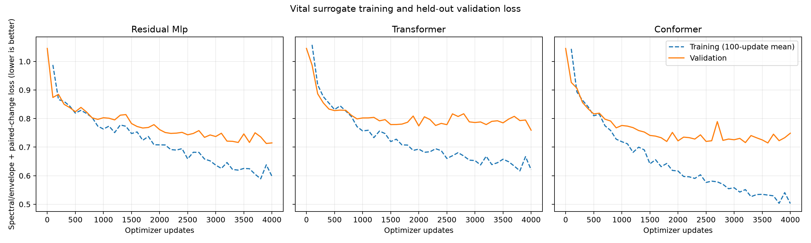

# Comparing neural surrogates for Vital patch optimization

## 1. Objective

We want to find out whether a neural network can approximate Vital accurately enough to use gradient descent to find synthesizer settings that reproduce a target sound.

Three architectures are compared: residual MLP, Transformer and Conformer. Each model learns to predict the stereo spectral and envelope features that Vital would produce given a set of synthesizer settings and a MIDI performance. This is a forward model (patch + MIDI → audio features), also called a surrogate. It is not a model that directly predicts a patch from audio.

There are two separate questions:

- **Audio prediction:** How accurately can the model predict what Vital will sound like?
- **Patch reconstruction:** Can we use the model to find settings that reproduce a target sound when rendered through actual Vital?

Accurate audio predictions do not necessarily mean that the model correctly predicts how the sound will change when a parameter is adjusted. We therefore evaluate the two capabilities separately.

## 2. Summary of results

| Architecture | Audio prediction loss ↓ | Actual Vital reconstruction error (MR-STFT) ↓ |
| --- | ---: | ---: |
| Residual MLP | **0.7148** | 1.7080 |
| Transformer | 0.7592 | 1.8440 |
| Conformer | 0.7487 | **1.6573** |

The default patch has a mean reconstruction error of **10.0038**. All three models reduce that error to between 1.66 and 1.84 after patch optimization.

The residual MLP has the lowest audio prediction loss, while the Conformer produces the closest spectral match to the target sound on average. However, the uncertainty in the pairwise reconstruction comparisons is too large to establish an architectural winner.

These results concern standalone neural surrogates, not the frozen-encoder audio-to-patch models in [#174](https://github.com/noisedoctrine/obruxo/issues/174).

## 3. Experimental setup

All three models were trained from scratch with the same training data, random seed and number of updates.

| Configuration | Value |
| --- | ---: |
| Training patch roots | 512 |
| Training updates per model | 4,000 |
| Training seeds | 1 (seed 174) |
| Adjustable Vital controls | 21 |
| Numerical inputs representing those controls | 33 |
| Audio prediction validation patch roots | 64 |
| Audio prediction validation patch/MIDI pairs | 128 |
| Distinct validation MIDI performances | 16 |
| Patch reconstruction evaluation patch roots | 96 |
| Patch reconstruction evaluation cases | 192 |
| Distinct reconstruction MIDI performances | 24 |

A patch root is an independently generated base patch in the experiment's authored patch pool. Training uses original and perturbed versions of patches so the models can also learn how changing controls affects the sound.

For audio prediction validation, each of the 64 held-out roots is used with two performances, with an original and perturbed render for each pair (256 clips). For reconstruction evaluation, a separate set of 96 fresh roots is used with two performances each. The 24 reconstruction performances are all new to training, with eight cases per performance. Both evaluations use exact known MIDI. The 417 reserved test roots remain untouched.

### Supported synthesizer parameters

All three architectures support exactly the same subset of Vital.

| Parameter group | Adjustable controls | Numerical input slots |
| --- | ---: | ---: |
| Oscillator settings (pitch, level, pan, enable and unison family) | 8 | 12 |
| Oscillator waveform selection | 2 | 8 |
| Main filters | 4 | 6 |
| Envelopes | 4 | 4 |
| Reverb | 3 | 3 |
| **Total** | **21** | **33** |

Of the 21 controls, 13 are normalized continuous values and eight are categorical choices. The forward model takes the encoded settings as input and predicts audio features; it does not have a parameter prediction head.

LFOs, modulation routing, other effects, advanced oscillator controls and sampling are outside the supported scope. The full control inventory is in the appendix.

## 4. How patch reconstruction works

For each target recording, we try to recreate its sound without giving the optimizer the original synthesizer settings. We do know the MIDI performance that produced the recording. This isolates patch reconstruction from the separate problem of transcribing the music.

The procedure is identical for all three models:

1. Start from the same default patch and measure its error against the target.
2. Use the trained surrogate to score a fixed shortlist of 24 legal combinations of categorical settings, such as oscillator waveforms. The original category labels are not given to the optimizer.
3. Keep the six combinations with the lowest predicted error.
4. For each retained combination, optimize the continuous settings with the same bounded Adam gradient-descent search, minimizing the surrogate's predicted audio error against the target.
5. Render the resulting patch through actual Vital and measure its audio error against the target recording.

For example, if a target sound has a darker tone than the current patch, a useful surrogate should predict how changing the filter cutoff will affect its spectrum. The optimizer can then use that gradient to adjust the cutoff. The final render through Vital determines whether the adjustment actually improved the match.

**The final reconstruction error is measured using real Vital audio, not the surrogate's predictions.**

## 5. Audio prediction accuracy

The validation loss measures how closely the models predict Vital's stereo spectral and envelope features, with an additional term measuring whether they predict the effect of changing synthesizer settings.

| Architecture | Final validation loss ↓ |
| --- | ---: |
| **Residual MLP** | **0.7148** |
| Conformer | 0.7487 |
| Transformer | 0.7592 |

Training loss is shown as a 100-update moving average. Validation loss is evaluated on the same complete set of 128 held-out patch/MIDI pairs at every validation checkpoint.

The validation objective is spectral/envelope prediction error plus 0.25 times the error in predicting the audio feature changes between paired original and perturbed patches. The second plot separates these components.

The residual MLP achieves the lowest final validation loss in this run. Neither the Transformer nor the Conformer demonstrates a lower final loss.

## 6. Patch reconstruction accuracy

We evaluate all three models on the same 192 target recordings. The metric is multi-resolution short-time Fourier transform loss (MR-STFT), which measures spectral differences at several time-frequency resolutions. Lower values indicate a closer spectral match; the metric is not a listening-test score.

| Architecture | Mean reconstruction error ↓ | 95% confidence interval | Error reduction from default ↑ | Cases completed |
| --- | ---: | ---: | ---: | ---: |
| **Conformer** | **1.6573** | [1.4969, 1.8238] | 8.3465 | 192/192 |
| Residual MLP | 1.7080 | [1.5288, 1.9020] | 8.2958 | 192/192 |
| Transformer | 1.8440 | [1.6310, 2.1477] | 8.1598 | 192/192 |
| Default patch | 10.0038 | — | — | — |

The Conformer produces the lowest mean error, despite the residual MLP being more accurate at forward audio prediction.

### Are the differences meaningful?

Since the models reconstruct the same target recordings, we can compare their errors directly for each recording rather than treating their results as independent samples.

| Comparison (first minus second) | Mean error difference | 95% confidence interval |
| --- | ---: | ---: |
| Conformer − MLP | −0.0507 | [−0.2067, +0.0923] |
| Conformer − Transformer | −0.1867 | [−0.4701, +0.0087] |
| MLP − Transformer | −0.1359 | [−0.4385, +0.1073] |

Negative values favour the first model. Every interval includes zero, meaning the observed differences do not establish that any architecture is better than another. The uncertainty accounts for both patch and MIDI variation; see the appendix for the calculation. It does not capture variation between training seeds.

## 7. Conclusions

All three surrogates support a patch optimization procedure that substantially reduces spectral reconstruction error relative to the default patch. The residual MLP has the lowest forward prediction loss, while the Conformer has the lowest average reconstruction error. There is no statistically established architectural winner.

There are several limitations:

- Only one training seed was evaluated.
- Reconstruction assumes the correct MIDI is already known. The effect of using transcribed MIDI is untested.
- The held-out patches come from the authored experiment pool; generalization to a separately authored Vital preset population has not been established.
- MR-STFT is a spectral similarity measure, not a direct measure of perceived timbre similarity.
- The improvement over the default patch establishes the benefit of the complete categorical search and continuous optimization procedure. This comparison does not isolate how much of that improvement is due to gradient descent rather than an equivalent search without gradients.

If standalone surrogate research is resumed, the residual MLP and Conformer are reasonable candidates for another matched run with a different seed, fresh patches and performances, followed by an evaluation using transcribed MIDI. These results do not require that experiment to be run now and do not replace the frozen-encoder comparison in #174.

## Technical appendix

### Uncertainty calculation

The 95% intervals use 10,000 crossed-cluster bootstrap draws. Patch roots are resampled independently, and MIDI performances are resampled within style. The pairwise intervals use matched reconstruction errors on the same cases. They describe uncertainty over the sampled patch and performance populations, conditional on the trained checkpoints and renderer.

### Full Vital control inventory

This table applies to all three architectures. The denominator is the number of controls or asset entries in each family in the recorded inventory, not the number of independent learned output parameters.

| Control family | Changeable / total | Surrogate input slots |
| --- | ---: | ---: |
| Global, voice and performance controls | 0 / 28 | 0 |
| Chorus, compression, delay, distortion, EQ, FX filter, flanger and phaser | 0 / 99 | 0 |
| Envelopes | 4 / 54 | 4 |
| Main filters | 4 / 32 | 6 |
| LFOs and random sources | 0 / 136 | 0 |
| Modulation routing and maps | 0 / 512 | 0 |
| Oscillator phase, warp, frame and routing controls | 0 / 69 | 0 |
| Oscillator pitch, level, pan, enable and unison | 8 / 21 | 12 |
| Reverb | 3 / 13 | 3 |
| Sampler and sample assets | 0 / 12 | 0 |
| Oscillator waveform assets | 2 / 3 | 8 |
| **Total** | **21 / 979** | **33** |

[Exact per-control inventory](data/issue173_surrogate_model_selection_controls.jsonl.gz)

### Execution and reproducibility

All three models were initialized from scratch with seed 174 and trained for 4,000 updates on the same 512 expanded-codec roots. Training reused the accepted cached Vital pairs: 1,024 basic and 1,022 expanded. Validation required 256 fresh native renders; reconstruction evaluation required up to 576 optimized-patch renders plus 576 shared target, repeat and default-start renders.

The renderer used DawDreamer 0.8.3 and Vital 1.6.4. Exact package and plugin fingerprints are in the runtime manifest. The runtime validator used Vita 0.1.0 from the official PyPI CPython 3.12 Windows wheel because the checkout lacked the C++ toolchain needed to build the Git-pinned source.

[Loss-curve data](data/issue173_surrogate_validation_loss.csv.gz) · [Runtime environment and renderer provenance](data/issue173_surrogate_model_selection_runtime.json) · [Per-case reconstruction measurements](data/issue173_surrogate_model_selection_cases.csv.gz) · [Aggregate metrics](data/issue173_surrogate_model_selection_summary.json) · [Frozen plan and data provenance](data/issue173_surrogate_model_selection_plan.json.gz)
