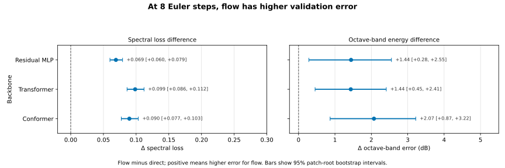
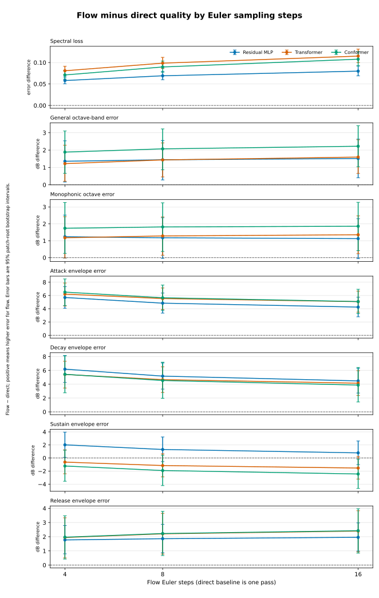
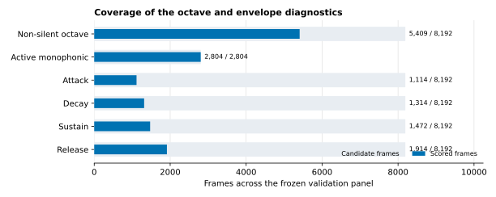
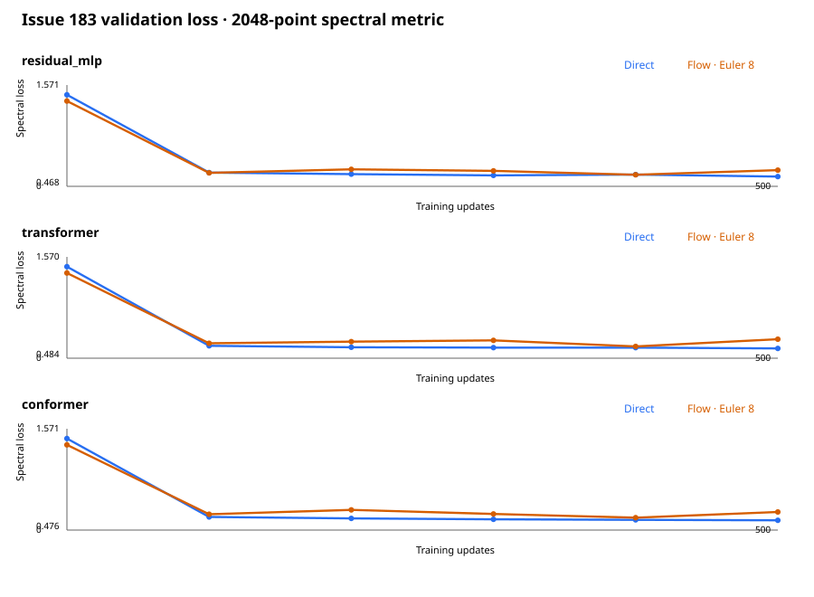
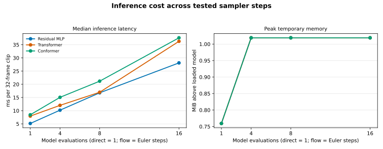

# Issue 183: Direct spectral prediction vs conditional flow matching

We compared direct prediction with conditional flow matching at 4, 8 and 16 Euler steps for stereo Vital-spectrum prediction. At 8 steps, direct prediction had lower spectral and general octave-band error for all three backbones, so it remains the evidence-supported baseline for this panel. The single-seed result is exploratory and does not establish a best architecture overall.

Spectral loss is the equal-weight average of relative spectral-shape error and log-amplitude error. Octave-band error measures mean absolute dB error in fixed one-octave band powers from 21.5 Hz to Nyquist. Lower is better for both; positive flow-minus-direct differences indicate worse flow error.

The frozen validation panel contains **128 paired recipes (256 clips), 64 patch roots, and 16 distinct MIDI performances**. Each recipe pairs original and perturbed clips.

## Primary comparison

The chart summarizes paired flow-minus-direct effects. Intervals resample patch roots and keep the MIDI-performance set fixed.

| Backbone | Spectral loss (Direct → Flow-8) | Flow − Direct (95% CI) | Octave error dB (Direct → Flow-8) | Flow − Direct (95% CI) |
|---|---:|---:|---:|---:|
| Residual MLP | 0.5747 → 0.6438 | +0.0691 [+0.0600, +0.0793] | 23.73 → 25.17 | +1.4427 [+0.2824, +2.5527] |
| Transformer | 0.5891 → 0.6877 | +0.0985 [+0.0862, +0.1121] | 24.47 → 25.91 | +1.4352 [+0.4541, +2.4105] |
| Conformer | 0.5816 → 0.6712 | +0.0897 [+0.0773, +0.1034] | 24.15 → 26.23 | +2.0717 [+0.8672, +3.2204] |

### Results across sampler steps

This chart includes spectral loss, general and monophonic octave error, and attack, decay, sustain and release envelope error. Intervals resample patch roots only; higher positive values mean larger flow error. At 8 steps, the envelope differences were attack +4.84 to +5.65 dB, decay +4.54 to +5.17 dB, sustain -1.92 to +1.30 dB, and release +1.86 to +2.22 dB.

The octave diagnostic scores absolute one-octave band-power error. Envelope error is mean absolute dB error in spectra-derived RMS envelopes during each note phase.

### Diagnostic coverage

General octave scoring used 5,409/8,192 non-silent candidate frames; 2,783 silent frames were excluded. The MIDI-centered diagnostic covered 2,804/2,804 active monophonic frames. Envelope-phase counts are shown against the 8,192 masked candidate frames.

## Uncertainty, model scope, and missing evidence

The 95% intervals resample the 64 patch roots, keeping clips from each root together. They do not resample the 16 MIDI performances or training runs; there was one training seed. Treat these as exploratory panel-level comparisons, not independent confirmation or an estimate across performances and seeds.

Pre-fix v1 estimates are excluded: that flow model used a restricted velocity head and the earlier mono-only octave score. This report shows the corrected v2 model and general absolute octave-band error.

This experiment shows how these six trained arms performed on this frozen panel. It does not establish an overall best architecture, generalization to new performances, or end-to-end patch reconstruction.

### Vital control scope

No Vital controls are predicted or changed. All arms receive the same 21-control Vital codec and known MIDI timing as conditioning inputs, then predict a stereo magnitude spectrogram (2 × 1,025 frequency bins). The [canonical frozen-control inventory](../../../modelling/frozen_encoder_retrieval/reports/vital_control_inventory.jsonl) describes the broader fixed-control scope.

### Missing evidence

- Only Residual MLP, Transformer, and Conformer backbones and 4-, 8-, and 16-step Euler flow samplers were tested; no additional architectures or solvers were evaluated.
- No independent training seed or fresh patch-root and MIDI-performance confirmation.
- The reserved test set and transcribed-MIDI evaluation were not run.
- No subjective listening ratings, phase-aware prediction, waveform prediction, or downstream patch reconstruction were measured.

## Additional diagnostics

These analyses add context but do not increase the independent validation sample.

Among direct arms, Residual MLP had the lowest mean spectral loss on this panel (0.5747; Transformer 0.5891; Conformer 0.5816). Patch-root intervals for these contrasts are in [direct-backbone-comparison.json](direct-backbone-comparison.json).

Increasing flow steps from 4 to 16 raised spectral loss for all three backbones (Residual MLP +0.0219; Transformer +0.0342; Conformer +0.0367). Exact values are in [summary.json](summary.json).
Three fixed Gaussian starts changed 4-step spectral loss only slightly for the finalists (Residual MLP 0.6327–0.6348; Conformer 0.6506–0.6526). They were selected on this same validation panel, so this probes initialization sensitivity, not new patches or performances. See [noise-sensitivity.json](noise-sensitivity.json).

### Fixed training-subset fit

On a fixed probe of 16 training recipes (32 clips, 16 roots), Residual MLP flow velocity MSE moved from 3.78 at initialization to 0.14 averaged across 3 Gaussian starts. Final sampled spectral losses averaged Residual MLP 0.5524, Transformer 0.6169, Conformer 0.5847. This shows fit on the probe only, not validation generalization; see [training-probe-noise-sensitivity.json](training-probe-noise-sensitivity.json).

### Learning curves

Validation loss uses the 8-step Euler sampler for flow. Training objectives differ across methods, so compare them only within the same objective.

[Learning curves and fixed-noise training probes](learning-curves.csv)

## Execution and reproducibility

All 6 arms started from random initialization and ran 500 updates with matched data order, batch size, optimizer, and validation cadence. Training used 2,046 accepted pairs across 512 roots. The reserved test set was not used.

Device: Intel(R) Arc(TM) 140T GPU (16GB) (xpu); PyTorch 2.12.1+xpu. The flow velocity is a predicted clean endpoint minus the full-dimensional initial-noise residual. Denoising blocks process frames independently, so the sampled training frames need not be evenly spaced.

Ten frozen #173 examples were exported as listening previews with deterministic 48-iteration Griffin–Lim. Their case IDs, source manifest, checkpoint hashes and asset receipts are recorded in summary.json; the audio stays with the local run. Audio is peak-normalized for audition and was not used for scoring.

Trainable parameters were: Residual MLP 221,338 direct vs 440,154 flow; Transformer 221,850 direct vs 440,666 flow; Conformer 223,706 direct vs 442,522 flow.

### Inference cost

Latency includes conditioning and prediction for one 32-frame clip. Peak temporary memory is above the loaded-model baseline.

The first 100 updates measured 20.0 updates/s. Extrapolating those measurements estimates 8.0 minutes for the complete six-arm training, validation and probe run; this is a planning estimate, not a new runtime measurement. See [duration-estimate.json](duration-estimate.json).

### Artifacts

[Summary](summary.json) · [Per-case metrics](per-case-metrics.json) · [Patch-root effects](direct-backbone-comparison.json) · [Sampler noise sensitivity](noise-sensitivity.json) · [Training probe noise sensitivity](training-probe-noise-sensitivity.json) · [Duration estimate](duration-estimate.json) · [Frozen plan](plan.json) · [Cache receipts](data-receipts.jsonl)

## Recommendation

Keep direct prediction as the baseline. Decide whether flow matching merits a longer run only after a matched second seed on fresh patch roots and MIDI performances, followed by the reserved test and downstream reconstruction evaluation.
