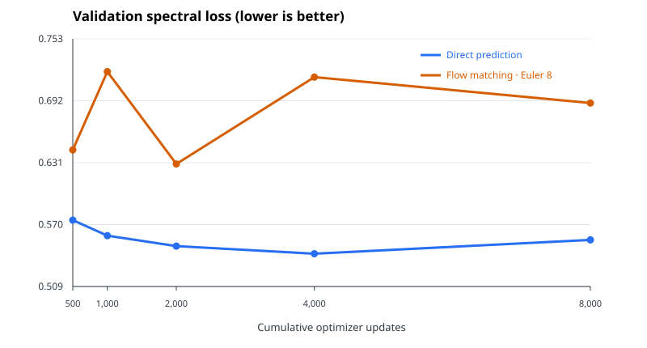

# Issue 185: direct and flow MLP learning curves

We extended the same Residual MLP models from 500 to 8,000 cumulative optimizer updates. The eight-step flow-minus-direct spectral-loss gap widened, from +0.0691 at update 500 to +0.1347 at update 8,000. Direct prediction remains better-supported for this panel; another seed is needed before generalizing.

The panel contains 256 clips, 64 patch roots, and 16 distinct MIDI performances. Lower error is better. Flow results use the same fixed Gaussian noise and eight-step Euler sampler at every checkpoint.

| Updates | Direct spectral loss | Flow spectral loss | Flow − direct | Direct octave error (dB) | Flow octave error (dB) | Direct MIDI-centered octave error (dB) | Flow MIDI-centered octave error (dB) | Direct attack / decay / sustain / release (dB) | Flow attack / decay / sustain / release (dB) |
|---:|---:|---:|---:|---:|---:|---:|---:|---:|---:|
| 500 | 0.5747 | 0.6438 | +0.0691 | 23.73 | 25.17 | 25.20 | 26.37 | 19.07 / 21.64 / 24.51 / 37.81 | 23.91 / 26.82 / 25.46 / 39.67 |
| 1,000 | 0.5593 | 0.7208 | +0.1614 | 23.59 | 22.98 | 24.24 | 23.25 | 18.04 / 19.91 / 24.61 / 38.12 | 15.55 / 15.67 / 16.10 / 37.94 |
| 2,000 | 0.5491 | 0.6299 | +0.0808 | 20.10 | 22.05 | 20.52 | 23.28 | 17.78 / 19.30 / 22.13 / 36.53 | 18.99 / 19.80 / 20.34 / 37.67 |
| 4,000 | 0.5416 | 0.7153 | +0.1737 | 16.27 | 19.18 | 17.17 | 20.84 | 9.10 / 7.26 / 10.02 / 34.19 | 18.73 / 19.92 / 19.27 / 36.42 |
| 8,000 | 0.5552 | 0.6899 | +0.1347 | 14.03 | 17.90 | 14.36 | 19.09 | 6.67 / 5.28 / 7.25 / 33.24 | 14.68 / 15.51 / 17.08 / 35.51 |

Direct prediction's lowest observed validation loss was 0.5416 at update 4,000. Flow matching's lowest observed loss was 0.6299 at update 2,000. Each update-8,000 value is reported separately in the comparison table. Five checkpoints do not establish convergence.

## Paired uncertainty

Intervals resample the 64 validation patch roots, keeping clips from each root together. They do not resample MIDI performances or training seeds. This is an exploratory single-seed comparison on the existing panel.

| Updates | Metric | Flow − direct (95% patch-root interval) |
|---:|---|---:|
| 500 | Spectral loss | +0.0691 [+0.0597, +0.0794] |
| 500 | General octave error (dB) | +1.4427 [+0.3122, +2.5459] |
| 1,000 | Spectral loss | +0.1614 [+0.1390, +0.1853] |
| 1,000 | General octave error (dB) | -0.6011 [-2.7470, +1.4941] |
| 2,000 | Spectral loss | +0.0808 [+0.0689, +0.0932] |
| 2,000 | General octave error (dB) | +1.9502 [+0.4258, +3.5192] |
| 4,000 | Spectral loss | +0.1737 [+0.1345, +0.2157] |
| 4,000 | General octave error (dB) | +2.9135 [+1.9453, +3.8620] |
| 8,000 | Spectral loss | +0.1347 [+0.0866, +0.1918] |
| 8,000 | General octave error (dB) | +3.8737 [+3.2405, +4.4991] |

## Execution and reproducibility

The two original checkpoints, optimizer states, training permutation, cursor, shuffle RNG, and flow-noise RNG were resumed from the corrected Issue 183 run. No architecture, objective, optimizer setting, data, or seed changed. The original cache receipts were re-verified and retained in [Source #183 cache receipts](../issue183_flow_matching/data-receipts.jsonl).

Source checkpoint SHA-256 values and frozen run identity are recorded in [plan.json](plan.json). All milestone metrics and paired intervals are in [summary.json](summary.json), with the shared graph data in [learning-curves.csv](learning-curves.csv).

No Vital controls are predicted or edited. The models condition on the existing 21-control codec and known MIDI, then predict a stereo magnitude spectrogram.

Unrun conditions include additional seeds, additional architectures, reserved-test evaluation, listening ratings, and downstream patch reconstruction. The conclusion applies to these two models on the frozen validation panel only.
